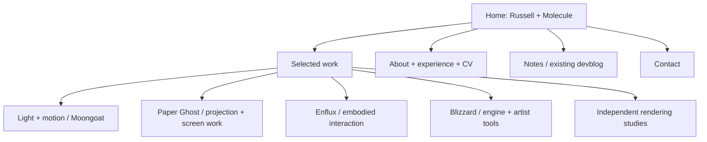

# Information architecture

## Navigation

**WORK · ABOUT · NOTES · CONTACT**

Make Work the homepage's primary destination.
Place CV and external profiles in the About page and footer, with an optional small CV link in the desktop navigation.
Keep labels legible and familiar even when section headings use the brand's braces or caps.
Move the mood board to a secondary Studio/Notes destination or keep it as a private reference until its role is decided.



Project names above describe the proposed hierarchy, not completed new pages.

## Homepage sequence

### 1. Introduce the person and the work

Show MOLECULE, Russell Jahn, and “software engineer & artist.”
Follow with one short sentence about interactive light, motion, and real-time graphics.
Use one strong moving or still image that communicates an experience, with its project title and role visible.
Primary action: **Explore the work**.
Secondary action: **Discuss a project**.

Use recent independent physical work if suitable footage exists.
If it does not, use an accurately credited Paper Ghost projection/set image as the initial featured project.
Do not use an abstract glowing render as if it were a photograph of a completed installation.

### 2. Establish engineering and production experience

Place a brief proof line near the introduction: Blizzard / Hearthstone, Paper Ghost / film and television, Enflux / motion capture.
Text credits are sufficient.
Add logos only when their use and presentation are appropriate, and do not imply endorsement or that they were all clients of Molecule.

### 3. Present selected work

Use a deliberate editorial order rather than publication dates:

1. Molecule light/motion project, with a separate Moongoat event story when documented.
2. Paper Ghost projection and interactive screen work.
3. Enflux embodied interaction and live demonstrations.
4. Blizzard graphics, engine, and content tools.
5. Independent rendering or art/audio pipeline study when ready.

Aim for four to six strong entries.
Combine related pieces where one short story is stronger than several sparse pages.
An in-progress piece must carry that status visibly.
Do not fill slots with unannounced-game placeholders that cannot show anything substantive.

Each entry needs a meaningful image, title, one-sentence experience, contribution, and status or year.
Use tags sparingly: Light, Motion, Real-time, Tools.
Do not make visitors learn a complex classification scheme to browse a small portfolio.

### 4. Explain the practice

Briefly connect artistic direction and technical execution.
Link three capability statements to projects: light and interaction, real-time visuals, and tools for artists.
This is where cross-platform and mobile depth can reinforce the ability to work within difficult constraints.

### 5. Invite a relevant conversation

State interest in installation commissions, collaborations, and creative technology work.
Provide a direct contact method and a fallback if a form is present.
Do not assert full-time availability, a location, or a contracting arrangement before Russell confirms it.

## Project page structure

1. **Experience first:** Title, sensory/creative premise, a hero image or short clip.
2. **At a glance:** Role, date, context, status, team/credits.
3. **What people did:** Actor, visitor, artist, or operator interaction in plain language.
4. **Artistic decisions:** Light, composition, motion, timing, material, or response.
5. **My contribution:** Specific authored work and responsibilities.
6. **How it worked:** One clear diagram and a few meaningful technical decisions.
7. **Constraints and outcome:** Delivery conditions and what actually shipped or was shown.
8. **Further depth:** Optional technical notes, related study, or source link.
9. **Next action:** Related project and contact.

Keep credits and contribution visible without opening an accordion.
Technical details may be deeper down the page, but should be reachable with ordinary scrolling and headings.

## Proposed routes

```text
/
/work/
/work/light-and-motion/
/work/moongoat/                 when the story is documented
/work/paper-ghost/
/work/enflux/
/work/hearthstone/
/work/rendering-studies/        when there is public work to show
/about/
/contact/
/devblog/                      keep this existing URL for Notes
```

Separate OLOSCAPE or OLOSET pages can follow when they have enough material.
Keep `/about/` useful for existing links while moving detailed projects into Work.
Audit old image and page URLs before moving existing bundles.

## Mobile and access

Use one reading column and stack project media on small screens.
Keep the headline's intended line breaks without clipping or forcing horizontal scrolling.
Make the work understandable from posters, captions, and text when video or JavaScript is unavailable.
Use ordinary links for navigation and working controls for media.
Do not require hover, a mouse, sound, or a 3D landing experience to discover the portfolio.
