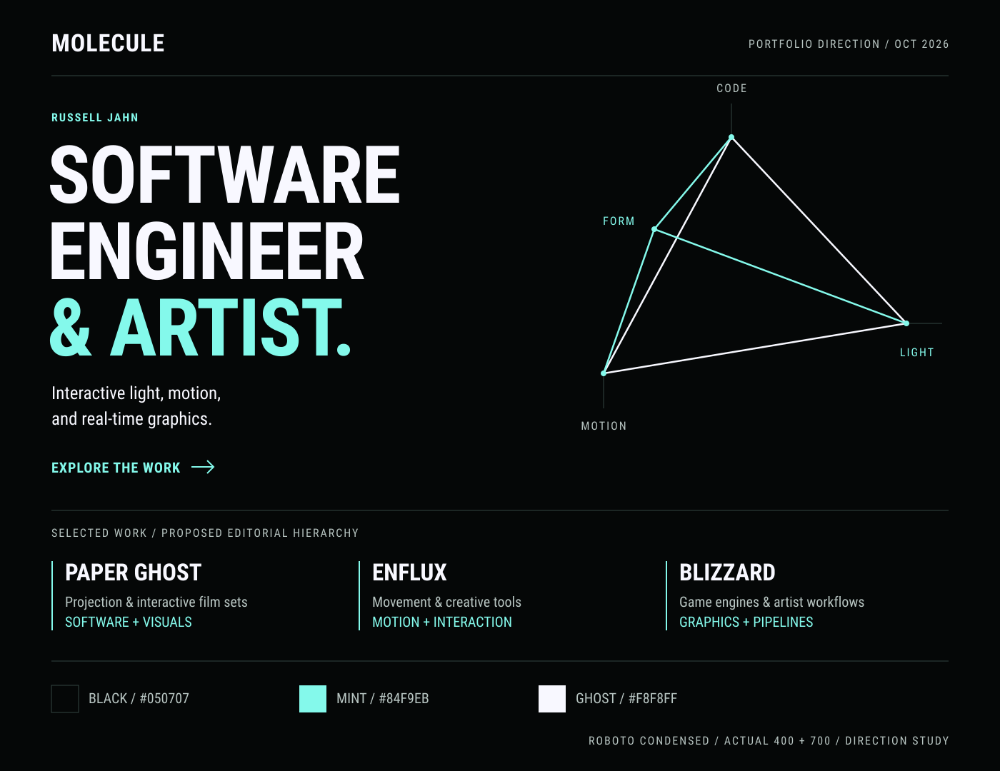

# Visual direction

## Art direction

A precise black field, assertive condensed typography, mint signals, and sparse vector connections.
Let photographs and moving work supply atmosphere and color.
Use the surrounding interface as a restrained frame.

The supplied [discipline reference](assets/discipline-reference.jpg) suggests a useful visual grammar: simple vertices, connections, deliberate asymmetry, and alternating mint/white lines.
Treat the geometry as a connection between disciplines or parts of an experience, not a radar chart measuring ability.
Use a small number of strong forms rather than an all-over technology texture.

The [direction study](assets/visual-direction.svg) is a proposed palette/type/layout specimen, not a functioning page or a final logo.

The SVG embeds the existing Regular and Bold faces so the study travels with the notes.
Their [font notice and license](assets/FONT-NOTICE.md) accompany the specimen.
The PNG is its visually checked preview. The [build script](assets/build-direction-study.cjs) can regenerate both with Node and the `sharp` package.

## Proposed color tokens

The [historical CV review](11-historical-cv-review.md) adds a direct typography reference: large bold caps, Roboto Condensed body, braces, arrows, narrow accent rules, and a ghost-white canvas with teal accents.
Translate that hierarchy to the requested black website, with more space and larger body text.
Compare its historical teal `#00B1AE` with the lighter proposed website mint below.

| Token           | Value     | Use                                              |
| --------------- | --------- | ------------------------------------------------ |
| Canvas          | `#050707` | Main background                                  |
| Surface         | `#101615` | Occasional inset content                         |
| Ghost white     | `#F8F8FF` | Primary type and white linework                  |
| Mint            | `#84F9EB` | Links, focus treatment, selected rules and marks |
| Muted text      | `#B7C4C1` | Secondary readable copy                          |
| Structural line | `#334541` | Dividers and nonessential diagrams               |

Mint is a proposed choice from the existing theme palette, not a newly established permanent brand specification.
Use black text on mint-filled buttons.
Use mint primarily as a signal rather than filling every heading and panel.
Avoid gray/white text over a bright light source in photographs.
Give text a solid backing or place it outside the image.

Check contrast on actual combinations during implementation, including hover/focus states and captions.
Use the [WCAG minimum contrast thresholds](https://www.w3.org/WAI/WCAG22/Understanding/contrast-minimum.html): at least 4.5:1 for ordinary text and 3:1 for qualifying large text.
Color must not be the only indication of a link or selected state.

## Typography

**Roboto Condensed is the primary family**, including much of the body text if the reading specimen remains comfortable.
Use Roboto where a broader, rounder shape improves a paragraph, a UI label, or a specific composition.
Avoid turning the whole site into a generic rounded body-font treatment by default.

| Role                   | Proposed treatment                                                                                       |
| ---------------------- | -------------------------------------------------------------------------------------------------------- |
| Display headline       | Roboto Condensed Black 900 when an actual font file is supplied. Bold 700 for the initial local specimen |
| Project title          | Roboto Condensed Bold 700, mostly caps, deliberate line breaks                                           |
| Body                   | Roboto Condensed Regular 400, approximately 18–20 CSS px, generous line height                           |
| Secondary prose option | Roboto Regular 400 where its wider shape is useful                                                       |
| Labels/navigation      | Roboto Condensed Bold 700, caps, modest positive tracking                                                |
| Technical annotation   | Roboto or occasional Roboto Mono, readable rather than tiny                                              |

The current repository includes Roboto Condensed Light, Regular, and Bold, plus Roboto Black.
It does **not** include a Roboto Condensed Black file among the inventoried fonts.
Do not label a rendered Bold face as Black or ask the browser to synthesize a missing weight.
An updated font source can be obtained from the [Google Fonts Roboto Condensed directory](https://github.com/google/fonts/tree/main/ofl/robotocondensed) during implementation, with its included license reviewed and retained.

Declare a single family with correct `font-weight` descriptors rather than using one family name per weight.
Use `font-display: swap` and load only needed faces.
Check regular, bold, italic, numerals, punctuation, and fallback behavior in a type specimen.

Start display size around `clamp(3rem, 7vw, 7rem)` and refine against real copy.
Keep display line-height close to 1, with normal body leading around 1.5.
Use caps for short structural statements, not every paragraph.
Keep body measure near 55–70 characters and avoid excessively wide paragraphs.
Use tracking near neutral for large condensed headlines and slightly wider for small caps labels.
Do not stretch glyphs with `scaleX()` to force a headline to fit.

## Composition and vector language

Use a clear grid, generous black space, fine separators, and occasional large project numbers if they help navigation.
Project media should have enough area to communicate a space or gesture.
Prefer square or minimally rounded corners over a wall of soft cards.
Keep line icons simple, consistently weighted, and functional.
Use the [rotating WebGL specialization pyramid](13-webgl-specialization-pyramid.md) as the geometric signature, with screen-space HTML labels anchored to its projected vertices.
Keep an SVG version for static uses and fallback.
The pyramid supplements the established Molecule mark.

The current header image embeds its magenta wordmark and cyan character in the pixels.
Plan a new export from source art or separate live type and character assets so the header follows the chosen palette.

Let ghost white carry most headlines.
Use mint to identify the important word, active link, or line segment.
Keep images in their original visual character unless a particular art treatment is explicitly selected.
The portfolio should not recolor film stills or employer artwork to simulate Molecule authorship.

## Motion

Light and motion footage is the main animation.
The specialization pyramid can rotate, while its labels remain upright in screen space.
Use deliberate rotation controls, with slow idle rotation as an optional treatment and a stationary reduced-motion view.
Avoid scroll hijacking, flashing decoration, animated cursors, and mandatory WebGL introductions.
Provide pause controls for persistent motion, following the [WCAG guidance on moving content](https://www.w3.org/WAI/WCAG22/Understanding/pause-stop-hide.html), and captions/transcripts for meaningful video/audio content.
Keep the initial poster useful when a clip is not playing.

## Design checks before implementation is approved

- Headlines use the intended actual font and weight, with no clipping at phone widths or browser zoom.
- A project still communicates with motion disabled and sound off.
- Keyboard focus is visible on every interactive element.
- The homepage reads clearly in black, mint, and ghost white before decorative imagery is added.
- Contribution captions remain readable and visible beside spectacular imagery.
- A commissioner can find the work and contact path without interpreting the geometric motif.
