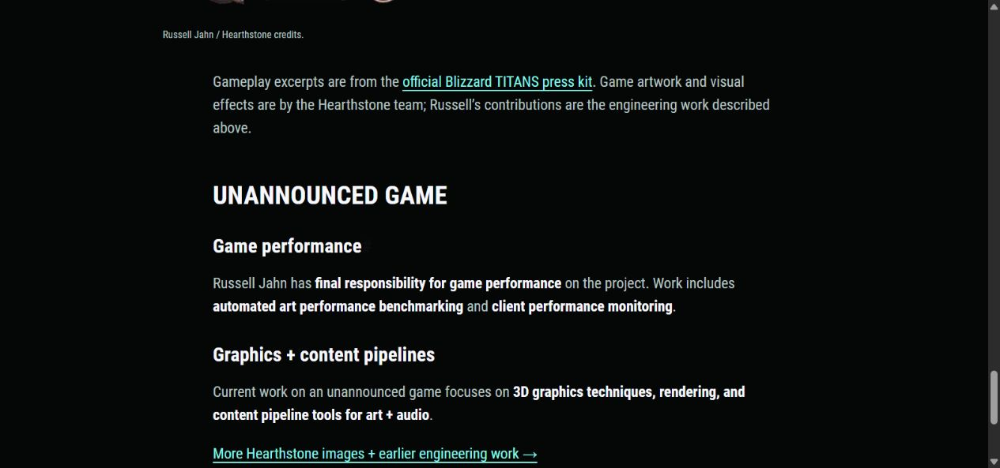

# Questions and decisions

## Recorded from Russell's brief

- Brand: Molecule.
- Domain preference: `ilovemolecule.com` and its subtle declaration of liking the thing visited.
- Desired positioning: software engineer and artist, with credibility for creative art/technology installations.
- Interest: interactive lighting, real-time graphics, motion capture, and hardware/software/art authorship.
- Professional emphasis: Paper Ghost, Blizzard graphics/content/core engine work, Enflux interaction and installations.
- Current role focus: 3D graphics techniques, content pipelines for art and audio, rendering on an unannounced game.
- Visual preference: fancy black, mint green, ghost white, simple bold vector linework.
- Typography: primarily Roboto Condensed, with Roboto where a rounder shape is useful. Careful widths, bold caps, and Black weight where appropriate.
- Current technology: Hugo.
- Planning destination: this repository, readable in Obsidian.
- Follow-up visual decision: a rotatable WebGL specialization pyramid, with screen-space text anchored to each point.

## Recommendations made in this planning pass

1. Keep Hugo and hosting, and replace the current framework/blog emphasis with a portfolio presentation.
2. Use “Molecule — Russell Jahn, software engineer & artist.”
3. Focus the public site on selected work, About, and Contact. The development blog is removed under the 2026-10-25 decision below.
4. Make Paper Ghost a flagship, Enflux a substantial interaction story, and Blizzard a clear engineering credibility pillar.
5. Document Moongoat and current Molecule physical work to bridge earlier employment with future commissions.
6. Use proposed mint `#84F9EB`, already present in the theme palette, alongside black and ghost white.
7. Start with actual Roboto Condensed Bold 700, adding a real Black face if selected. Do not simulate the weight.
8. Keep planning notes outside the website content tree.

These are planning recommendations. The live site and external profiles have not been changed.

## Questions that materially change the next edit

### Career and offer

- Which historical role end dates and current Blizzard role title/dates should be public?
- Is the first priority installation commissions, a balanced practice, or senior graphics/tools employment?
- What kinds of work can Russell currently take on alongside the present role?
- Is “creative practice” the preferred description for Molecule, or is there another established business description?
- What location, travel range, and contact method should be public?

### Artistic authorship

- Which three pieces feel most like the work Russell wants to make next?
- What visual or experiential ideas recur: gesture, rhythm, presence, trace, play, immersion, or something else?
- In each project, which visual, animation, interaction, and physical design decisions were Russell's?
- Which independent light/motion work is ready to be shown now?

### Project particulars

- What exactly happened at Moongoat: event/date, piece, interaction, collaborators, and usable media?
- Which Paper Ghost production has the best combination of clear contribution and strong imagery?
- Are OLOSET and OLOSCAPE names worth using publicly, or should page titles favor the experience?
- Which Enflux demo best shows someone interacting with the result?
- Which rendering and art/audio tool examples can be discussed publicly?
- Which light/sensor device is the current physical build, and what does it demonstrably do?

### Assets and publication

- Which archive images/clips should form the final public edit?
- Which photographs, clips, logos, and testimonials are intended for reuse, with what credits?
- Is there an existing preferred Molecule wordmark/character file among the archive assets?
- Which mint is preferred after comparing the specimen against existing art?

## Decision log

### 2026-10-24 — Initial planning

Reviewed the existing source, partial public profile information, local media candidates, and selected firmware files.
Created this Obsidian-friendly planning package.
The supplied historical CV was read and its typography inspected through the Docs connector. It predates Blizzard experience.
Selected VADER folders and event/hardware images were subsequently reviewed outside the restricted shell environment.
Existing untracked contact files were left in place.
No content or source instructions were treated as authorization to publish, contact others, or change profiles.

Add later decisions here with date, reason, and affected notes.

### 2026-10-24 — Historical CV added

Russell supplied the pre-Blizzard Google Docs CV as a visual reference.
Its formatting reinforces condensed typography, large bold caps, braces, arrows, teal rules, and careful alignment.
The installation narrative now also includes the InContext VR multiplayer project and the longer history of independent embedded work.
The final timeline still needs updated end dates and current role details.

### 2026-10-24 — VADER archive access and event evidence

The archives are readable outside the restricted shell environment.
Found the PixelPerf event folder, a strong Molecule light-prop/display setup photo, nearby interaction clips, curated Paper Ghost/Enflux/InContext folders, and an Affinity Designer logo source.
Move Moongoat up as a leading independent case-study candidate.
September 2, 2023 is supported by folder/poster names and remains a date to confirm.

### 2026-10-24 — Rotating specialization pyramid

Russell specified a WebGL-rendered pyramid that can rotate, with text anchored to each point in screen space.
Plan a four-vertex triangular wireframe with HTML labels that follow projected vertex positions while staying upright and consistently sized.
The [component plan](13-webgl-specialization-pyramid.md) covers readable label placement, rotation, responsive projection, and fallback.
Idle rotation and final specialization wording remain design choices.

### 2026-10-24 — Theme recommendation clarified

Keep Blowfish as the starting foundation and build custom Molecule homepage, work, and project layouts in the repository's own layout/style directories.
A move to another premade theme is not needed for the proposed visual direction or WebGL pyramid.
Review the remaining Blowfish dependency after the first custom pages work, and consider a small custom theme only if little useful theme behavior remains.
The stored theme identifies version `2.38.3`, so current online examples need checking against the local implementation.

### 2026-10-24 — Deployment repair deferred

Russell chose to defer fixing the failed GitHub Pages workflow until the reworked website has a good enough first version.
Continue local design and implementation work first.
The planning and first implementation are merged into `main` through PR #1, but that merge's deployment failed because of the old artifact action.
Track the failure and later repair checks in [Deferred deployment repair](15-deferred-deployment.md).

### 2026-10-24 — Cleanup merged and local iteration resumed

Russell merged cleanup PR #2 into the planning branch.
Continue the website on `feature/portfolio-rework-v1`, starting from the first implementation already merged into `main`.
Preserve and commit the deployment follow-up notes as a separate documentation change.
Keep generated preview files and downloaded tools ignored, and leave deployment repair for the first-version release pass.

### 2026-10-24 — Writing and picture selection need a different direction

Russell rejected the rework's generic promotional language, specifically the Moongoat paragraph about "a little invitation to play."
He says it does not capture him and prefers the original About page's language and pictures.
Use that original material as the source for the next edit.
Study how established artist/studio portfolios name and document work, including Rhizomatiks, without adopting their slogans or inventing an artistic motivation for Russell.
The [reference study](16-artist-and-studio-references.md) and [copy/media plan](17-copy-and-media-revision-plan.md) replace the earlier copy draft's tone recommendation.
An optional question asks Russell to describe what he showed at Moongoat and what a visitor could actually do.

### 2026-10-24 — Moongoat interaction described by Russell

Russell supplied the actual behavior of two distinct demonstrations: suit-free outside-in capture from webcam video with a C++ wireframe composite at 60 fps, and inside-out capture using IMU-equipped wooden swords whose LED colors followed real-world orientation deterministically.
Use these facts and Russell's direct language for the next Moongoat copy pass.
The [demonstration note](18-moongoat-demonstrations.md) records the source, proposed descriptions, and separate media needs.

### 2026-10-25 — Less personal, more emphasis on the work

Russell is inclined to reduce first-person language and make the work more prominent. The [editorial voice study](20-work-focused-editorial-voice.md) compares official artist and studio portfolios and recommends making the work the subject of homepage and project descriptions, with explicit contribution fields. First person can remain in a short About introduction or process essay when useful. The note contains examples. This research pass does not change website copy.

Russell subsequently authorized applying the direction. The homepage and four project pages now describe the work directly, each project names Russell Jahn in its contribution block, and Paper Ghost separately credits Zed Axiz Productions. The About page keeps its personal voice and original galleries. Implementation and verification are recorded in the editorial voice note.

### 2026-10-25 — Use the existing curated About images for this iteration

Russell specified the image selection already curated on the About Me page. The project pages now share that source directly, preserving the active selections and order. Homepage covers use the original lead images. Moongoat remains a text entry because it has no image in that selection. See [Curated About media](21-curated-about-media.md) for the implementation and checks.

### 2026-10-25 — Remove the development blog entirely

Russell requested complete removal of the development blog. Removed the blog sources and bundled media, Notes navigation, and blog destinations in configuration. Work, About, and Contact remain the public navigation. The preview uses a clean, isolated output directory so stale blog pages are not served. Historical evidence can be read from Git history. See [Development blog removal](22-development-blog-removal.md).

### 2026-10-25 — Professional Work and Experiments

Russell requested separate groups, with Moongoat in Experiments and Blizzard prominent near the top while potentially closing Professional Work. The applied review order is Paper Ghost, Enflux, then Blizzard. The precise order remains open. Section labels are single-line, ghost white, and left-aligned. The Blizzard case study leads with explicit engineering contributions. Two existing photographs were restored from matching higher-resolution originals, and responsive delivery/display caps address small images being enlarged. See [the structure and image-quality record](23-professional-work-experiments-and-image-quality.md) for provenance, limits, and checks.

### 2026-10-25 — One project collection, tags, and new lead work

Russell requested a single collection with `professional` and `experimental` tags, displayed as Professional Work and Experimental. The homepage still groups by tag. Work filters the same collection. The Glass Castle projection setup leads, mother! is a separate featured project, Enflux uses its Blender image, and X-Men stays inside Paper Ghost. Blizzard becomes Game Engine, Graphics + Content Pipeline with Hearthstone and Unannounced game sections. Russell confirmed the latter wording. Moongoat becomes Motion Capture + Lightsabers and gains its existing event photo. Titles now use mint, superseding the preceding ghost-white rule. See [the applied revision](24-tagged-projects-and-new-headliners.md). Russell requested a commit and PR, followed by About Me and quiet-carousel ideation.

### 2026-10-25 — Ghost-white project titles and selective mint headings

Russell refined the heading rule: project titles such as THE GLASS CASTLE should be ghost white, with mint reserved for the most important details and accents. The applied [heading hierarchy](26-heading-hierarchy.md) supersedes the all-mint rule above. Shared CSS defaults headings to ghost white and uses an explicit `heading-accent` class for the identity and primary page/brace section headings. Size variables are defined independently of color and semantic heading level. Existing layout, credits, and project copy are preserved.

### 2026-10-25 — Glass Castle image selection

Russell selected `glasscastle_test1.jpg` as the headliner, `glasscastle_test3.jpg` as the accent, and `glasscastle_final3.gif` as tertiary media. The headliner now appears across project listings and the case study. The case study presents the selected supporting media in order. Use the JPG originals behind the supplied thumbnail URLs and retain the GIF animation without enlarging it. See [the media selection record](27-glass-castle-media-selection.md).

### 2026-10-25 — Blizzard gameplay cover and sharper Hearthstone media

Russell selected `hearthstone_gameplay1.jpg` as the temporary Blizzard headliner and requested better-looking Hearthstone stills/motion. Applied that cover and reviewed official press assets from the recorded role period. Two verified 4K/60 fps TITANS clips now supply short, manually played 1080p excerpts and sharp still previews in the case study, replacing the smaller GIF/VFX examples while preserving Russell's credits and the Hearthstone team's artwork/FX attribution. [Research and source records](28-hearthstone-headliner-and-media-research.md) include alternate key art and further motion candidates.

### 2026-10-25 — Current-project performance accountability

Russell clarified that he has final responsibility for game performance on the current project, including automated art performance benchmarking and client performance monitoring. The homepage's current-role line now mentions that responsibility, and the Blizzard contribution summary and Unannounced game section name the work explicitly. This accountability is scoped to that project. Preserve the earlier confirmed Unannounced game label. The evidence is recorded as S11 in [Evidence and CV review](02-evidence-and-cv-review.md).

Pinned Hugo production build and whitespace checks passed. Home, Work, and the Blizzard case study were checked at 1280px, 390px, and 320px without horizontal overflow. Preview restarted and left running.

### 2026-10-25 — No semicolons in prose

Russell requested no semicolons in the writing and asked for the rule to be saved in skills. The [writing preference](29-writing-punctuation.md) records the reusable skill and the applied cleanup of website copy and planning notes. Code, HTML entities, URLs, and exact quotations preserve their required syntax.

### 2026-10-25 — Calmer wording and separate Blizzard responsibilities

Russell rejected “Final responsibility for game performance” as too showy for the portfolio and identified the mixed responsibility summary as inaccurate in its grouping. Public copy now uses “Responsible for game performance” and names automated art performance benchmarking and client performance monitoring. This supersedes the earlier public-copy decision about performance accountability without changing the reported facts.

Unannounced game comes first with performance, graphics/rendering, and art/audio tools. Hearthstone follows with its own engine, platform, pipeline, artist-tools, and team-support work. Its gameplay cover, clips, and credits sit within that section. The shared summary no longer combines the two responsibility lists. See [Blizzard project responsibilities](30-blizzard-project-responsibilities.md) for the applied structure and checks.

### 2026-10-25 — Performance initiative leadership, not individual ownership

Russell corrected the previous interpretation. He leads the performance initiative and is transforming the team culture through tools, education, and initiative. Performance is everyone's responsibility. The earlier “final responsibility” and “Responsible for game performance” descriptions incorrectly implied individual ownership.

Preserve this context in the notes. Russell is uncertain that the leadership/culture aspect should be emphasized on this portfolio. For this iteration, the public section is “Performance tools” and names automated art performance benchmarking and client performance monitoring. Keep the two game sections separate. This clarification supersedes the individual-ownership wording in the earlier entries above. See [the role record](30-blizzard-project-responsibilities.md) and S12 in [Evidence and CV review](02-evidence-and-cv-review.md).

### 2026-10-25 — Project labels and bullets replace the Blizzard summary paragraph

Russell requested Hearthstone followed by Unannounced title as separate overview labels, with “Core systems + multiplatform development” and “Graphics + Content pipeline tools + performance” beneath them. Applied this format to Home, Work, and the case-study introduction through shared frontmatter. The detailed current-project heading also uses Unannounced title, preserving the old section anchor. This updates the earlier Unannounced game display label while keeping the project unannounced. See [the summary format](30-blizzard-project-responsibilities.md).

### 2026-10-25 — Keep a compact horizontal overview within each project section

Russell clarified that separate sections should each retain the earlier compact horizontal overview, followed by important details, description, and photos. The large vertical responsibility headings were a misunderstanding of that request. The Blizzard case study now presents Unannounced title with its own three-column overview, then Hearthstone with its own overview and supporting content. The duplicate case-header project summary is removed. Home and Work card summaries retain the approved labels and bullets. See [the section structure](30-blizzard-project-responsibilities.md).

### 2026-10-25 — Remove the closing explanation and raise the Hearthstone credits card

Russell found the closing press-kit/artwork/contribution paragraph unnecessary and requested his Hearthstone card higher on the page. Removed the paragraph and moved the credits card directly below Hearthstone's horizontal overview, before its prose and gameplay media. Source provenance stays in the media research notes. See [the placement decision](30-blizzard-project-responsibilities.md).

### 2026-10-25 — Selected Molecule archive media

Russell supplied ten specific files for the custom Patch computer, lightsaber prototypes, and PixelPerf Market at Moongoat Coffee. Applied all ten as seven photos and three playable clips. A supplied landscape event photograph replaces the earlier portrait lead. Keep prototype documentation distinct from event photos and retain the existing factual demonstration copy. GIFs are delivered as controlled MP4 videos, with original source paths and hashes saved in [the media record](31-molecule-selected-media.md).

### 2026-10-25 — Preserve original portfolio media in the repository

Russell requested organized copies of the GIFs and original media in the portfolio source. Preserved all ten selected Molecule files under `source-media/molecule/`, grouped into Patch computer, lightsaber prototypes, and PixelPerf Market/date folders. Original filenames and bytes are retained. The manifest links each repository copy to its VADER source and prepared website asset. See [the source-media index](../../source-media/README.md).

### 2026-10-25 — Bokken terminology and windup-first photos

Russell identified the props as bokken, wooden martial arts practice swords, and requested that wording throughout the portfolio. Updated public project copy, About, accessible image/video descriptions, and the current copy drafts. He also requested the windup image before the extended pose in the first body-tracking photo pair. Swapped the image sources and their alt text while keeping the two captions in their original positions. See [the media record](31-molecule-selected-media.md).

### 2026-10-25 — Preserve GIFs as continuously looping images

Russell clarified that Melissa's spinning-lightsaber GIF and the original portfolio GIFs are intended as cool looping images. Use animated WebP for smaller delivery with broad modern-browser support. This supersedes the earlier controlled-MP4 delivery for GIF selections. Preserve both original GIFs, every frame, dimensions, timing, and infinite loops. Keep the separate Patch source video as a video with audio. See [Looping portfolio images](32-looping-portfolio-images.md).

### 2026-10-25 — Explain the work in everyday language

Russell found the bokken copy too full of jargon and asked for a more natural, succinct explanation. Use his wooden-practice-sword introduction, then describe what the sensors and lights do. Lead with what a visitor sees and keep useful technical facts without formal labels added for effect. Applied this to the Molecule case study, shared card description, and matching About paragraph. See [Plain-language project copy](33-plain-language-project-copy.md).
