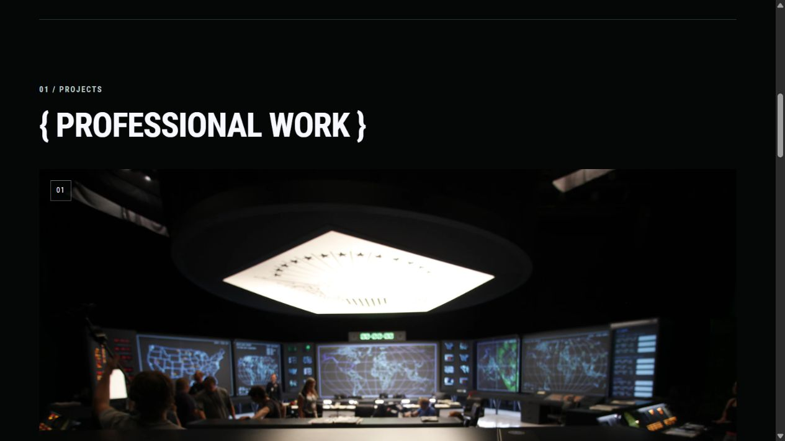
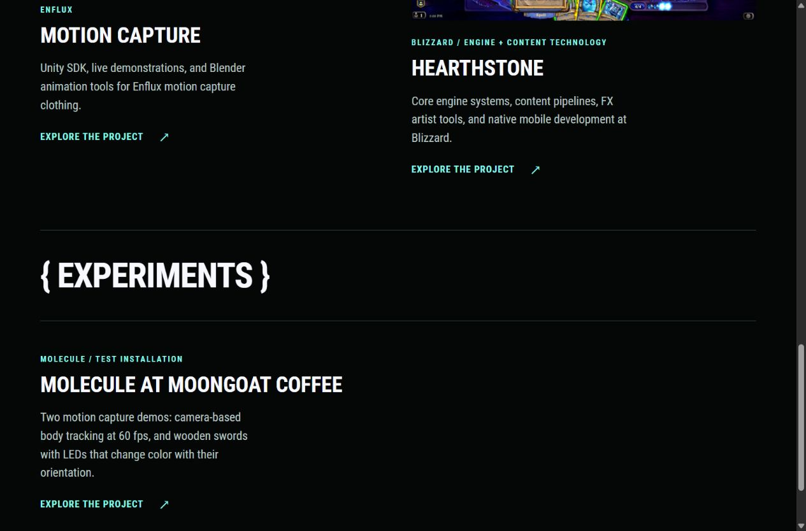
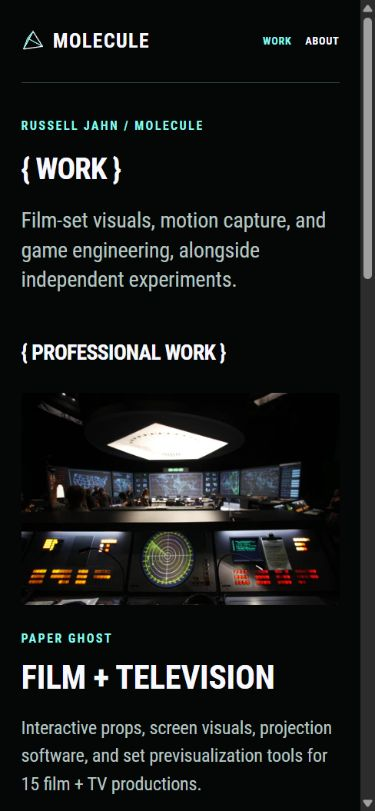

# Professional Work, Experiments, and image quality

## Direction requested by Russell

Split the portfolio into **Professional Work** and **Experiments**. Put the small Moongoat test installation in Experiments. Lead with strong visual work, keep Blizzard prominent near the top, and consider Blizzard last among the professional projects. The exact order remains open.

Keep section labels on one line, in ghost white, aligned to the same left edge. Remove forced breaks and the offset heading placement. Preserve the black/mint/ghost-white palette, Roboto Condensed, curated About images, and accurate credits.

## Applied structure

- Homepage and Work index: **Paper Ghost → Enflux → Blizzard** under Professional Work. This is the current review order, not a settled editorial decision. Paper Ghost provides the strongest spatial/visual introduction. Blizzard closes the professional sequence with engineering experience at production scale.
- Blizzard's current graphics, rendering, and art/audio pipeline work is named directly in the homepage introduction, alongside the existing Blizzard-first experience strip.
- The Blizzard case study opens with named engineering contributions: engine/platform work, content/artist tools, and expansion delivery/team support. Gameplay remains supporting context and is credited to the Hearthstone team. Current unannounced-game work remains separate from the dated Hearthstone experience.
- Moongoat lives at `/experiments/moongoat/`, with an Experiments index at `/experiments/`. `/work/moongoat/` redirects to the new project URL. The combined Work index includes both groups.
- Moongoat describes an independent pop-up test installation and retains Russell's account of the two distinct demos. It remains text-only for this iteration because the curated About selection contains no Moongoat image.
- The same case-study template serves both sections, with the appropriate return link. Paper Ghost still names Russell's contributions and credits Zed Axiz Productions for hardware and set operators.

## Why the images looked pixelated

The X-Men lead was a **675 × 450 JPEG displayed about 1137 CSS pixels wide** in the desktop browser check. The served file was a 675-pixel WebP. The browser enlarged it by about 1.7× before accounting for display density. This was a small source being enlarged by layout, rather than Hugo secretly choosing a much smaller thumbnail.

The previous helper generated at most 640px and 1280px candidates, capped at source width, using WebP quality 82/85 and the Box filter. It did not generate oversized derivatives, but CSS still stretched small images and the candidate set limited larger images on dense displays. Gallery `sizes` also described a single 900px slot regardless of the image's actual column span.

### Matching originals recovered

| Curated image | Previous file | Restored original | Provenance |
| --- | --- | --- | --- |
| `content/about/PaperGhost/xmen_apocalypse_pentagon3.jpg` | 675 × 450, 52,686 bytes | 2784 × 1856, 583,321 bytes | [Original X-Men asset](https://static.wixstatic.com/media/42e2ca_154a4d8b45de4e329032ead774fd76ca~mv2_d_2784_1856_s_2.jpg) |
| `content/about/PaperGhost/glasscastle_software1.jpg` | 800 × 450, 43,407 bytes | 5312 × 2988, 4,742,557 bytes | [Original Glass Castle asset](https://static.wixstatic.com/media/42e2ca_13adac6a616e4f46ba6b888c16f34c3b~mv2_d_5312_2988_s_4_2.jpg) |

The matching archived files are in `\\VADER\MotherBrain\Molecule\Portfolio Pics\Paper Ghost\Zed Axiz`. Their filenames record larger original dimensions, but the actual decoded archive copies are small website exports. The archived X-Men file and the old site file have identical SHA-256 hashes. An archive filename alone is not evidence of its actual resolution.

The original image-host URLs were inferred from those exact archived asset identifiers, then checked by decoding the downloaded files and comparing their pixels and compositions against the curated versions. The normalized 128 × 128 RGB comparisons had mean squared errors of approximately 1.65 for X-Men and 1.22 for Glass Castle. Both images were visually inspected before replacement. These are the same photographs, preserving the existing selection and credit context.

The source files were replaced at their existing paths, improving both the case-study derivatives and the original About gallery URLs. No synthetic enlargement or sharpening was applied. The X-Men original has some photographic softness. Higher pixel dimensions do not repair focus in the photograph.

### Other sources checked

A focused comparison covered 43 smaller local still images against 236 images in the curated X-Men, Zed Axiz, Glass Castle, Quantico, mother!, Arrival, and Enflux archive folders. Selected original work-directory structures were also inspected. This was not an exhaustive review of every raw project asset.

Examples whose matching archive copies were also small: Glass Castle's finished still (275 × 183), Quantico's bullpen still (391 × 219), the mother! software image (800 × 693), and the Enflux convention still (800 × 449). No larger matching copies were found in that pass. The other X-Men stills remain 1400 × 350 and 800 × 337. Retain them at restrained sizes unless better sources become available.

### Image delivery changes

- Responsive WebP candidates at 320, 480, 640, 960, 1280, 1600, 1920, and 2560px, bounded by actual source dimensions. Include the native width when smaller than 2560px.
- WebP quality 90 and Lanczos downsampling, consistently across candidates.
- `sizes` reflects the cover/card widths and gallery column spans, rather than forcing every image into the same requested slot.
- Source dimensions preserve aspect ratio, and CSS caps portfolio image display at native width. The same cap applies to the original animated GIFs. Their animation and source URLs are retained.
- Wider gallery margins stop growing beyond 80px, matching the largest declared gallery slot.

In the browser at a 1280px viewport and device pixel ratio 1.25, the homepage selected the **1600px X-Men WebP**, replacing the previous 675px candidate. At 390px, the Work index selected a 480px candidate for its roughly 331px image slot. Candidate widths were checked against the decoded files, not density-adjusted browser `naturalWidth` alone.

## Verification

- Production build passed with the repository's Hugo Extended 0.115.4.
- Nine core routes passed checks for one primary heading and existing local links/assets, including the two new Experiments routes, About, and Contact.
- All 214 responsive image candidates referenced by those routes had width descriptors matching their decoded file widths. Portfolio candidates did not exceed their original source widths.
- Homepage and Work index grouping/order were checked. Moongoat appears after the Experiments heading and uses the new URL. The old URL's alias targets the new project. The deleted development blog stays absent from clean output.
- Browser layout checks covered seven affected routes at 320px, 390px, and 1280px. No horizontal page overflow or CSS enlargement beyond source width was found in the portfolio images.
- Professional Work and Experiments labels stayed on one line, in ghost white, aligned left. A narrow-screen wrap in the Experiments index title was corrected and rechecked.
- The contribution section precedes the gameplay image in the Blizzard case study and stacks into one column on phones.
- Desktop and phone screenshots were reviewed for composition and representative image clarity. See the saved review images below.
- Live HTTP checks returned 200 for the homepage, Work, Experiments, Moongoat, and the old Moongoat alias page. The actually served 1600 × 1067 X-Men WebP decoded successfully and measured 120,888 bytes.
- The preview script was restarted after website changes and left running at `http://127.0.0.1:1313/`, following [the repository workflow](../../AGENTS.md).

Deployment remains deferred. Changes are local to `feature/portfolio-rework-v1`.

## Saved review images

