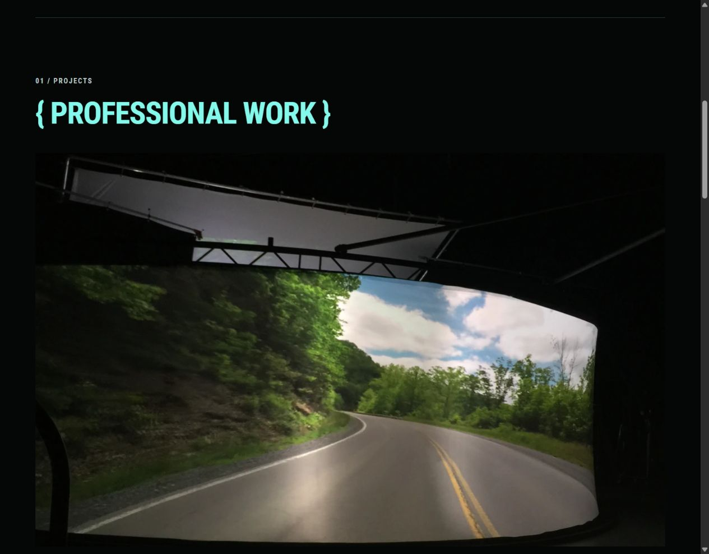
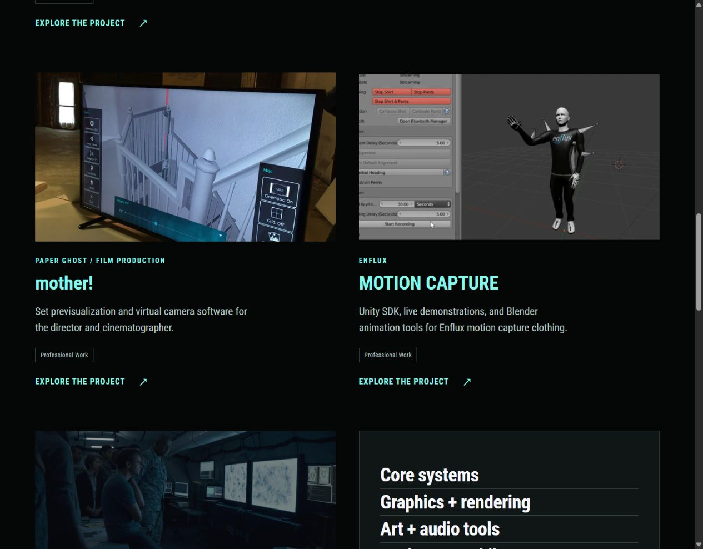
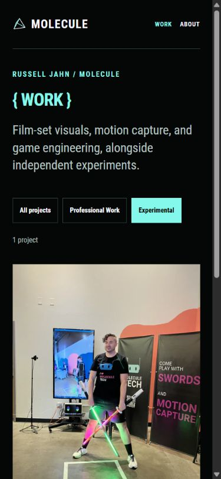

# Tagged projects and new headliners

The later [reusable film-project revision](34-reusable-film-projects.md) supersedes this note's flat homepage ordering and Arrival collection cover. Film + television now groups X-Men, The Glass Castle, mother!, and Arrival while keeping their individual Work pages.

## Russell's updated direction

Every entry is a project, with professional/experimental classification stored as tags. The homepage still has Professional Work and Experiments sections. Work becomes a single catalogue with filters. Tag values must remain stable while their visible labels are readable.

Use the Glass Castle projection setup as the large lead image and give the film a separate project page. Add mother! as another featured project. Use Enflux's Blender image or SIGGRAPH GIF as its cover. Keep the soft X-Men photograph in the Paper Ghost case study. Rename the Blizzard project to Game Engine, Graphics + Content Pipeline, with separate Hearthstone and Unannounced game sections. Rename Moongoat to Motion Capture + Lightsabers and restore an image.

**Titles are mint green**, including the full SOFTWARE / ENGINEER / & ARTIST headline and brace section headings. This explicitly supersedes the ghost-white heading decision in [the preceding pass](23-professional-work-experiments-and-image-quality.md). Section labels remain on one line and left-aligned.

Russell confirmed that the current game should still be called **Unannounced game**.

## Project collection

All six project sources now live in `content/work/`, share the same case-study template, and have ordinary Hugo `tags` in front matter.

| Stored tag value | Visible label | Source of label |
| --- | --- | --- |
| `professional` | Professional Work | `data/project_tags.yaml` |
| `experimental` | Experimental | `data/project_tags.yaml` |

The data records contain both `value` and `label`. Project tags link to the corresponding Work filter. The homepage queries the same tags rather than maintaining a second project list. Unknown tag values produce a build error when rendering a project tag, helping catch metadata typos. The taxonomy term pages also have the requested readable titles.

### Current project order and covers

| Project | Tag | Homepage cover |
| --- | --- | --- |
| The Glass Castle | professional | `PaperGhost/glasscastle_test4.jpg`: the curved rear-projection setup, shown large as the lead |
| mother! | professional | `PaperGhost/mother_preproduction3.png`: the virtual-camera interface on a monitor |
| Motion capture / Enflux | professional | `Enflux/enflux_blender1.jpg`: the Blender recording interface |
| Film + television / Paper Ghost | professional | `PaperGhost/arrival_spytent2.jpg`: a high-resolution still already in the curated About selection |
| Game Engine, Graphics + Content Pipeline / Blizzard | professional | A restrained text panel naming the actual areas of engineering work. Hearthstone artwork is supporting material within its case study |
| Motion Capture + Lightsabers / Molecule | experimental | Existing `assets/portfolio/moongoat-light-and-motion.jpg`: the vertical tracking display and illuminated props at Moongoat |

The Glass Castle cover has a 16:10 presentation crop for the homepage/catalogue. Its case study preserves the full image. Other stills keep their source aspect ratios. The Moongoat portrait is uncropped. The homepage places it beside the project description.

These are all existing curated About images except the requested Moongoat event image, which was already in the repository and is documented in [the archive review](12-archive-review.md). No new archive selections or generated illustrations were added. Enflux's SIGGRAPH/convention GIF remains in its case-study gallery. The static Blender image provides a quiet cover without loading that large animation on the homepage.

## Case-study changes and credits

- Glass Castle and mother! have their own pages with the corresponding curated galleries. Paper Ghost links to these pages instead of repeating their full galleries.
- Paper Ghost retains the X-Men gallery, including the original first photograph. Recovering its larger file did not fix softness in the original photography, so it no longer leads the homepage.
- The gallery helper can omit a named cover image, keeping it from appearing twice when it is not the first image in the original selection. Remaining image order and original animated GIFs are preserved.
- The Blizzard project names the engineering contribution before showing game imagery. Hearthstone and Unannounced game are separate sections, and the project context identifies both. Its homepage text panel represents areas of work, not a claimed internal production architecture.
- The game images are credited to the Hearthstone team. Russell's authorship is attributed to engineering. Paper Ghost and the individual film pages keep the production context and relevant Zed Axiz collaboration credits.
- Motion Capture + Lightsabers retains the two actual demos described by Russell: 60 fps suit-free C++ body capture/compositing and orientation-controlled IMU/LED wooden swords. Moongoat remains the venue/context rather than the project title.

## Work filters

The default view shows all six projects. **Professional Work** shows five. **Experimental** shows one. Buttons expose their selected state and support normal keyboard activation. A live count reports the result.

Selected filters are shareable as `/work/?tag=professional` and `/work/?tag=experimental`. Reload retains the selection. Browser Back/Forward restores it. An unknown value falls back to all projects. Without JavaScript, all projects remain in the page and inactive filter controls stay hidden.

Earlier URLs remain usable:

- `/work/hearthstone/` → `/work/game-engine-graphics-content-pipeline/`
- `/work/moongoat/` and `/experiments/moongoat/` → `/work/motion-capture-lightsabers/`
- `/experiments/` → `/work/?tag=experimental`
- `/work/#experiments` also selects the experimental filter when no tag query is supplied.

## Validation

- Hugo Extended 0.115.4 production build passed. JavaScript syntax and Git whitespace checks passed.
- Ten core routes passed checks for one primary heading, local links/assets, correct lead images/order, Blizzard section structure, and old-URL targets. The clean output does not contain the removed development blog.
- All 222 responsive image width descriptors referenced by those routes matched decoded file dimensions, with no generated width exceeding its source.
- Eight affected routes were checked in the browser at 320px, 390px, and 1280px. No horizontal overflow or portfolio image enlargement beyond native width was found. All tested main headings were mint, and homepage section labels stayed on one line.
- Work filter checks passed for 6/5/1 projects, deep links, unknown-value fallback, keyboard activation, reload, and browser Back restoration. No warning/error console messages were captured in the tested filter tab.
- The preview script was restarted after website updates and left running at `http://127.0.0.1:1313/`.

The PR includes the earlier local portfolio iteration, curated galleries, editorial changes, pyramid anti-aliasing, blog removal, contact refinement, and saved planning notes, as well as this pass. Deployment repair remains deferred.

[PR #4](https://github.com/MoleculeTechnology/MoleculeTechnology.github.io/pull/4) was opened from `feature/portfolio-rework-v1` into `main` after the website commit `9348b11`. The subsequent [About and carousel concepts](25-about-and-project-carousel-concepts.md) are planning material, not additional website behavior.

## Saved review images

