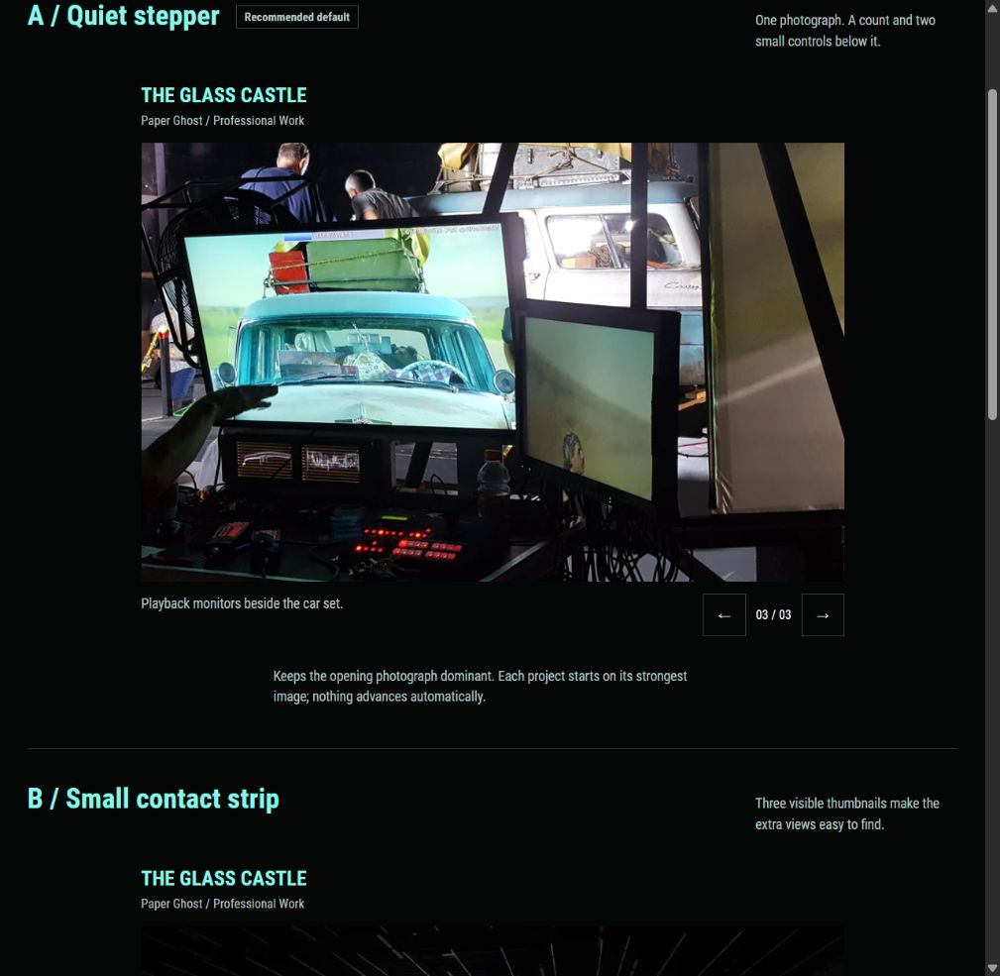

# About Me and project image concepts

The later [carousel comparison](35-carousel-concept-comparison.md) supplies three treatments across all seven current homepage projects. Its looping-image behavior follows Russell's later direction in [Looping portfolio images](32-looping-portfolio-images.md), which supersedes this note's earlier GIF-to-video proposal. The About concepts below remain proposals.

Prepared after opening [PR #4](https://github.com/MoleculeTechnology/MoleculeTechnology.github.io/pull/4), as Russell requested. These are proposals. The website has not gained a carousel or an expanded biography in this pass.

## Starting point

The work now has individual project pages, a shared tag model, selected covers, and clear credits. The homepage About block is still short, and the original About page already has a stronger personal introduction, the curated headshot, and substantial career evidence.

Preserve that original voice and photo selection. Add enough context to connect the film, motion capture, game engineering, and independent hardware work without repeating all the case studies. Do not add artistic motivations, an installation scale, client claims, or availability that Russell has not supplied.

## About Me: three possible treatments

### A / Short introduction + portrait

Use the existing curated headshot beside 80–120 words. Keep one personal introductory sentence, then distinguish current Blizzard work from independent Molecule hardware work. Add one link to the full About page. Keep the adjacent Contact section as the inquiry destination.

Possible copy for review, based on the current About source:

> I'm Russell → software engineer + artist. My work includes film-set projection, motion capture tools, real-time graphics, and content pipelines.
>
> At Blizzard, current work on an unannounced game focuses on 3D graphics techniques, rendering, and pipeline tools for art + audio.
>
> As Molecule, I'm building lightsaber and motion capture hardware, including the embedded firmware for lights and sensors. The aim is to make the hardware + software + art myself.

This retains the personal introduction where it is useful. Project cards and descriptions remain focused on the work. The wording is a proposal, not a replacement already applied to the site.

**Strength:** Gives the person behind the projects a visible place. **Tradeoff:** The detail still lives on the About page.

### B / How the work gets made

Keep the portrait and a shorter introduction, followed by three compact rows connecting a capability to a real example:

| Area | Concrete evidence | Project link |
| --- | --- | --- |
| Real-time graphics | Rendering and graphics techniques, with desktop + mobile engine experience | Game Engine, Graphics + Content Pipeline |
| Tools for artists | Projection playback controls, virtual cameras, animation recording/export | Glass Castle, mother!, Enflux |
| Physical systems | Camera-based tracking, IMU orientation, lights, and embedded firmware | Motion Capture + Lightsabers |

These should read as evidence, with one example per row, rather than a large skill badge collection. A small vector line treatment could echo the pyramid without adding another moving object.

**Strength:** Connects the experience to prospective installation work. **Tradeoff:** Too many examples could turn the section into a second Work index.

### C / Career in context

Give the full About page a compact career sequence, supported by the original curated photographs: film sets and projection → motion capture and developer tools → Blizzard engine/graphics/content work. Present Molecule as independent work continuing alongside the current role.

Use verified dates only. The known Hearthstone interval is March 2021–August 2023. Confirm the other role dates and current-role chronology before publishing a dated timeline. The conceptual sequence alone should not be presented as a verified employment timeline.

Keep the homepage version to a short summary with a link to the longer career record. Existing earlier work, including InContext, can support that deeper record instead of being crowded into the homepage.

**Strength:** Shows how the range of experience accumulated. **Tradeoff:** Gives the page a stronger résumé emphasis than the other directions.

### Recommended About direction

Use **A on the homepage**, with one concise proof row from B if needed. Use C as part of the fuller About page. This adds a person and current context without making visitors read the career history before reaching the work.

First person can stay in this short introduction, consistent with [the editorial voice decision](20-work-focused-editorial-voice.md). Do not replace it with an implied studio “we.”

## Project images: three visual treatments

The [interactive comparison](concepts/project-carousels.html) uses the same three Glass Castle images in each treatment. This makes it possible to compare the controls without changing the photography. It is a self-contained planning prototype, not a public website route.

When the local prototype server is running, open [the comparison](http://127.0.0.1:1314/project-carousels.html). The HTML can also be opened directly from the repository. Its images and Roboto Condensed files are included beside it. The local server can be recreated with:

```powershell
python -m http.server 1314 --bind 127.0.0.1 --directory docs/portfolio/concepts
```

### A / Quiet stepper — recommended default

One image, a short caption, and `← 01 / 03 →` below the frame. The project title, description, tag, and case-study link stay in place.

Start on the strongest image. No automatic advancement. The small counter makes additional photographs discoverable without a strip of competing images. On a narrow screen, the same controls remain visible and large enough to tap.

Best fit: the general homepage project cards. Keep each set to two or three selected views.

### B / Small contact strip

One image with three small thumbnails below it. The current thumbnail has a mint border. The others remain neutral. Clicking one changes the large image and caption.

This makes the selection more obvious but introduces more visual texture. Reserve it for the large Glass Castle lead if the arrow treatment is too easy to miss. Avoid repeating thumbnail strips under every card.

### C / Named views

Replace generic navigation with two or three meaningful labels, such as **Setup / Controls / On set**, **Tool / In use / VR**, or **Blender / Suit / Demo**. The selected label changes the image and caption.

This is useful when the photographs explain different aspects of the contribution. It can show software next to its use in a set or demonstration without depending on a long description.

Use buttons with a selected state and ordinary keyboard activation. Do not make the labels look like site navigation or require a hover to reveal them.

### Recommended image treatment

Use **A as the common pattern**. C is an alternative where its labels add real meaning. B is a possible exception for the large lead project. Do not use all three patterns at once without a clear reason. Consistency is part of keeping the page calm.

## Proposed image sequences by project

| Project | Two or three views | Notes |
| --- | --- | --- |
| Glass Castle | Car + projection setup (`glasscastle_test1.jpg`) → production monitors (`glasscastle_test3.jpg`) → finished scene (`glasscastle_final3.gif`) | Russell selected this order after reviewing the initial concepts. It supersedes the prototype's original setup/controls/on-set sequence. The case study now uses these three sources. Keep the GIF at native size and load it only when selected in a future homepage carousel. |
| mother! | Virtual-camera interface → tool in use during preproduction → Gear VR version | Use the current cover, `mother_preproduction5.jpeg`, and `mother_preproduction4.png`. Keep the larger animated walkthrough for an explicit play action or the case study. |
| Enflux | Blender recording interface → sensor clothing → live demo | The SIGGRAPH GIF is a candidate for deliberate playback. Confirm the exact clip and venue caption before changing the current general demo caption. |
| Paper Ghost | Arrival screen work → X-Men video wall → a Quantico prop/demo | Keep the soft X-Men photograph as supporting context. Favor the wider X-Men view or the higher-resolution submarine still at a suitable size. Do not enlarge a soft still to fill the lead slot. |
| Game Engine, Graphics + Content Pipeline | Engineering contribution overview → public Hearthstone context/credits, if useful | A photo carousel is optional here. Keep unannounced-game work as supported text unless approved media is supplied. Gameplay is context, with team art credits, rather than proof that Russell authored the game art. |
| Motion Capture + Lightsabers | Existing event photograph → clearer tracking-screen view → IMU/light-prop detail, when reviewed | Do not manufacture a three-image set from duplicate crops. Hide carousel controls until at least two useful, distinct images exist. |

## Interaction and implementation constraints

- Keep titles, project tags, descriptions, and the case-study link outside the changing image area. Changing photographs should not change the page height or shift neighboring projects.
- Choose each project's frame and image treatment deliberately. Use containment for software interfaces or portrait documentation when cropping would remove useful details.
- No autoplay, rotating thumbnail animations, timed progress indicators, or automatic GIF playback across multiple cards. The pyramid already provides movement near the top.
- Keep controls visible on touch devices and operable by keyboard. Preserve focus on the control used, and announce the new image/caption after a manual change. These choices follow the [W3C WAI carousel guidance](https://www.w3.org/WAI/tutorials/carousels/), which also notes that carousel content can be difficult to discover.
- Load only the initial still and lightweight selected thumbnails initially. Defer other images and video until needed. Do not load a 10–32 MB GIF just because its project card enters view.
- Prefer short video plus a still poster for future motion examples after reviewing the actual source clip. Honor reduced-motion preferences.
- A project with one useful image remains a normal image. Do not display redundant carousel controls.
- Keep one independent controller per project. Slide changes should not add browser-history entries or interfere with the Work filter URL.
- Proposed metadata can add an optional `homeMedia` list of source, alt text, caption, and media kind. It should reference selected existing assets and share the current responsive image helper. This is a future extension, not an additional collection or a second copy of each image.

## Prototype limits and checks

The prototype demonstrates manual selection, counters, captions, selected states, and keyboard arrow behavior. It does not implement swipe gestures, production lazy loading, video playback, or an About redesign. It uses existing 960px derivatives for a small design comparison. It is not the production image-quality implementation.

Its three options use the same fixed 16:10 frame for comparison. Actual project media may need a different ratio or containment. No production carousel dependency has been added.

Checked in the browser: A's next/previous pattern and keyboard arrow selection, B's thumbnail selection/pressed state, and C's named selection/caption. Counters changed independently, all images loaded, and no warning/error console messages were captured. The layouts fit at 320px, 390px, and desktop widths without horizontal overflow. Image-frame dimensions stayed fixed.

The existing Roboto Condensed font license is included with the prototype's copied font files. Its photographs are existing site derivatives, retaining the Glass Castle/Paper Ghost/Zed Axiz context described in the project notes.


