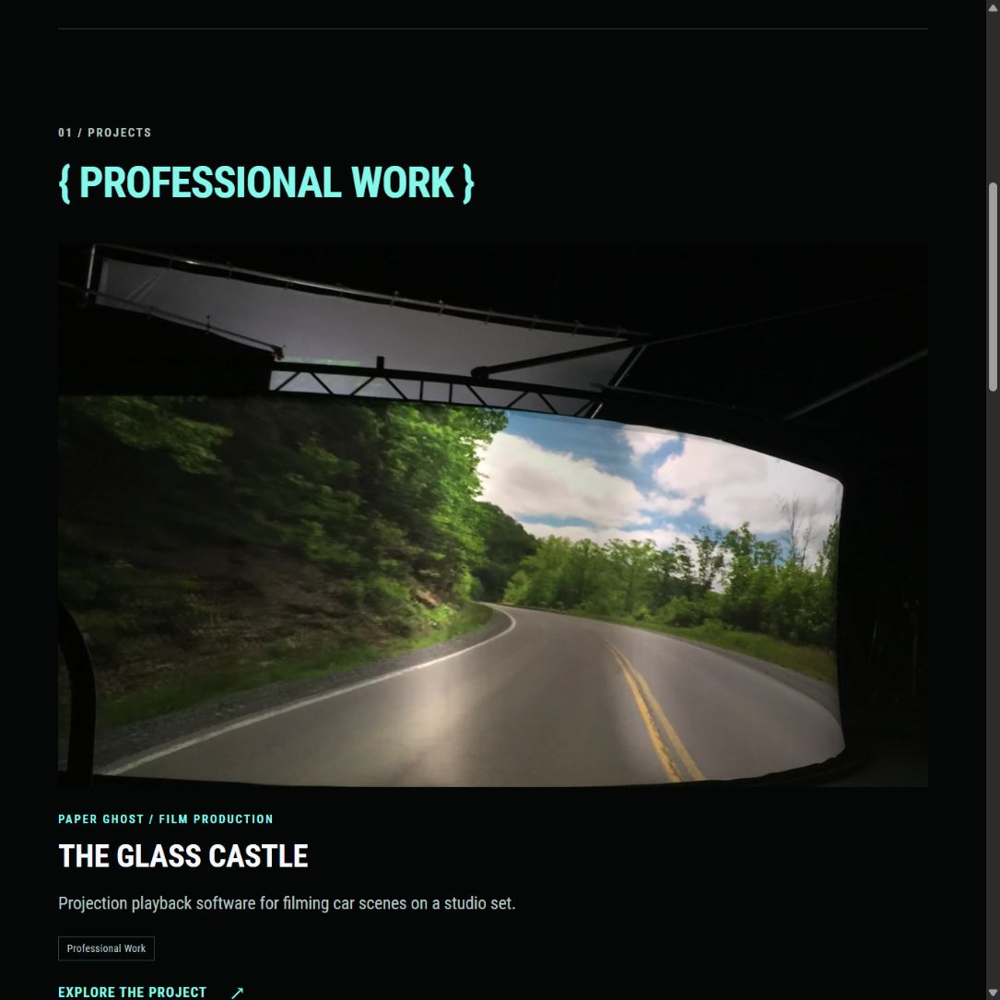
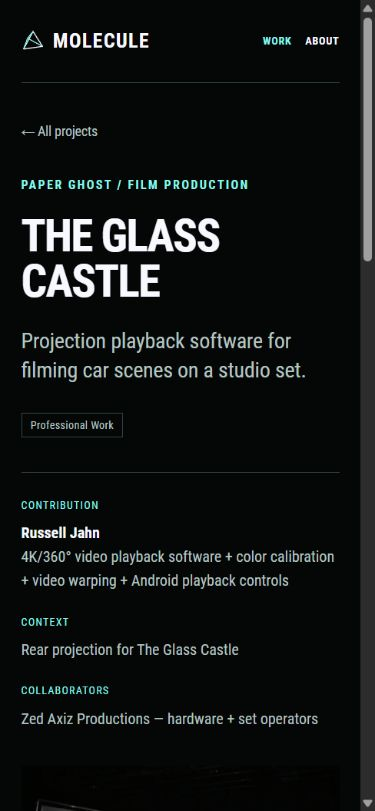

# Heading hierarchy and accent color

Russell prefers project titles such as THE GLASS CASTLE in ghost white, reserving mint for the most important details and accents. This supersedes the all-mint title rule in [the previous project revision](24-tagged-projects-and-new-headliners.md).

## Applied rule

| Role | Color | Shared style |
| --- | --- | --- |
| Homepage SOFTWARE / ENGINEER / & ARTIST. | Mint `#84F9EB` | `heading-accent` |
| Primary page titles and brace section headings | Mint | `heading-accent` |
| Project titles, including case-study page titles | Ghost white `#F8F8FF` | Default heading color |
| Content subheadings and contact form headings | Ghost white | Default heading color |
| Project context, contribution labels, links and controls | Existing accent treatment | Existing component styles |

Color follows the heading's role rather than its HTML level. Homepage cards remain `h3`; Work cards remain `h2`; case-study titles remain `h1`. Each page still has one `h1`. Changing the heading level to change its appearance would break that semantic structure.

`assets/css/portfolio.css` owns the default ghost-white heading color and explicit mint accent class. Shared size variables cover the identity display, section labels, page titles, project titles, subsections, and smaller detail headings. Existing responsive sizes and component spacing are preserved. The carousel comparison also uses white project titles.

The repository's `AGENTS.md` now records this rule for later iterations.

## Verification

- Production build passed with pinned Hugo Extended 0.115.4.
- Home, Work, The Glass Castle, Game Engine / Graphics / Content Pipeline, About, and Contact checked at 1280px, 390px, and 320px.
- All rendered heading colors matched their roles; one `h1` per page; no horizontal overflow.
- Brace headings stayed on one line and left-aligned at all checked widths.
- Desktop and mobile views visually reviewed. Portfolio and carousel-concept previews restarted and left running.

