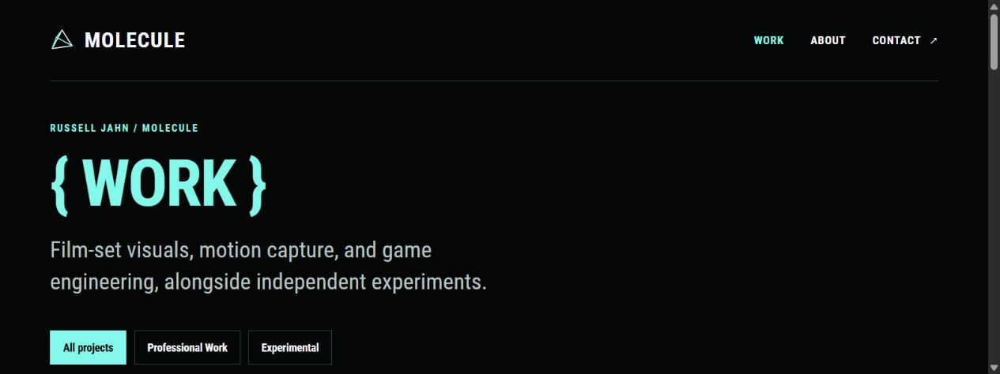
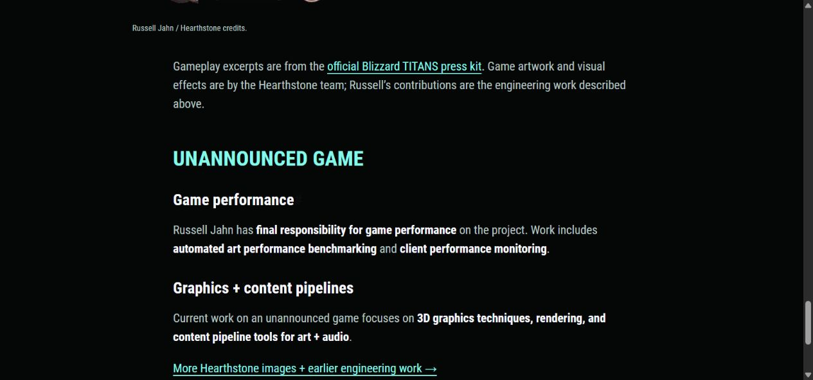
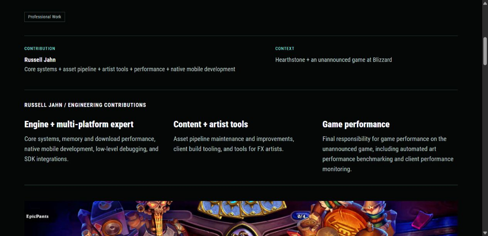

# Heading hierarchy and accent color

Russell prefers project titles such as THE GLASS CASTLE in ghost white, reserving mint for the most important details and accents. This supersedes the all-mint title rule in [the previous project revision](24-tagged-projects-and-new-headliners.md).

## Applied rule

| Role | Color | Shared style |
| --- | --- | --- |
| Homepage SOFTWARE / ENGINEER / & ARTIST. | Mint `#84F9EB` | `heading-accent` |
| Primary page titles and brace section headings | Mint | `heading-accent` |
| Hearthstone and Unannounced game sections within the Blizzard case study | Mint | Page-level `accentSectionHeadings` opt-in |
| Project titles, including case-study page titles | Ghost white `#F8F8FF` | Default heading color |
| Content subheadings and contact form headings | Ghost white | Default heading color |
| Project context, contribution labels, links and controls | Existing accent treatment | Existing component styles |

Color follows the heading's role rather than its HTML level. Homepage cards remain `h3`. Work cards remain `h2`. Case-study titles remain `h1`. Each page still has one `h1`. Changing the heading level to change its appearance would break that semantic structure.

`assets/css/portfolio.css` owns the default ghost-white heading color and explicit mint accent class. Shared size variables cover the identity display, section labels, page titles, project titles, subsections, and smaller detail headings. Existing responsive sizes and component spacing are preserved. The carousel comparison also uses white project titles.

The repository's `AGENTS.md` now records this rule for later iterations.

The later [brace casing concepts](39-brace-casing-concepts.md) compare lowercase and UPPERCASE across every brace label. They retain the current color hierarchy and do not apply a casing choice to the website.

## Verification

- Production build passed with pinned Hugo Extended 0.115.4.
- Home, Work, The Glass Castle, Game Engine / Graphics / Content Pipeline, About, and Contact checked at 1280px, 390px, and 320px.
- All rendered heading colors matched their roles, with one `h1` per page and no horizontal overflow.
- Brace headings stayed on one line and left-aligned at all checked widths.
- Desktop and mobile views visually reviewed. Portfolio and carousel-concept previews restarted and left running.

## Header navigation correction

Russell reported that Contact stayed mint on every page. Removed its unconditional mint rule. Header links now use mint only when marked `aria-current="page"`. Hover adds an underline without changing the link color. Verified Home (no active section), Work, About, Contact, and a Work case study. The preview rebuilt successfully and was restarted.

## Blizzard game section headings

Russell requested mint for Hearthstone and Unannounced game on the Blizzard case study. That page now opts into `accentSectionHeadings`, which uses shared CSS to color its direct `h2` game section headings. The case-study project title, smaller `h3` headings, and headings on other project pages stay ghost white. Heading sizes and anchor links are unchanged.

The production build passed. Rendered colors and layout were checked at 1280px, 390px, and 320px. Both game headings are mint, smaller headings are ghost white, and there is no horizontal overflow. The Glass Castle's headings were checked to confirm the change is scoped to the Blizzard page. Preview restarted and left running.

## Stronger Blizzard headings

Russell renamed the contribution label to **Engine + multi-platform expert** and requested bolder section headings. The game section headings and contribution labels now use real Roboto Condensed Black 900. They previously used Bold 700, so this adds an actual heavier face while retaining the selected font family and the existing heading sizes/colors. Smaller body subheadings remain Bold 700.

The new Latin WOFF2 is self-hosted at `static/fonts/RobotoCondensed/RobotoCondensed-Black-latin.woff2` (20,996 bytes), sourced from the [official Google Fonts stylesheet for weight 900](https://fonts.googleapis.com/css2?family=Roboto+Condensed:wght@900&display=swap). Its SIL Open Font License is included as `OFL-Black.txt`, from the [Google Fonts source](https://github.com/google/fonts/tree/main/ofl/robotocondensed). The older local faces retain their existing license. Font synthesis stays disabled.

[Font provenance](assets/roboto-condensed-black-source.json) records the exact Google-hosted file URL and SHA-256. Production build and whitespace checks passed. Browser font checks confirm the 900 face is available and the affected headings compute to weight 900. Checked at 1280px, 390px, and 320px with no horizontal overflow. Colors remain mint for game sections and ghost white for contribution labels. Preview restarted and left running.

