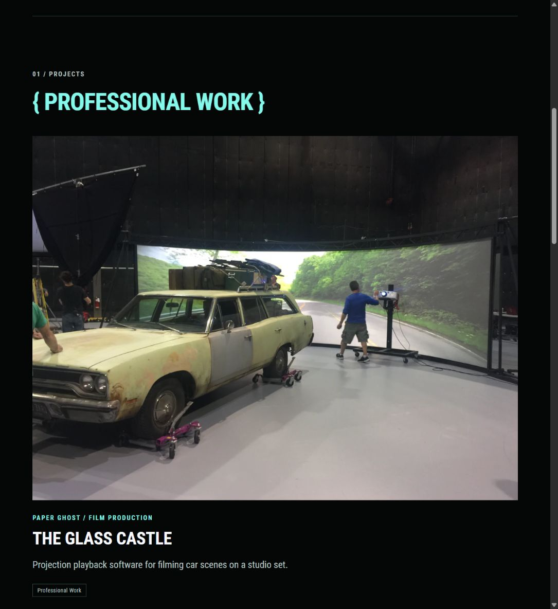
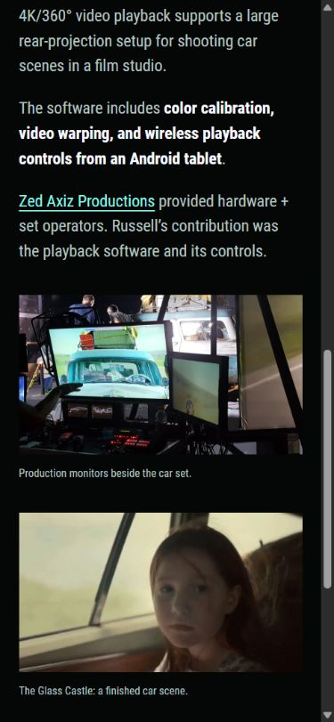

# Glass Castle selected media

Russell selected a new three-image sequence:

| Role | Source in `content/about/PaperGhost/` | Original dimensions |
| --- | --- | --- |
| Headliner | `glasscastle_test1.jpg` — car and curved projection screen together | 3264 × 2448 |
| Accent | `glasscastle_test3.jpg` — production monitors beside the car set | 5312 × 2988 |
| Tertiary | `glasscastle_final3.gif` — finished car scene | 498 × 280, 30 animation frames |

The first two supplied URLs pointed to generated 640px WebP thumbnails. The implementation references their matching full-resolution JPG originals and keeps the existing responsive WebP pipeline. The new headliner appears on Home, Work, and the case study, with its full 4:3 framing preserved. The case study follows it with the accent photograph and then the animated GIF.

The shared image helper now publishes GIF originals without resizing them into still images. The animation remains lazy-loaded and is capped at its native width. The About page retains its existing curated gallery. Russell's playback/software contribution and Zed Axiz Productions' hardware/set-operator credit are unchanged.

The selected sequence is also recorded in [About and project-image concepts](25-about-and-project-carousel-concepts.md), superseding that note's first Glass Castle sequence. The older control-comparison prototype remains a study of the three control patterns. Production homepage carousels are still a proposal.

## Verification

- Pinned Hugo production build passed.
- Ten core routes passed local link/asset checks, including 205 decoded responsive image width descriptors.
- Home, Work, and the Glass Castle case study checked at 1280px, 390px, and 320px: correct image selection/order, loaded media, original proportions, and no horizontal overflow.
- The rendered desktop hero selected a 1280px derivative rather than the linked 640px thumbnail. The case-study GIF stayed at or below 498px wide.
- Original GIF bytes and frame count verified against the served build asset.
- Preview script restarted and left running at `http://127.0.0.1:1313/`.

