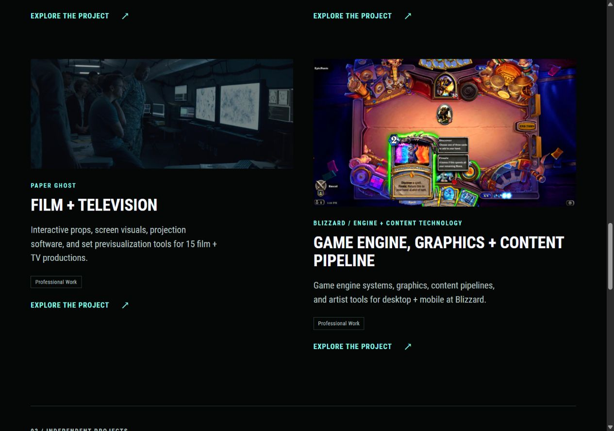
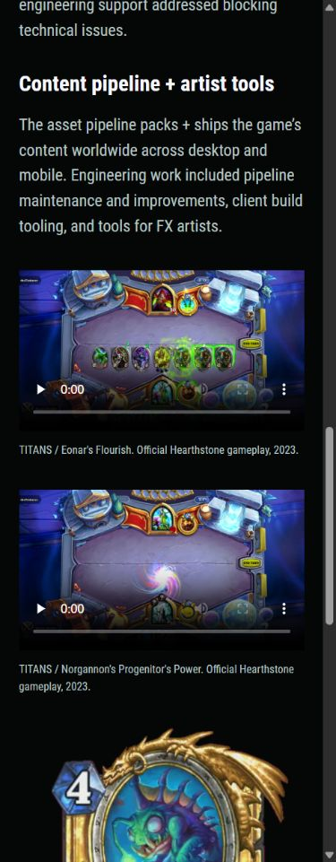

# Hearthstone headliner and sharper media

Russell selected the existing `Blizzard/hearthstone_gameplay1.jpg` as the temporary Blizzard headliner and requested a search for stronger photographs/screenshots and high-resolution motion examples.

## Applied presentation

- Home, Work, and the Game Engine / Graphics / Content Pipeline case study use the requested gameplay image. The source is 1280 × 720; the supplied URL was its generated 960px WebP. Preserve the original 16:9 frame.
- Keep the engineering contribution block before the case-study hero and retain separate Hearthstone and Unannounced game sections.
- Replace the case study's small gameplay GIF, small VFX still, and Zephrys GIF with two manually played TITANS excerpts and sharp still posters. Keep Russell's existing credits card at its native size. The original About gallery and source files remain available.
- Credit gameplay, artwork, and visual effects to Blizzard / the Hearthstone team. These are game-context examples; Russell's named contribution remains engineering, content pipelines, tools, performance, and platforms.

## Research shortlist

Prioritize media from the recorded March 2021–August 2023 Hearthstone period. The [official Blizzard press archive](https://blizzard.gamespress.com/en/Hearthstone) has expansion-specific collections, so there is no need to use recent expansion imagery to illustrate the earlier role.

| Candidate | Verified source quality | Visual assessment and decision |
| --- | --- | --- |
| TITANS — Eonar / Flourish gameplay | Downloaded official clip: 3840 × 2160, 60 fps, 31.38 s | Clear board composition with green ability effects. Applied as a 7 s, 1920 × 1080 excerpt with a still taken at source time 18 s. Best of this pass for a broad gameplay/FX example. |
| TITANS — Norgannon / Progenitor's Power gameplay | Downloaded official clip: 3840 × 2160, 60 fps, 29.42 s | Distinct spell animation against an uncluttered board. Applied as a 6 s, 1920 × 1080 excerpt; poster at 21.5 s captures the colored swirl before the bright impact. |
| TITANS key art | Press-kit image metadata: 10000 × 5865 | Strong illustrative alternative for an occasional image break. Keep as a candidate; gameplay better supports this engineering case study. |
| Festival of Legends key art | Press-kit image metadata: 10000 × 5848 | Colorful concert composition matching the requested headliner's expansion. Useful alternate artwork, with team credit; not applied in this pass. |
| March of the Lich King — announce B-roll | Official kit lists individual clips including Corpse Explosion, Reborn Mechanic, and The Sunwell | Additional motion source if more variety is wanted. Clip dimensions and visual quality were not inspected in this pass; do not label these 4K based on the TITANS clips. |

Sources: [TITANS press kit](https://blizzard.gamespress.com/en/Hearthstone-TITANS---Press-Kit), [Festival of Legends press kit](https://blizzard.gamespress.com/en/Hearthstone-Festival-of-Legends---Press-Kit-98430), [March of the Lich King press kit](https://blizzard.gamespress.com/en/Hearthstone-March-of-the-Lich-King---Announce-Press-Kit).

The official [TITANS announcement](https://hearthstone.blizzard.com/en-us/news/23973114/announcing-titans-hearthstone-s-next-expansion) also embeds a GIF, but it is only 480px wide. It is not a resolution upgrade. The downloadable press B-roll provides substantially better source material.

## Delivery and source record

The original case-study gameplay GIF was 480 × 270, the VFX still 828 × 466, and the Zephrys GIF 324 × 480. The two GIFs alone totaled approximately 29.5 MB. The replacement motion files total 8.64 MB at 1920 × 1080, with 30 fps delivery, no audio, and native playback controls. `preload="none"` and no autoplay keep the videos from downloading/playing merely because the page is opened. Their JPG stills are also saved at 1920 × 1080 for later image selection; Hugo produces the displayed WebP posters.

The source originals are 122.3 MB and 120.1 MB and stay in ignored `.preview/hearthstone-research/`. Downloaded FFmpeg tooling stays in ignored `.tools/media-python/`. The website includes only the prepared excerpts and stills under `assets/portfolio/hearthstone/`.

[The source manifest](assets/hearthstone-media-sources.json) records original filenames, SHA-256 hashes, source dimensions, exact excerpt times, poster times, output sizes, and credits. Source pages and filenames are durable references; expiring signed download URLs are not committed.

Preparation used FFmpeg 7.1: trim the specified intervals, scale to 1920 × 1080 with Lanczos, encode H.264 at CRF 20 / medium, use YUV 4:2:0 and MP4 fast start, and omit audio. No compositing or generated imagery was used.

## Verification

- Pinned Hugo production build passed; ten core routes passed link/asset checks and 201 decoded responsive width descriptors.
- Both output videos decoded fully without errors. Both posters and MP4 sources resolve in the built site.
- Browser keyboard playback succeeded for both clips, reporting 1920 × 1080 and durations of 7 s / 6 s. Both start paused with native controls and `preload="none"`.
- Home, Work, and the Blizzard case study checked at 1280px, 390px, and 320px: no horizontal overflow; headliner and video frames retain 16:9 proportions. The homepage headliner loaded when scrolled into view.
- Preview script restarted and left running on port 1313.

