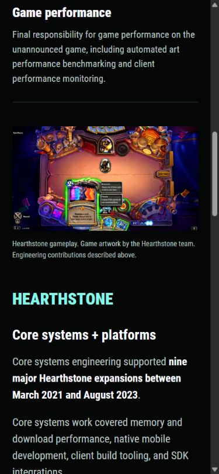

# Writing punctuation preference

Russell requested no semicolons in the writing and asked for the preference to be saved in skills.

The reusable [russell-writing-style skill](skills/russell-writing-style/SKILL.md) is kept in this repository and installed in `C:\Users\russe\.codex\skills\russell-writing-style\SKILL.md`. Keep the installed copy aligned with the repository source when changing the skill. `AGENTS.md` also records the rule for this project.

Rewrote four live-copy instances across the Blizzard and Paper Ghost pages and About. Updated the authored planning prose, a gallery-helper comment, the carousel-concept note, and the PR description. Use natural sentences and lists while preserving the original facts and credits.

Code punctuation, HTML entities, URLs, and exact quotations retain their required syntax. Archived screenshots remain historical images. The preference applies to new prose and editable text.

## Verification

- The skill passed the skill-creator validator. The installed copy matches the repository source byte for byte.
- No semicolons remain in the editable Markdown content, portfolio planning prose, or repository guidance.
- The production build and ten-route link/asset checks passed.
- Rendered Blizzard, Paper Ghost, and About text has no semicolons at desktop and phone widths, with no horizontal overflow. The carousel comparison's rendered prose was also checked.
- Both preview servers restarted and remain running.

