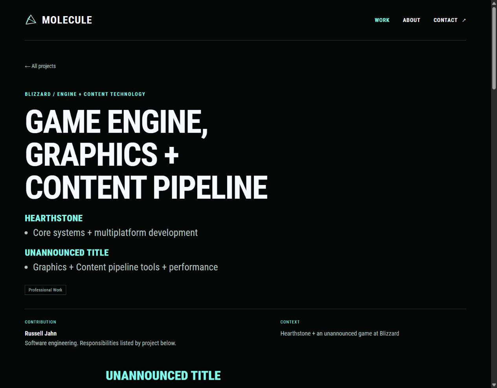
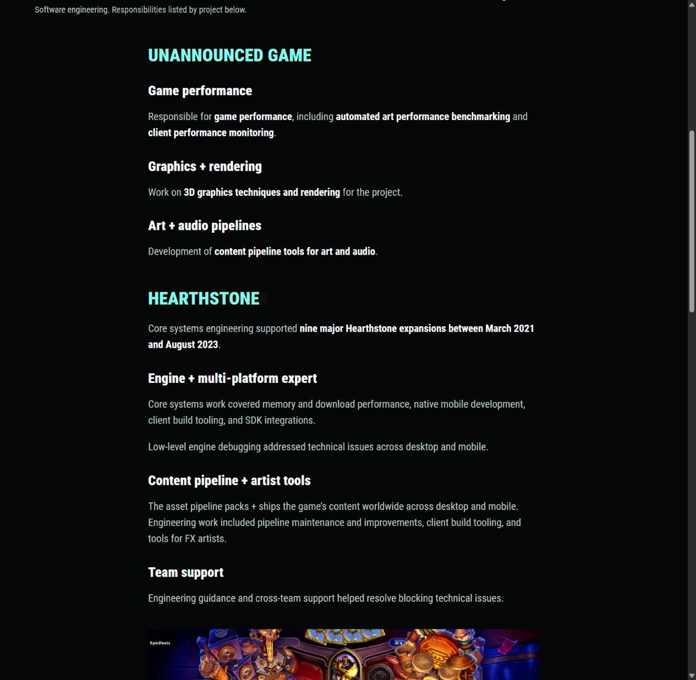

# Blizzard project responsibilities

Date: 2026-10-25

Russell found “Final responsibility for game performance on the unannounced game” too showy for the portfolio. He also identified that the shared contribution list mixed responsibilities from two different projects.

## Applied wording and structure

The initial replacement “Responsible for game performance” was also inaccurate. Russell subsequently clarified the role and preferred emphasis below.

The page now says:

> **Automated art performance benchmarking** and **client performance monitoring**.

This sits under “Performance tools.”

The homepage mentions game performance alongside the current graphics, rendering, and art/audio pipeline work without a claim about final authority. The shared contribution field identifies software engineering and directs readers to the separate project responsibilities.

| Section | Responsibilities |
| --- | --- |
| Unannounced game | Automated art performance benchmarking, client performance monitoring, 3D graphics, rendering, and content pipeline tools for art and audio |
| Hearthstone | Core systems, memory/download performance, native mobile, low-level debugging, SDK integrations, client build tooling, asset pipeline work, FX artist tools, and cross-team engineering support |

The detailed current-project section comes first. Hearthstone follows with its historical nine-expansion claim and its own responsibilities. The current project's public heading is now Unannounced title, following Russell's latest summary format.

The selected Hearthstone gameplay cover remains on Home and Work. On the case study, it now appears inside Hearthstone's section, followed by the two official gameplay excerpts and Russell's credits card. Team artwork and effects attribution remains visible. This avoids placing Hearthstone imagery above the current project's responsibilities.

A shared hero partial and a `project-hero` shortcode reuse the selected cover metadata. Other case studies retain their existing hero placement. Game headings remain mint and responsibility headings remain ghost white, both using Roboto Condensed Black 900.

## Performance leadership clarification

Russell is leading the performance initiative and transforming the team culture on the unannounced game. The goal is to make performance everyone's responsibility. He provides the tools, education, and initiative that enable the team to work that way.

This is a correction to the role description, beyond a softer choice of words. Neither “final responsibility” nor “responsible for game performance” captures that distinction. Do not infer sole ownership from the earlier “The buck stops at me” statement.

Russell wants this context preserved in the notes but is uncertain that it should receive much emphasis on the creative portfolio. Keep the public description focused on the actual benchmarking and monitoring work for this iteration. Do not expand it into a leadership or team-culture pitch without revisiting that editorial choice.

## Opening summary format

Russell replaced the opening prose paragraph with two compact project labels and contribution bullets:

**HEARTHSTONE**

- Core systems + multiplatform development

**UNANNOUNCED TITLE**

- Graphics + Content pipeline tools + performance

Use this order in the overview on Home, Work, and the case study. The detailed body sections remain separate. The new label follows Russell's latest wording and still identifies the title as unannounced. Preserve the existing `#unannounced-game` section anchor for links.

The shared summary partial reads `projectSummaries` frontmatter. Other projects retain their prose descriptions. Overview labels are ghost white on project cards and mint in the Blizzard case header, using Roboto Condensed Black 900. Bullet text stays readable in the existing muted text color.

The summary was checked on Home, Work, and the Blizzard case study at 1280px, 390px, and 320px. Labels remain on one line with no horizontal overflow. Both contribution bullets fit on one line in the desktop case header and wrap naturally at mobile widths. The pinned production build and ten-route asset/content checks passed. The preview script was restarted after the final CSS adjustment.

## Verification

- Production build passed with Hugo Extended `0.115.4`.
- Ten core routes passed the existing heading, local link/asset, project ordering, alias, and image checks. All 201 responsive width descriptors matched their decoded files.
- Checked that current-project terms occur in its own section and that Hearthstone's platform work, historical expansion count, and gameplay sources occur in Hearthstone's section. The mixed contribution list is absent.
- Blizzard rendered at 1280px, 390px, and 320px without horizontal overflow. Both game headings rendered mint at weight 900, with ghost-white responsibility headings at weight 900.
- Home, Work, and Glass Castle rendered at 1280px and 390px without horizontal overflow or failed loaded images. Home and Work retain the selected Hearthstone cover. Glass Castle retains a single normal case-study hero.
- Restarted `scripts/preview.ps1` after website changes and left the preview running at [localhost:1313](http://127.0.0.1:1313/work/game-engine-graphics-content-pipeline/).
- After the leadership clarification, the production build and ten-route checks passed again. The corrected performance-tools copy rendered at 1280px and 390px without horizontal overflow. Confirmed the individual-ownership sentence is absent, then left the restarted preview running.

The screenshot below records the earlier layout pass. Its “Responsible for game performance” sentence is superseded by the performance-tools wording above.

Source evidence and the role correction are S11 and S12 in [Evidence and CV review](02-evidence-and-cv-review.md). The latest clarification supersedes the earlier individual-ownership descriptions in the [decision log](10-questions-and-decisions.md).
