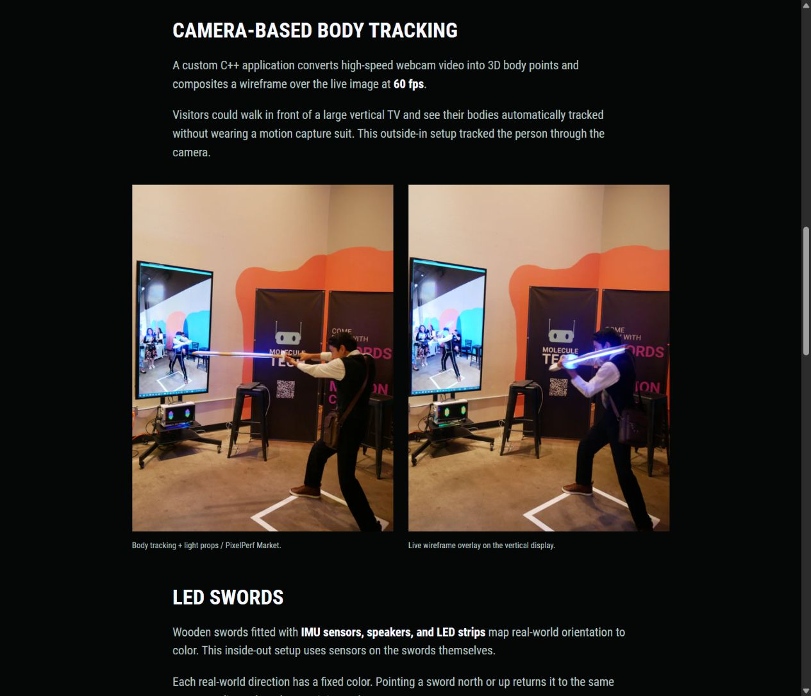
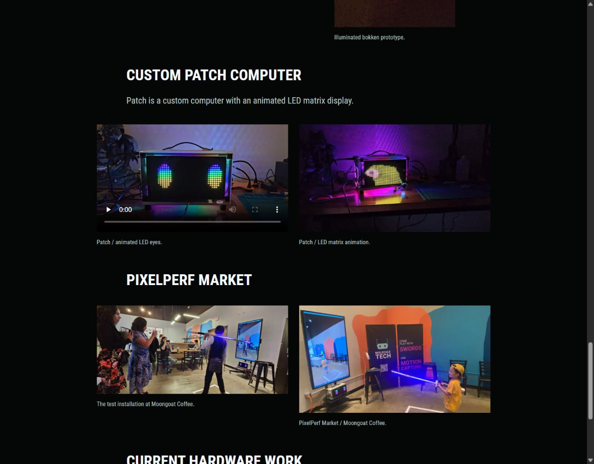

# Molecule selected photos and motion

Date: 2026-10-25

Russell supplied ten specific archive files for Motion Capture + Lightsabers, grouped as the custom Patch computer, lightsaber prototypes, and PixelPerf Market at Moongoat Coffee. This selection updates the earlier About-only image choice for this project.

## Applied presentation

- The landscape photograph of a visitor beside the body-tracking screen is the new lead on Home, Work, and the case study.
- Two portrait photographs show a visitor using the bokken in front of the live tracking display, with the windup before the extended pose.
- Melissa's spinning-bokken GIF appears as a continuously looping portrait WebP image beneath the orientation-to-color description.
- The two prototype photographs sit together under Bokken prototypes, distinct from the event documentation.
- Custom Patch computer has its own section with the supplied MP4 and a continuously looping WebP version of the LED matrix GIF.
- Two additional event photographs show the wider installation and another visitor using a bokken.

All ten selections are represented as seven photographs, two looping images, and one video. The project remains Experimental. The original 60 fps body-tracking account and fixed real-world orientation-to-color behavior remain as Russell described them. The recording frame rates do not independently measure the application's performance.

## Sources and delivery

The [source manifest](assets/molecule-selected-media.json) records each exact VADER path, original filename, SHA-256 hash, source dimensions, preparation, and resulting asset. Its `repository_source` field identifies the preserved original in this repo. Prepared media lives in `assets/portfolio/molecule/`.

Russell subsequently requested copies of the original files, including both GIFs, organized in the portfolio source. All ten originals are now preserved under `source-media/molecule/` with their original filenames and unchanged bytes:

- `patch-computer/` contains the MP4 and GIF.
- `lightsaber-prototypes/` contains both source photographs.
- `pixelperf-market/2023-09-02/` contains five source photographs and the GIF.

The copies total 98,003,186 bytes. Every copy was verified against the recorded original SHA-256 hash. The source directory is outside Hugo's mounted input folders. See the [source-media index](../../source-media/README.md).

| Supplied file | Prepared dimensions | Use |
| --- | --- | --- |
| `20230509 204759-1.mp4` | 1920 × 1080 | Patch LED eyes video, 10.32 s |
| `ezgif-5-5d129b59f5.gif` | 600 × 338 | Patch LED animation, looping WebP, 7.24 s |
| `20220926_185841.jpg` | 1758 × 792 | Held bokken lightsaber prototype |
| `20220926_200930.jpg` | 1816 × 4032 | Upright illuminated bokken prototype |
| `6B6893E6-EF2E-41E2-8B7A-221764C88E1A.jpeg` | 4592 × 3448 | New lead photograph |
| `20230903_120930.gif` | 540 × 960 | Melissa spinning the bokken, looping WebP, 6 s |
| `C92D9BF1-DD97-4BCA-88A7-83F49037B4C7.jpeg` | 3448 × 4592 | Visitor pointing a bokken toward the display |
| `49DF8843-13AC-41F3-9E11-BD25674B0334.jpeg` | 3448 × 4592 | Visitor winding up the bokken beside the tracking display |
| `20230902_104130.jpg` | 4000 × 1848 | Wider event view |
| `IMG_0741.JPG` | 3520 × 1980 | Visitor beside the banner and display |

Russell subsequently clarified that the props are bokken, wooden martial arts practice swords. Public copy now uses that term, defined on the project and About pages. The first body-tracking pair shows `pixelperf-sword-movement.jpg` first and `pixelperf-sword-pointing.jpg` second. Only the image and its descriptive alt text change slots. “Body tracking + light props / PixelPerf Market.” remains the first caption and “Live wireframe overlay on the vertical display.” remains the second. Preserved source files and asset filenames stay unchanged.

The windup-first order and both unchanged captions were checked at 1280px, 390px, and 320px. Updated terminology rendered on Home, Work, and About at 1280px and 390px without horizontal overflow. The production build and ten-route content/asset checks passed. Preview restarted after the copy changes.

Three supplied `.jpeg` files are MPO containers with a second stored photographic frame. Used the primary frame and applied its EXIF orientation. The portrait prototype also needed its stored rotation baked in. These exports retain native dimensions and use JPEG quality 95 with no chroma subsampling. The other upright JPEGs are copied without re-encoding. Hugo produces responsive WebP derivatives at quality 90 with Lanczos resizing.

The source MP4 is remuxed with its original video and audio, without re-encoding. Both GIFs were initially converted to manually played MP4s. Russell clarified that the continuous loop is the point of these images. Animated WebP now replaces those video derivatives, preserving all frames, original pixel dimensions, and frame timing with an infinite loop. See [Looping portfolio images](32-looping-portfolio-images.md) for format support, encoding, sizes, and checks.

The Patch source video uses native controls, inline playback, a still poster, and `preload="none"`, with no autoplay. The WebP images animate automatically without playback controls. Display widths are capped at the source width. Portrait media is capped further for readability. Paired media uses two columns on desktop and one column on mobile, with full uncropped photographs.

## Initial media-pass verification

The checks below record the initial seven-photo/three-video pass. [Looping portfolio images](32-looping-portfolio-images.md) records the subsequent replacement of both GIF-derived videos with animated images.

- Production build passed with Hugo Extended `0.115.4`.
- The preserved source copies all match their original SHA-256 hashes. A production rebuild confirmed that `source-media/` is absent from the generated website.
- Ten core routes passed heading, local link/asset, selected-image, alias, and project-order checks. All 247 responsive image width descriptors matched their decoded files.
- The project has seven still images, three videos, and four paired media groups. All video and poster paths resolve.
- All three videos decoded fully with FFmpeg and played through the browser's native controls. Browser metadata confirmed 540 × 960 / 6 s, 1920 × 1080 / 10.32 s, and 600 × 338 / 7.24 s.
- The case study was checked at 1280px, 820px, 390px, and 320px without horizontal overflow, offscreen body elements, or enlarged images/videos. Mobile groups stack in one column.
- Home and Work use the new lead at 1280px and 390px without horizontal overflow. The Blizzard case study retains its credits-card placement and media layout after the shared shortcode updates.
- Restarted `scripts/preview.ps1` after the final media changes and left [the project preview](http://127.0.0.1:1313/work/motion-capture-lightsabers/) running.

