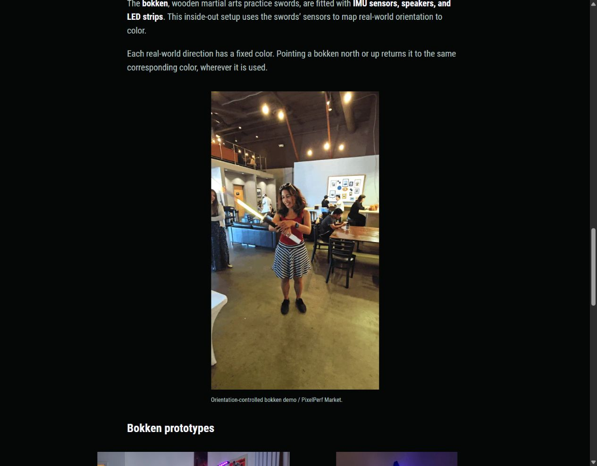
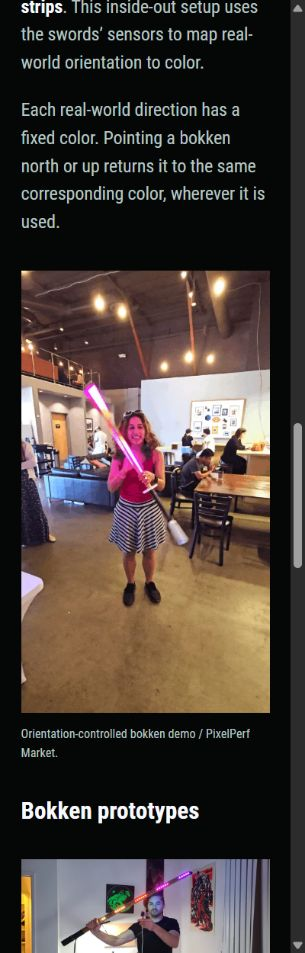

# Looping portfolio images

Date: 2026-10-25

Russell identified the PixelPerf animation as Melissa spinning the lightsaber and clarified the purpose of the original GIFs: continuously looping images. Requiring a click to play a video lost that intent. Use looping image delivery for these selections.

## Format choice

Animated WebP is supported in current Chrome, Edge, Firefox, Opera, and Safari. Google's [WebP browser-support list](https://developers.google.com/speed/webp/faq#which_web_browsers_natively_support_webp) specifies animation support from Chrome 32, Edge 18, Firefox 65, Opera 19, and Safari 14 on iOS 14 or macOS Big Sur onward. [MDN's image-format guide](https://developer.mozilla.org/en-US/docs/Web/Media/Guides/Formats/Image_types#webp_image) also lists animation and support across those browsers. Older browsers outside this range are not a target for this iteration.

Use animated WebP for the two GIF selections. It behaves as an image with an automatic continuous loop and does not need a video player or an autoplay permission. Original GIFs remain preserved byte-for-byte in `source-media/`.

## Applied delivery

- Melissa's bokken spin uses `assets/portfolio/molecule/pixelperf-sword-demo.webp`, at 540 × 960 with 300 frames over 6 seconds.
- Patch's LED matrix GIF uses `assets/portfolio/molecule/patch-led-animation.webp`, at 600 × 338 with 239 frames over 7.24 seconds.
- Patch uses WebP quality 85 and method 6. Melissa's taller animation uses quality 75 and method 4, selected after comparing sample frames with the original and a larger quality-85 encode. Original frame durations and pixel dimensions are retained. A loop count of zero means infinite repetition.
- The actual Patch source MP4 keeps its audio and native video controls.
- `work-image` accepts `animated="true"`. The shared image partial publishes the prepared animation directly. Running animated WebP through Hugo's still-image resizing would flatten it to a single frame. Still photographs keep responsive image resizing.
- Preserve portrait framing, captions, source-width limits, and the windup-first photo order. Do not introduce autoplay video players in place of these loops.

The [media manifest](assets/molecule-selected-media.json) records original sources and hashes, prepared paths, output sizes and hashes, animation format, and loop settings. The superseded GIF-derived MP4s are no longer used.

| Animation | Original GIF | Animated WebP | Reduction |
| --- | --- | --- | --- |
| Melissa spinning the bokken | 45,138,068 bytes | 17,191,870 bytes | 61.9% |
| Patch LED matrix | 20,873,641 bytes | 7,460,580 bytes | 64.3% |
| Combined | 66,011,709 bytes | 24,652,450 bytes | 62.7% |

The WebPs are lossy delivery versions. Representative source and output frames were compared side by side. The source GIFs already contain palette and dithering artifacts, which conversion cannot recover.

## Verification

- Production build passed with Hugo Extended `0.115.4`. Ten core routes passed local link/asset, heading, project order, alias, and image-selection checks. All 247 responsive still-image width descriptors matched their decoded files.
- Both WebPs decoded with the original frame counts, every original frame duration, original dimensions, and infinite-loop metadata. The built files are byte-identical to the prepared animations, confirming Hugo did not flatten them.
- All ten original media files still match their recorded source hashes.
- Restarted `scripts/preview.ps1`. Home responds with HTTP 200. Both animation URLs respond with `image/webp` and hashes matching the prepared files.
- The in-app browser renders both as images without video controls. Separate browser captures show the image content advancing automatically, including Melissa's animation after more than one loop's duration. The actual Patch video retains its native controls and no autoplay.
- Checked at 1280px, 820px, 390px, and 320px. Images load, retain their aspect ratios, remain within source dimensions, and produce no horizontal overflow. The Patch media pair stacks on mobile.
- Browser execution was checked in the in-app browser. Cross-browser format support is based on the vendor and MDN references above.

