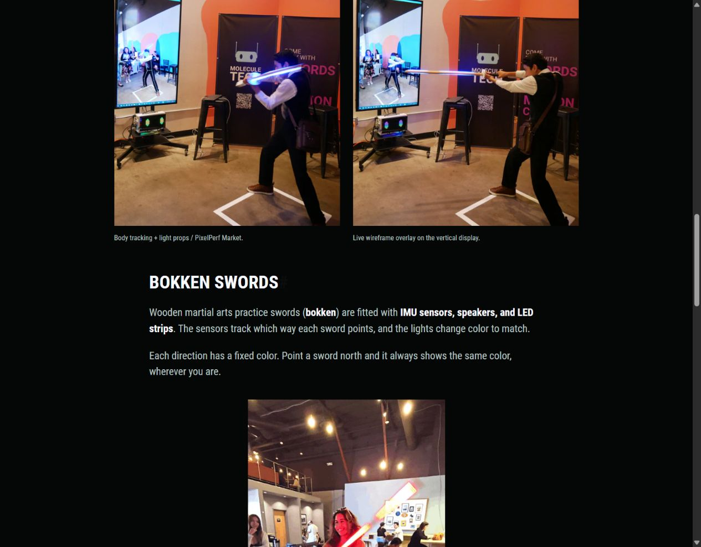
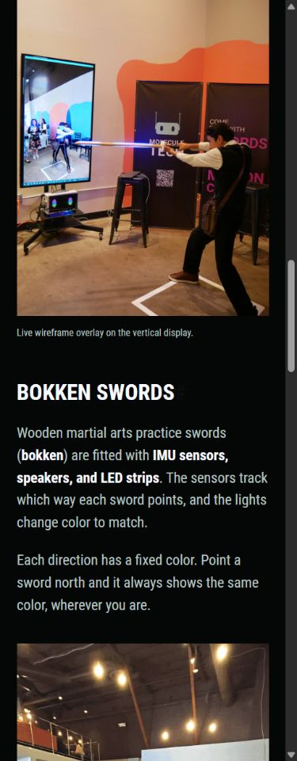
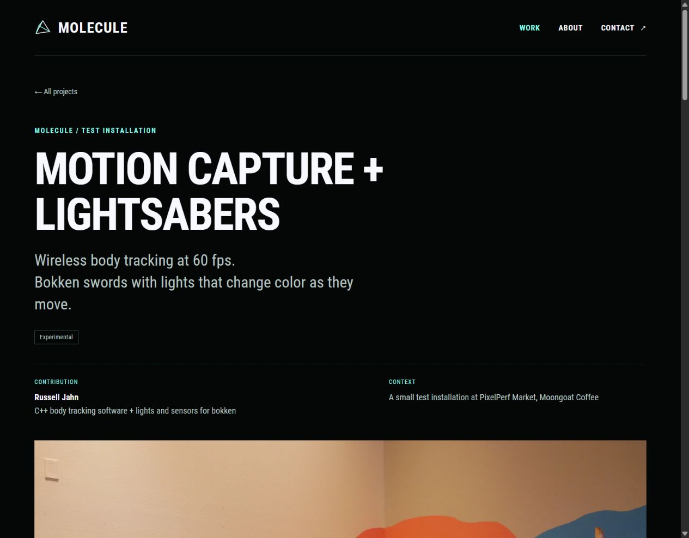
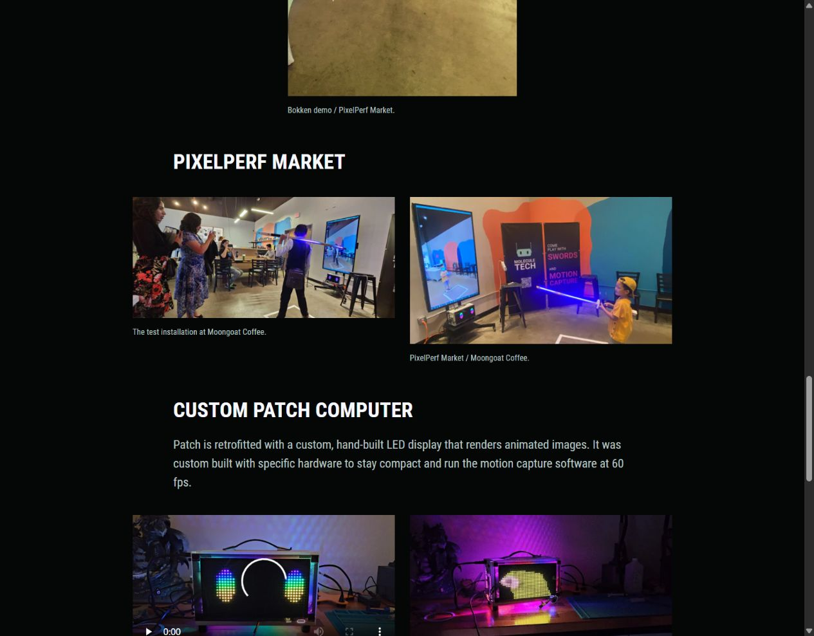

# Plain-language project copy

Date: 2026-10-25

Russell found the bokken copy too full of jargon and asked for natural, succinct explanations that an everyday reader can understand. His suggested wording starts with wooden martial arts practice swords, with bokken in parentheses, then explains the lights and sensors.

## Writing direction

- Describe what someone can see or do before describing the technology.
- Use ordinary verbs and concrete examples. “Which way a sword points” explains orientation without needing that label.
- Keep technical facts that show the work, such as C++, 3D body points, 60 fps, IMUs, speakers, and LEDs. Explain their purpose instead of adding a chain of technical terms.
- A work-focused voice should still sound like a person explaining something. Avoid formal wording added just to sound professional.
- Introduce bokken once as wooden martial arts practice swords. Use “sword” where repeating bokken would sound forced.
- Keep project roles and claims accurate. Do not invent behavior for the speakers or imply the camera controls the sword lights.

## Applied scope

Rewrote Motion Capture + Lightsabers, its shared Home/Work description, and the matching About paragraph. The camera section now begins with what visitors saw. The sword section explains the sensors and lights with a north-pointing example. The Patch introduction and current hardware paragraph also use simpler wording.

The earlier inside-out and outside-in labels remain in [Russell's source account](18-moongoat-demonstrations.md). They are not needed in this short public introduction. The original account remains the factual basis.

## Bokken section

Wooden martial arts practice swords (**bokken**) are fitted with **IMU sensors, speakers, and LED strips**. The sensors track which way each sword points, and the lights change color to match.

Each direction has a different color. Point a sword north and it always shows the same color, wherever you are.

## Russell's summary wording

Russell supplied this replacement for the project summary:

> Wireless body tracking at 60 fps. 
> Bokken swords with lights that change color as they move.

Applied verbatim to Home, Work, and the case-study introduction. `summaryLines` keeps the two sentences on separate lines through the shared summary partial. The description metadata uses the same sentences as plain text. The detailed sword explanation still describes direction determining color.

## Verification

- The later summary wording was checked on Home, Work, and the project page at 1280px and 390px, with one explicit line break between the two supplied sentences and no horizontal overflow. Rebuilt the site and restarted the preview after this update.
- Production build passed with Hugo Extended `0.115.4`. The existing ten-route content and asset checks passed.
- Checked Home, Work, About, and Motion Capture + Lightsabers at 1280px and 390px. The revised copy appears in the expected places without horizontal overflow.
- Confirmed the north-pointing example and simple sensor explanation on the rendered project page. The original photo order and its two captions remain unchanged, and the sword animation is still an image loop.
- Restarted `scripts/preview.ps1` and left the updated project preview running.

## Patch placement and description

Russell clarified that Patch was retrofitted with a custom, hand-built LED display. Its hardware was selected to stay compact and run the motion capture software at 60 fps. Applied his revised two-sentence description verbatim. The current order is PixelPerf Market, Custom Patch computer, then Bokken prototypes, with each section's media kept together. The prototypes use a separate section heading so they do not appear to be part of the Patch computer.

The sword animation's public caption and alt text now describe the demo without naming the participant, as Russell requested.

Checked the new order, exact Patch paragraph, and participant descriptions in the restarted preview at 1280px and 390px. The media pairs stack on mobile without horizontal overflow. The production build and existing ten-route checks passed.

