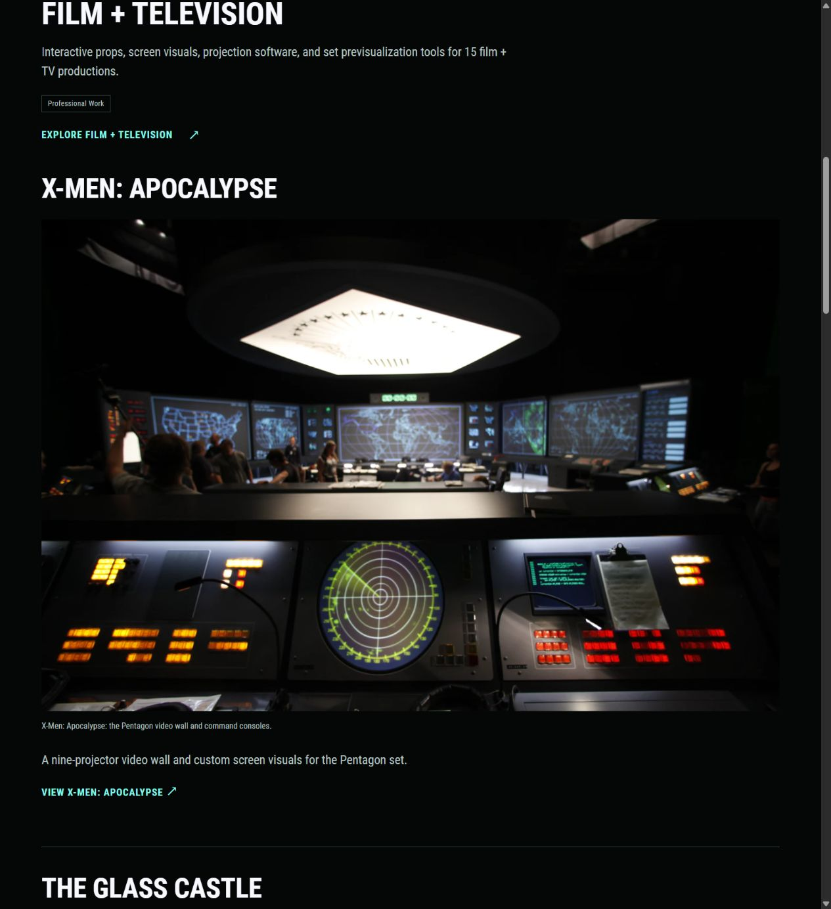

# Reusable film projects

Date: 2026-10-25

Update: The later [C carousel implementation](37-homepage-contact-strip-carousels.md) adds thumbnails and image selection to each homepage project. The shared film structure below is retained.

Russell clarified that X-Men: Apocalypse, The Glass Castle, mother!, and Arrival belong under Film + television. Their order is the same on Home and the combined film page. Work should continue to offer separate project pages.

## Presentation

- Home: Film + television is one Professional Work collection, followed by Enflux and Blizzard. Its four films appear vertically, each with a lead image, a short description, and its own project link.
- Film + television: the same four films appear in that order with their full text, images, and contribution credits. Quantico and Ça Décolle! remain as supporting work after them.
- Work: the four films are individual cards and pages, alongside Enflux, Blizzard, and Motion Capture + Lightsabers. The collection is not counted again as another project. All seven cards retain their Professional Work or Experimental tags and filters.
- Individual film pages link both to Work and back to Film + television.

## One source per film

The canonical sources are:

| Film | Source | URL |
| --- | --- | --- |
| X-Men: Apocalypse | `content/work/x-men-apocalypse/index.md` | `/work/x-men-apocalypse/` |
| The Glass Castle | `content/work/glass-castle/index.md` | `/work/glass-castle/` |
| mother! | `content/work/mother/index.md` | `/work/mother/` |
| Arrival | `content/work/arrival/index.md` | `/work/arrival/` |

The Film + television page owns an ordered `projectRefs` list. Each film identifies its collection with `parentProject`. Home and the collection shortcode resolve those actual Hugo pages. The full collection renders each child's `.Content`, hero, and the same contribution-facts partial used by its standalone page. Copy and gallery changes therefore carry through to the combined view without maintaining another version of the film's text.

Home uses the same page references and heroes, with short descriptions in place of the full galleries. This keeps the homepage lighter and leaves room for the next carousel pass. No production carousel has been added.

## Requested headliner

The first film supplies the collection's lead image: `content/about/PaperGhost/xmen_apocalypse_pentagon3.jpg`. This is the source behind Russell's supplied 960px WebP URL. The original is 2784 × 1856 and 583,321 bytes. Responsive WebP versions are generated from that original, with no enlargement. There is no second image-path copy in the collection frontmatter.

This supersedes the earlier flat homepage order and Arrival collection cover in [Tagged projects and new headliners](24-tagged-projects-and-new-headliners.md). Glass Castle's selected cover, accent photo, and finished-scene GIF remain together in that film's source page. Original About selections and Zed Axiz credits are retained.

## Checks

- Production build passed with pinned Hugo Extended `0.115.4`.
- Three tracked regression tests verify the requested order, individual Work cards, complete reused project copy and galleries, matching credits, and unique IDs on the combined views.
- Twelve core routes passed local link/asset and heading checks. All 247 responsive image width descriptors matched their decoded files.
- Home, Film + television, Work, and all four film pages were checked at 1280px, 390px, and 320px without horizontal overflow or enlarged source images.
- Work filters show seven total projects, six Professional Work projects, and one Experimental project.
- The preview script was restarted after the changes and left running.

Run the regression tests after building to `.preview/project-catalogue-check`:

```powershell
python -m unittest discover -s tests -v
```

Set `PORTFOLIO_BUILD_DIR` to check another Hugo output directory.


