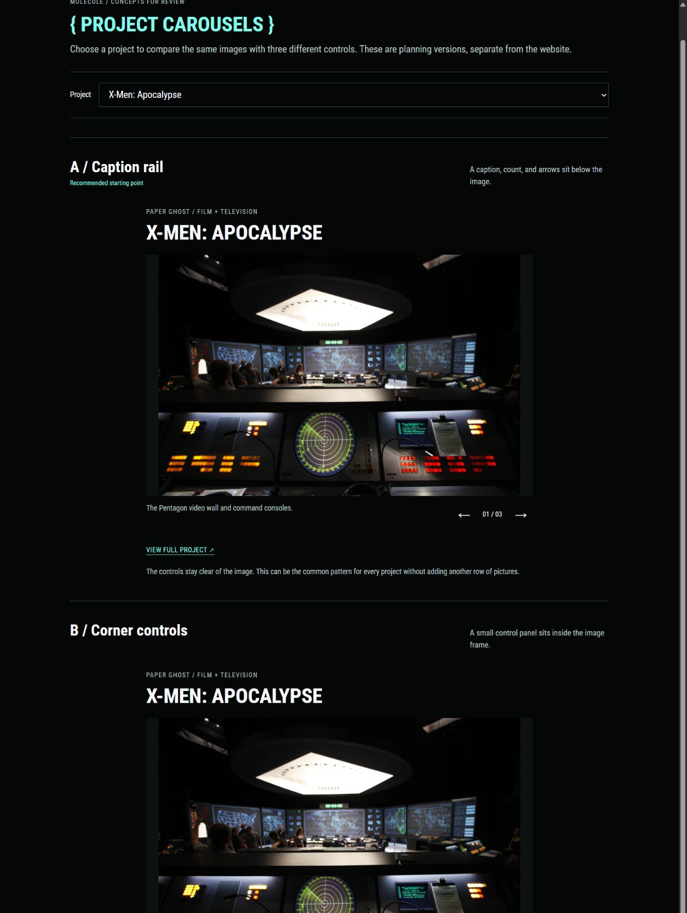

# Carousel concept comparison

Date: 2026-10-25

Decision update: Russell selected **C / Small contact strip**. It is now [implemented on the homepage](37-homepage-contact-strip-carousels.md). The comparison and recommendations below record the earlier exploration.

Prepared after committing the reusable Film + television structure in `b677402` and updating [PR #4](https://github.com/MoleculeTechnology/MoleculeTechnology.github.io/pull/4).

The [interactive comparison](http://127.0.0.1:1314/project-carousels-v2.html) lets Russell choose any of the seven homepage projects and see the same images in three treatments. Its [HTML source](concepts/project-carousels-v2.html), [image choices](concepts/project-carousel-data.js), and static animation thumbnails are saved here in the repo. These are proposals for the next pass. The production homepage still uses one selected image per project.

## Three versions

| Version | Controls | Benefit | Tradeoff |
| --- | --- | --- | --- |
| A / Caption rail | Short caption, image count, and arrows below the image | Keeps controls off the artwork and works consistently across projects | Other views are less obvious than with thumbnails |
| B / Corner controls | Arrows and count on a small black panel over the image | Takes less space below the photograph | Covers part of the image, especially on mobile or software screenshots |
| C / Small contact strip | Two or three still thumbnails, a count, and caption | Shows which other views exist before someone clicks | Adds another row of pictures under every project |

Start with **A** as the common treatment. Compare C where the different views need to be more obvious. B is worth trying visually, but controls over the software and set photos can hide useful details. The comparison leaves this choice open.

## Images by project

| Project | Views in the comparison | Suggested fit |
| --- | --- | --- |
| X-Men: Apocalypse | Requested Pentagon image → wide Pentagon view → submarine screen | A keeps the controls off the detailed screens |
| The Glass Castle | Car + projection setup → production monitors → finished-scene loop | A or C, depending on how visible the extra views should be |
| mother! | Virtual camera interface → tool in use → Gear VR version | A preserves the full software interface |
| Arrival | Surveillance tent → office screens → cryptography tent | A with short captions distinguishing the sets |
| Enflux | Blender recording interface → motion capture clothing → live demonstration loop | A, with C as a more visible alternative |
| Game Engine, Graphics + Content Pipeline | Hearthstone gameplay → Russell's credits card | A, or keep one image if the engineering text is more useful. No unannounced-game imagery is implied |
| Motion Capture + Lightsabers | PixelPerf event photo → bokken loop → Patch LED loop | A, with the chosen animation looping as an image |

The selector has seven projects and twenty image choices. It follows the film order used on Home. Each treatment has independent controls, so changing A does not change B or C.

## Behavior and efficiency

- Photo selection is manual. There is no timed slide advancement.
- GIF and animated WebP selections keep their original continuous image playback. This follows [Russell's looping-image direction](32-looping-portfolio-images.md), superseding the earlier proposal to turn GIFs into manually played video.
- Thumbnail versions of animations are still images, at most 160 × 100. They do not load the full animation just to show the thumbnail strip.
- The full images use the current local Hugo preview URLs. Only the selected full image is mounted in each treatment. The comparison therefore needs the portfolio preview running on port 1313. It does not copy the full source images into the planning folder.
- Frames stay fixed while selecting images. Software interfaces and portrait media use containment rather than destructive cropping, with source-width limits. The shared 16:10 frame is for comparing controls, not a final ratio prescribed for every project.
- Buttons have a 44px minimum hit area. Selection works with the keyboard, including arrow keys, Home, and End. Captions and image counts are announced after selection, and focus stays on the control used.
- These image URLs are planning snapshots. Production carousel metadata should reference the canonical Hugo assets, not copy the prototype's published resource URLs.

For implementation, add an optional image list to each canonical project page and extend the shared image/hero partial. Keep the title, description, project link, and collection order in place. No carousel library is needed for these small image sets.

## Running and reviewing

Keep `scripts/preview.ps1` running for portfolio media, then serve this planning folder:

```powershell
python -m http.server 1314 --bind 127.0.0.1 --directory docs/portfolio/concepts
```

The existing comparison server is already running. Open [the comparison](http://127.0.0.1:1314/project-carousels-v2.html) and use its Project selector. The older [Glass Castle comparison](concepts/project-carousels.html) remains as historical planning material.

Checked the arrows, thumbnail selection, independent counters, keyboard End selection, all seven project choices, the two-image Blizzard set, and the three looping-media selections. Image frames stayed at 720 × 450 on desktop and scaled consistently at 390px and 320px without horizontal overflow. Main image URLs, thumbnail URLs, and project links were checked for successful responses. Animation thumbnails were decoded as still images.


