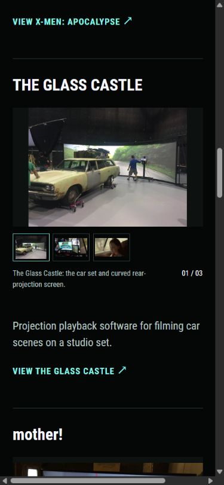

# Homepage thumbnail-strip carousels

Date: 2026-10-25

Update, October 27, 2026: All eligible About gallery images now feed the home carousels. Ten carousels contain 54 selections, including a restored Hearthstone carousel that excludes its credits card. See [Complete project galleries and public pages](52-complete-project-galleries-and-pages.md) for shared selection rules and current verification. The initial decisions below remain historical context.

Russell selected **C / Small contact strip** from the [carousel comparison](35-carousel-concept-comparison.md). That choice replaces the earlier recommendation to start with A.

The initial implementation used C on all seven homepage projects. The later [media revision](42-lowercase-media-and-film-layouts.md) removes Blizzard's carousel because it has one selected image and gives Enflux four selections. Six projects now use C. The film order, project links, and contribution summaries are preserved.

## Presentation and controls

- One image appears in a fixed 16:10 frame, preserving its full composition and limiting display to the original width.
- Two or more small, still thumbnails sit underneath. The selected thumbnail has a mint border. Single-image projects render without a carousel.
- A short caption and image count follow the thumbnails. Their reserved space keeps the surrounding content steady when images change.
- Selection is manual. Selected GIF and WebP loops keep looping as images.
- Thumbnail controls have 64 × 48px hit areas. Tab enters at the selected thumbnail. Left and right arrows select adjacent images and wrap. Home and End select the first and last image. Keyboard focus follows selection.
- Each carousel has its own selection, descriptive image text, pressed states, and a polite status announcement.
- Without JavaScript, the first image and caption remain visible, with the existing full-project links available.

The About, Work, and case-study galleries keep their existing presentation.

## Project metadata and media

The canonical project frontmatter owns an ordered `carousel` list. Each entry has a `label` and can specify `source`, `alt`, and `caption`. An entry without a source inherits the project's existing hero and its description. This keeps the selected lead image tied to the project metadata.

Animated entries use `animated: true` and an explicit still `thumbnail`. Paths refer to source assets, with no dependence on the planning server or hardcoded generated-image URLs. The selections follow the twenty images reviewed in the comparison.

The shared carousel partial uses the existing responsive image pipeline. Unselected full images remain in inert HTML templates until selected. The displayed image is replaced when selection changes, so only one full image is mounted per carousel. Small thumbnails load lazily and never load the full animation.

The twenty thumbnails are at most 160 × 100px and total **70,902 bytes**. Four still animation thumbnails were copied from the reviewed prototype into `assets/portfolio/carousel-thumbnails/`. Full animations and original source files are unchanged.

Carousel CSS and JavaScript load only on Home. No additional library is used. About's existing stylesheet fingerprint and complete presentation fixture still match.

## Verification

- Production build passes with pinned Hugo Extended `0.115.4`.
- Twelve tracked tests pass, covering the seven carousels, twenty selections, static fallback, inert image templates, still thumbnail dimensions and formats, animation sources, Home-only code, and the existing project and About behavior.
- All twenty image choices were checked in the browser at 1280px, 390px, and 320px. Frame and caption dimensions remained stable for every choice, with no horizontal overflow.
- Keyboard End, Home, and left/right wrapping were checked, including focus and count updates. Selections remain independent between projects.
- Selected images load successfully, including the four looping choices. The browser reported no JavaScript errors.
- Pillow confirmed all twenty thumbnails contain one frame and stay within the size limit.
- Twelve routes pass local link, asset, and heading checks. All 247 responsive image width descriptors match their decoded files.
- The preview script was restarted after the website changes and left running on port 1313.

Open [the implemented homepage](http://127.0.0.1:1313/) to review. The comparison on port 1314 remains historical planning material.

