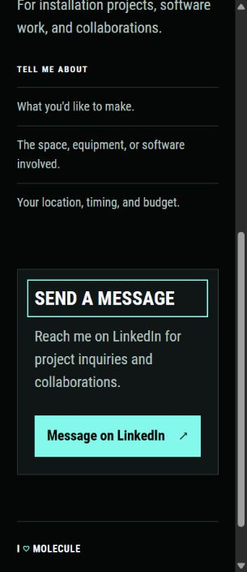

# Contact without advertising

Date: 2026-10-25

Russell reported a HubSpot advertisement in the Contact form and said it should never appear on the portfolio.

## Findings

The existing `contactform` shortcode loaded HubSpot's hosted form script. Its generated form included a second iframe promoting free HubSpot forms. This content was controlled by HubSpot.

The existing form had Email and Message as required fields, with Name optional. A cached public definition confirmed CAPTCHA was off. The live definition returned `Form not found`, and the embed fell back to HubSpot's cached S3 definition.

A submission endpoint preflight succeeded, but a deliberately invalid validation probe containing no fields, email address, or message returned **HTTP 403** with `Portal isn't allowed to post submissions`. No valid inquiry was sent. A custom frontend pointed at that same endpoint would still have a delivery problem.

## Applied change

The hosted form embed and its shortcode were removed. Contact now has a native card linking directly to Russell's existing LinkedIn profile. The project inquiry prompts, navigation, typography, colors, and keyboard jump are retained. Contact loads no third-party scripts, forms, or iframes.

The direct destination and label live in the Contact page's frontmatter as `contactUrl` and `contactLabel`. No public email address was invented or copied from historical documents. Russell was asked whether to keep LinkedIn or provide an email address. LinkedIn is the working option while that choice is open.

This replaces the earlier decision to retain the hosted form in [Local implementation](14-local-implementation.md). The change removes the source of the advertisement instead of covering it with CSS.

If a native inquiry form is added later, it needs a working delivery endpoint. Keep form markup and response text controlled by the site, and verify delivery with an authorized test before relying on it. Do not restore an embed that can inject advertisements or provider upsells.

## Checks

- Production build passes with Hugo Extended `0.115.4`.
- Thirteen tracked tests pass. The new Contact check verifies the direct destination, keyboard jump target, and absence of scripts, forms, iframes, and HubSpot references in the production page.
- Contact was checked at 1280px, 390px, and 320px with no horizontal overflow. The message button fits narrow screens.
- The Write a message jump moves focus to the contact heading.
- The rendered browser page has no external scripts or embedded frames.
- The twelve-route link and asset check passes, including all 247 responsive image width descriptors.
- The preview script was restarted and left running on port 1313.

The service documentation was checked while evaluating a custom form: [HubSpot's public submission API](https://developers.hubspot.com/docs/api-reference/legacy/marketing/forms/v3-legacy/submit-data-unauthenticated) and [form spam settings](https://knowledge.hubspot.com/forms/prevent-spam-form-submissions). The portal-specific 403 response is the reason that approach was not used.

