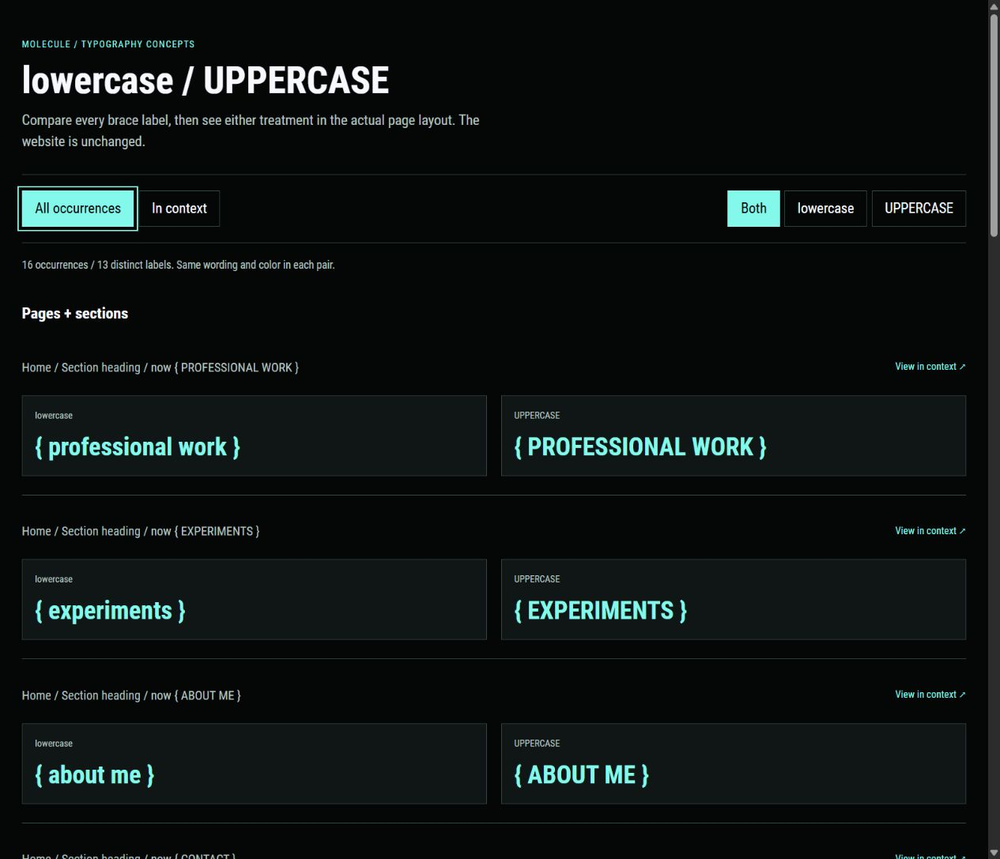

# Brace casing concepts

Russell requested lowercase and UPPERCASE concepts for every visible `{ }` label, then selected lowercase for this iteration. The website now uses that choice, including the pyramid caption previously uppercased by CSS. The comparison and inventory below preserve the earlier design review.

Open the [interactive comparison](http://127.0.0.1:1314/brace-casing.html). **All occurrences** shows paired specimens. **In context** shows the same treatments in copies of the actual page layouts. Choose a location and a page width of 1280px, 390px, or 320px. **Open full size** opens either page without comparison scaling.

The comparison covers **16 occurrences across 13 distinct labels**. The source's lowercase `specializations` caption currently appears uppercase through CSS, which is included in the inventory.

## Complete inventory

| Lowercase | UPPERCASE | Occurrences | Appearance before the choice |
| --- | --- | --- | --- |
| `{ professional work }` | `{ PROFESSIONAL WORK }` | Home section | Uppercase, mint |
| `{ experiments }` | `{ EXPERIMENTS }` | Home section and legacy Experiments redirect | Uppercase, mint |
| `{ about me }` | `{ ABOUT ME }` | Home section and About page title | Uppercase on Home, lowercase on About, both mint |
| `{ contact }` | `{ CONTACT }` | Home section and Contact page title | Uppercase, mint |
| `{ work }` | `{ WORK }` | Work page title | Uppercase, mint |
| `{ now }` | `{ NOW }` | About subsection | Lowercase, ghost white |
| `{ my professional experience }` | `{ MY PROFESSIONAL EXPERIENCE }` | About subsection | Lowercase, ghost white |
| `{ programming }` | `{ PROGRAMMING }` | Pyramid vertex | Lowercase, ghost white |
| `{ design }` | `{ DESIGN }` | Pyramid vertex | Lowercase, mint |
| `{ art }` | `{ ART }` | Pyramid vertex | Lowercase, mint |
| `{ animation }` | `{ ANIMATION }` | Pyramid vertex | Lowercase, mint |
| `{ specializations }` | `{ SPECIALIZATIONS }` | Pyramid caption | Uppercase through CSS, muted |
| `{ mood board }` | `{ MOOD BOARD }` | Legacy Mood board title | Lowercase, mint |

## How to judge the treatments

The paired list uses a common size to compare the letterforms directly. Each pair retains the original color and weight. The in-context pages retain actual type sizes, colors, weights, spacing, and responsive rules. Project titles, navigation, and the homepage identity are unchanged.

Lowercase uses less width and gives the brace labels a quieter appearance. Uppercase matches the existing main section labels and has a stronger visual presence. Either can become a consistent rule once Russell chooses.

The long About heading fits on one text line at 390px in lowercase. Its uppercase version wraps the closing brace. Both versions wrap at 320px with the current 24px type. The small pyramid caption also wraps at these widths under its existing width constraint, with uppercase taking an additional line. These differences are shown in the concepts instead of shrinking one treatment to hide them. A later implementation can address narrow-screen sizing after the casing choice.

## Saved sources

- [Comparison HTML](concepts/brace-casing.html)
- [Snapshot generator](concepts/build-brace-casing.py)
- [Occurrence inventory](concepts/brace-casing/inventory.js)
- [Lowercase Home snapshot](concepts/brace-casing/home-lowercase.html)
- [Uppercase Home snapshot](concepts/brace-casing/home-uppercase.html)

Twelve HTML snapshots cover Home, Work, About, Contact, Mood board, and the Experiments redirect in both treatments. These live outside Hugo's content and static mounts. They are review material and are not published by the normal website build.

The generator copies the current built CSS, JavaScript, fonts, and font licenses alongside the snapshots. CSS font references become relative paths so the concepts use their own dependencies without cross-origin stylesheet restrictions. Review copies omit stylesheet integrity attributes after those URL changes. The website's original attributes and assets are untouched.

Images use the existing portfolio preview on port 1313. Bare legacy images receive lazy loading and intrinsic dimensions in the review copies. External video frames and the retired mood-board widget are omitted. The legacy Experiments redirect is disabled in its snapshots so its title can be inspected. The pyramid uses its static fallback, showing all four labels together without rotation during the comparison.

## Regenerate and run

Build a fresh production copy with the pinned Hugo executable, then run the generator with Python and Pillow available:

```powershell
& ./.tools/hugo/0.115.4/hugo.exe --destination .preview/project-catalogue-check --cleanDestinationDir
python docs/portfolio/concepts/build-brace-casing.py
```

The generator accepts another build directory as its first argument. Run the normal portfolio preview for images and the separate concepts server:

```powershell
./scripts/preview.ps1
```

```powershell
python -m http.server 1314 --bind 127.0.0.1 --directory docs/portfolio/concepts
```

Both servers were restarted after the concept updates and left running.

## Verification

- Confirmed all 16 source occurrences, 13 distinct labels, and 12 generated pages.
- Checked every occurrence in both treatments at 1280px, 390px, and 320px. Casing overrides are effective, original colors and weights match, and neither page treatment causes horizontal overflow.
- Checked the paired index at desktop and phone widths, the two single-case modes, location selection, the full-pyramid context jump, and the page-width controls.
- Confirmed local preview responses, snapshot anchors, copied stylesheet and font dependencies, and unchanged public website sources.


