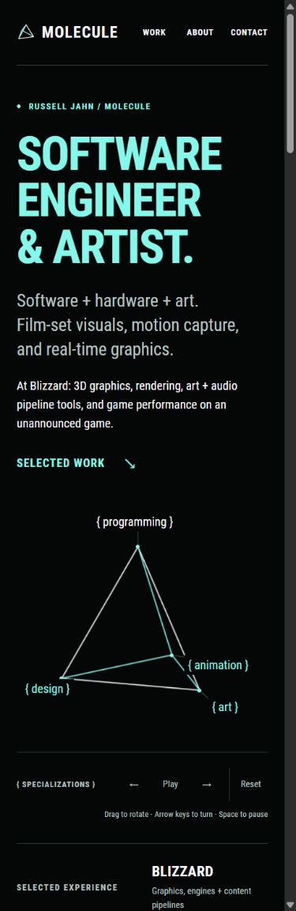
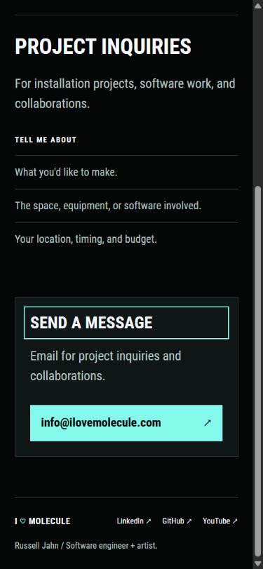

# Mobile readiness and page-load performance

Russell asked whether this iteration is fully mobile friendly, how to improve loading without losing media quality, and how to measure before and after with a reusable tool.

The site is responsive and passes the viewport checks below. That is not a guarantee across every mobile browser or physical device. A real iPhone Safari and Android Chrome pass remains part of the publishing check.

## Measured results

Measured with **Google Lighthouse 13.5.0**, Chrome **156.0.8078.48**, Node **24.19.0**, and the pinned Hugo **0.115.4** production build. The table uses medians of three cold-cache runs per page with Lighthouse's standard simulated mobile throttling. Its mobile viewport is 412 × 823 at device pixel ratio 1.75. The exact CPU and network settings are saved with every run.

LCP measures when the largest visible content appears. It is a better guide here than the load event, because off-screen media should load later as the visitor scrolls.

| Page | Performance score, before → after | LCP, before → after | Initial transfer, before → after |
| --- | --- | --- | --- |
| Home | 87 → 99 | 3.83s → 2.10s | 0.68 MB → 0.40 MB |
| Work | 84 → 97 | 4.28s → 2.63s | 0.79 MB → 0.48 MB |
| About | 75 → 98 | 51.53s → 2.41s | 182.57 MB → 0.54 MB |
| Film + television | 87 → 98 | 3.90s → 2.33s | 0.71 MB → 0.43 MB |

MB means 1,000,000 bytes. About's initial transfer fell **99.7%**. Its LCP fell **95.3%**. Home's LCP fell **45.0%**.

The desktop Home median improved from **0.72s to 0.47s LCP**, retaining a performance score of **100**. Desktop transfer fell from 0.74 MB to 0.42 MB.

One-run mobile smoke checks on the other principal pages scored 99 for Enflux, 98 for the Blizzard case study, 96 for Motion Capture + Lightsabers, and 100 for Contact. These single runs are not three-run comparisons. All eight audited mobile routes scored 100 for automated accessibility, best practices, and SEO. Those scores do not replace manual accessibility or device testing.

The main comparisons' final LCP ranges were 1.88–2.18s for Home, 2.40–2.63s for Work, 2.11–2.48s for About, and 2.25–2.40s for Film + television. Work remains slightly above the usual 2.5s LCP target in its median. Report ranges and medians instead of selecting the best run.

The baseline is a frozen production build of `bfc54e8`, captured before website edits. The baseline's dirty flag reflects newly added audit tooling. The final measurement uses the optimized production build, without Hugo's live-reload client. Both versions use the same local server, gzip for text, a 600-second cache header, Chrome version, and Lighthouse settings. Public hosting latency and its real caching/compression behavior are not measured by this local comparison. Repeat on the published URL after deployment repair.

## What changed

1. About's 54 images previously loaded eagerly, with no intrinsic dimensions. Its 51 gallery selections now use the shared image pipeline, with responsive WebP stills at quality 90, source-width limits, dimensions, asynchronous decoding, and lazy loading. The portrait stays eager and has high loading priority.
2. Large loops use a still preview until they are within 600px of the viewport. Then the browser receives the original GIF or animated WebP. Native lazy loading alone was still downloading roughly 39 MB of distant Quantico GIFs in an intermediate audit, so heavy animations need the tighter observer. Full animation files, frames, timing, and dimensions are unchanged. JavaScript-free viewing retains the still preview and a link to the original loop.
3. Home's carousel choices remain manual. Unselected full images stay inside inert templates. Selecting an animation loads the original loop immediately. No timed advancement or manually played replacement video was introduced.
4. Still-image variants now include 768px and 1152px. This gives high-density phones closer-fitting sources between the existing sizes while staying above the required display resolution. No variant exceeds its original's width. Framing and quality settings are unchanged.
5. Regular and Bold Roboto Condensed use losslessly compressed WOFF2, reducing their combined files from **339,200 to 129,472 bytes**, a **61.8%** reduction. Every glyph outline, character map entry, and horizontal advance matches the original TTF. Both faces are preloaded because both appear above the fold. Original fonts and licenses remain in place, with TTF fallback.
6. About's Packery layout now initializes through deferred JavaScript using reserved image dimensions. It no longer needs blocking jQuery or inline load handlers. The YouTube frame is lazy. Actual videos keep native controls, inline playback, and `preload="none"`, with a lazy-loading hint for supported browsers.
7. Contact remains present in the mobile header. The narrowest headers wrap to two rows. Header links and pyramid controls have touch areas at least 44 × 44px. The pyramid caption stays on one line and the controls can wrap below it. Its antialiasing and rendered text labels are unchanged.
8. Russell supplied **info@ilovemolecule.com**. Contact now links to `mailto:info@ilovemolecule.com`, with the address visible for copying. No inquiry was sent, and opening a mail client does not prove mailbox delivery.

## Fidelity and mobile checks

- Twelve core pages checked at widths 320, 360, 390, 430, 667, 768, and 1280. The 667px check uses a 375px landscape height. All **84 cases** have one main heading, visible Work/About/Contact navigation, no horizontal overflow, and no media extending outside the viewport.
- Main navigation targets meet 44 × 44px in every case. Pyramid controls meet that minimum. Work's Experimental filter shows the correct single project.
- Carousel click selection and Home/End keyboard selection still work, with a stable image frame. A manually selected bokken animation uses its original animated WebP immediately.
- About retains every original gallery selection, order, and project-copy passage. All 54 displayed image sizes matched the before version within one pixel at 1280px, 390px, and 320px. Its 390px document height is unchanged. Minor desktop rounding and the narrow header's extra height are intentional limits of pixel comparisons.
- Original GIF delivery files are checked byte-for-byte. The Quantico GIF and bokken WebP were observed loading when approached, with their full original source URLs active. The actual Patch video remains unloaded before playback.
- The source images and source-media copies are untouched. Typography, credits, captions, project order, and the pending brace-casing decision are preserved.
- Seventeen tracked tests pass. They protect source selections, original About copy, reviewed markup, deferred media, untouched GIF delivery, critical-image priority, font preloads, Contact's email destination, and existing collection/carousel behavior.
- Checked 1,018 responsive width descriptors against 390 decoded image files across twelve pages. Every descriptor matches its file and stays within the original's width. Final Lighthouse runs contain no original animation or MP4 requests before scrolling, no TTF fallback downloads, and no run warnings.
- Browser inspection uses the in-app Chromium browser and Lighthouse's Chrome emulation. Physical Safari/Android, touch gestures, orientation changes on hardware, and user font scaling still need a device smoke test.

The measurements and provenance are saved in [responsive audit](assets/responsive-audit-2026-10-25.json), [About layout comparison](assets/about-layout-comparison-2026-10-25.json), [font compression proof](assets/woff2-font-compression.json), and [animation preview sources](assets/animation-poster-sources.json).

## Run the same measurement again

[The audit runner](../../scripts/audit-performance.mjs) is pinned through [package.json](../../package.json) and its lockfile. For a fresh checkout, use Node 22.19 or later, Chrome, the repository's pinned Hugo executable, and `npm ci`. Dependencies are already installed in this workspace, so this command works from the repo root:

```powershell
node scripts/audit-performance.mjs --label release-01
```

The npm equivalent is:

```powershell
npm run performance -- --label release-01
```

This builds a separate production site, serves it on localhost port 4173, runs three audits each for Home, Work, About, and Film + television, and writes native HTML/JSON Lighthouse reports plus `runs.json` and `summary.json` to `.preview/performance/release-01/`. Chrome and this temporary server close at the end. The normal preview remains separate.

For a desktop comparison:

```powershell
node scripts/audit-performance.mjs --label desktop-01 --forms desktop --routes /
```

The runner also accepts `--routes`, `--runs`, `--port`, `--output`, and `--chrome`. `--site` selects a build folder. `--no-build` audits a frozen build without changing it. Keep a unique label so earlier reports remain available. Run measurements sequentially on an otherwise quiet machine.

The chosen summaries and per-run measurements are committed under [performance/2026-10-25](performance/2026-10-25/). Full raw reports from all runs remain in the ignored `.preview/performance/` directory.

Saved native Lighthouse reports are available in the concepts preview:

- [Home before](http://127.0.0.1:1314/lighthouse/2026-10-25/home-before.html) and [Home after](http://127.0.0.1:1314/lighthouse/2026-10-25/home-after.html)
- [About before](http://127.0.0.1:1314/lighthouse/2026-10-25/about-before.html) and [About after](http://127.0.0.1:1314/lighthouse/2026-10-25/about-after.html)

## Further work and publication

- Check the real iPhone/Android experience, including scrolling over the pyramid, carousel taps, native video controls, text scaling, and the email link. The local layout audit is complete, but these hardware checks remain open.
- The remaining legacy GIFs are still large when viewed. Evaluate lossless animated WebP derivatives one at a time, comparing every frame, timing, and looping behavior. Keep originals. Deferring a file avoids unnecessary initial downloads but does not make that file smaller when requested.
- Trim unused theme CSS only with visual regression checks across About and project pages. Lighthouse reports about 21 KiB of unused compressed CSS on some routes. Avoid removing prose/gallery styles just to improve a score.
- Verify the deployed host's text compression, caching, content types, HTTPS, and asset paths after the separately deferred deployment repair. Keep repeat visits efficient without substituting long local cache headers to improve the benchmark.
- Repeat Lighthouse on the published URL and use PageSpeed Insights for field data when traffic is sufficient. A static site's local server load event is not a real mobile-network result.

Official references: [Lighthouse CLI and reporting](https://github.com/GoogleChrome/lighthouse#using-the-node-cli), [performance score variability](https://developer.chrome.com/docs/lighthouse/performance/performance-scoring), [image lazy loading](https://web.dev/articles/browser-level-image-lazy-loading), and [video lazy loading and preload behavior](https://web.dev/articles/lazy-loading-video).




