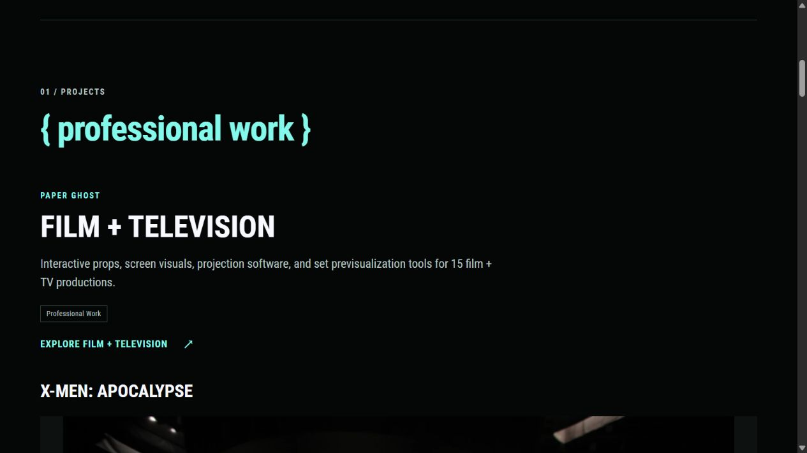
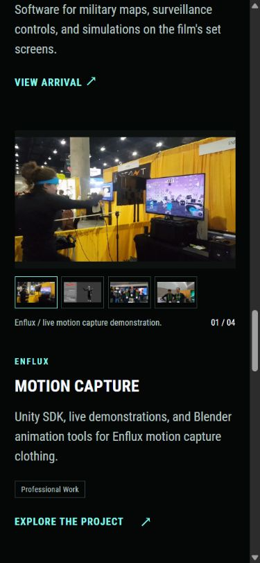
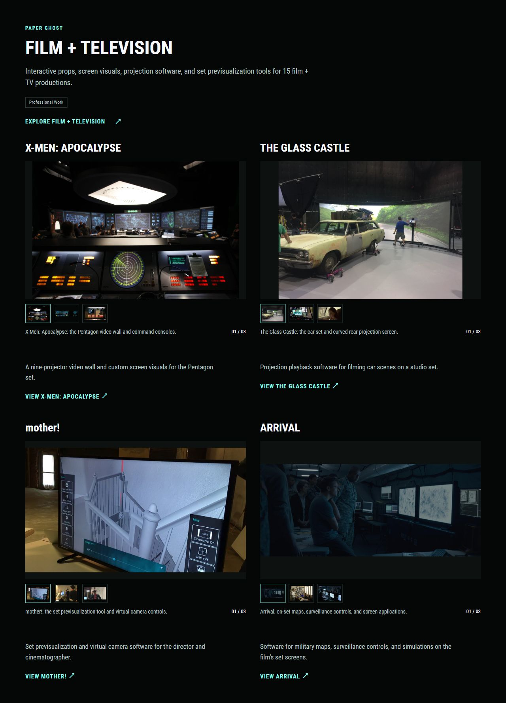

# Lowercase labels, selected media, and film layouts

Russell selected lowercase for all visible brace labels. Home, Work, Contact, the legacy Experiments redirect, and the pyramid caption now use lowercase. About, the pyramid vertices, and Mood board already used it. The shared `brace-label` class prevents uppercase heading and eyebrow styles from changing this choice.

Home's individual project headings are smaller. Standalone project titles reach 30px, and film titles reach 28px, while the Film + Television collection heading reaches 48px. The sizes have separate shared CSS variables, retain ghost white, and shrink on phones. Semantic heading levels remain h2 for the homepage section, h3 for the collection, and h4 for its films.

## Enflux selection

The Home carousel order is:

1. The live convention demonstration from `Enflux/enflux_convention2.gif`.
2. The Blender motion capture plugin, `Enflux/enflux_blender1.jpg`.
3. The convention demonstration photograph, `Enflux/enflux_convention1.jpeg`.
4. The booth photograph, `Enflux/enflux_convention4.jpg`.

The requested convention loop also supplies the Work card and Enflux case-study headliner. The original GIF remains in `content/about/Enflux/`. The delivery copy is an animated WebP under `assets/portfolio/enflux/`, with a separate still preview. Home and Work defer the loop until near the viewport. Explicit carousel selections load immediately. The case study loads its headliner directly.

The original GIF is 32,664,853 bytes. The quality-95 WebP is 24,531,550 bytes, about 25% smaller. Both retain 600 × 338px, the same ten-second timeline, and infinite looping. The encoder merges 31 repeated frames, leaving 299 displayed frames with exactly matching durations for every distinct source frame. Frames at 0, 3, and 6 seconds were visually compared. A lossless trial saved only 12%. The selected version uses lossy compression. A 56,266-byte still preview avoids downloading the animation while it is far below the viewport. [The delivery manifest](assets/enflux-loop-delivery.json) records hashes and encoding details.

The Blender screenshot now appears in the Blender subsection of the case study because it is no longer the lead image. The original About gallery selection, order, and appearance stay intact. Existing image alt text was made explicit in project metadata where changing the headliner would otherwise alter it indirectly.

## Hearthstone selection

Home, Work, and the Blizzard project use `portfolio/hearthstone/eonar-flourish.jpg`, a 1920 × 1080 still already extracted from the requested Eonar's Flourish clip. It replaces the previous Festival of Legends headliner. It uses responsive WebP delivery and retains its full composition.

Home no longer shows Russell's credits card. Blizzard has a single homepage image, so it has no carousel or thumbnail controls. The shared card templates only render a carousel for two or more selections.

The credits card remains early in the Hearthstone case-study section and in the original About gallery. Both the Eonar's Flourish and Norgannon's Progenitor's Power video embeds were removed. Their source files and provenance remain in the repository.

### Follow up: Sunken City

Find a strong, high-resolution gameplay still or short video from **Voyage to the Sunken City**. Prefer an official Blizzard source and record provenance in the existing [Hearthstone media manifest](assets/hearthstone-media-sources.json). This is a later media task, rather than a change to Russell's engineering credits.

## Film + Television layout comparison

Open the [interactive film layout comparison](http://127.0.0.1:1314/film-layouts.html).

- **A / Full width** keeps the four films in a vertical sequence.
- **B / Two-column grid** pairs X-Men with The Glass Castle, then mother! with Arrival.

Both versions use the same project order, copy, lead images, and manual thumbnail carousels generated from the built homepage. They preserve image composition and source-width limits. Both stack into one column at phone widths. The controls offer desktop, 390px, and 320px previews and show the rendered section height.

At a 1241px preview width, A is approximately 4654px tall and B is 1752px tall. The grid reduces this section's scrolling by about 62%. These measurements describe the prototype, including its collection introduction, and may change with viewport width or typography. The desktop grid is worth considering because it keeps all four films visible much sooner. Full width gives each image more room.

The grid is a review prototype. The homepage continues to use the full-width film sequence until Russell chooses a layout. The collection page and individual project pages keep their current arrangement.

Regenerate the two review pages after website changes:

```powershell
& .\.tools\hugo\0.115.4\hugo.exe --destination .preview/project-catalogue-check --cleanDestinationDir
python docs/portfolio/concepts/build-film-layouts.py
```

The comparison server serves `docs/portfolio/concepts` on port 1314. The prototype keeps local copies of its CSS, scripts, and font dependencies. Its project images reference the running portfolio preview on port 1313. The generator changes only the review files, outside Hugo's published content.

## Verification

- Pinned Hugo Extended 0.115.4 production build and all eighteen tracked tests pass.
- Twenty-four browser checks across Home, Work, About, Contact, Enflux, and Blizzard at 320, 390, 768, and 1280px show no horizontal or media overflow, with one main heading on each page.
- Enflux's four thumbnail choices and the looping lead image work on mobile. The prototype's carousel click and arrow-key controls work.
- All 341 responsive image variants used across those six production routes match their actual decoded widths. The source images and original GIFs remain unchanged.
- About's original main presentation, copy hash, and gallery selection match the prior version. Only the shared stylesheet fingerprint changes in its regression fixture.
- Both removed Hearthstone MP4s are absent from generated output. The repository originals remain available.
- The preview script was restarted after website changes and remains available on port 1313. The concept comparison is available on port 1314.






