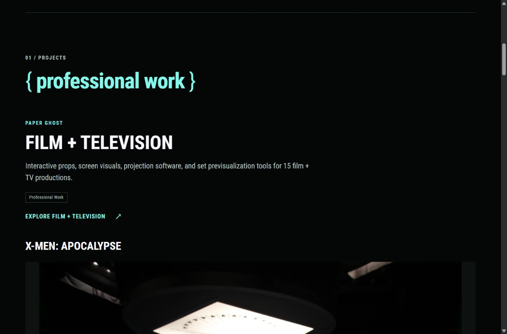

# Shared brace labels

Russell wants every opening and closing curly brace at normal weight, with the enclosed text keeping its existing weight. Labels remain lowercase.

The reusable `portfolio/braced-label.html` partial produces one `.brace-label` containing two `.brace-glyph` spans and the label text. Shared CSS gives only the glyph spans `font-weight: 400`. The label inherits its surrounding font size, weight, color, and line height. Bold headings remain bold, and regular pyramid labels remain regular. Braces stay real text in the document rather than images or JavaScript output.

## Use it in templates

Pass unbraced text:

```go-html-template
<h2 class="heading-accent">{{ partial "portfolio/braced-label.html" "professional work" }}</h2>
```

## Use it in Markdown

Existing braced headings are converted automatically through the shared heading render hook. Their anchors remain intact:

```markdown
## { now }
```

For an inline label, use the shortcode:

```go-html-template

```

Simple page titles and the legacy Blowfish list template also route braced titles through this component. The list override retains the theme's existing structure and changes only title rendering. It covers the retired Mood board page without changing its layout.

All sixteen occurrences use the component: nine on Home, one on Work, three on About, one on Contact, one on the legacy Experiments redirect, and one on Mood board. Pyramid label backgrounds apply only to the outer label, so the nested brace spans do not add padding or extra backgrounds.

The historical casing comparison remains a record of the earlier design review. It is not the source of live typography rules.

## Verification

The pinned Hugo build and all eighteen tracked tests pass. About's visible copy and original gallery selection remain unchanged. Its regression fixture records the intentional brace markup and shared CSS change.

Browser checks on Home, Work, About, Contact, and Mood board at desktop and 320px show normal-weight 400 brace glyphs, unchanged label weights, and no horizontal overflow. The legacy redirect's markup is checked in the build. The preview script was restarted after the changes.


