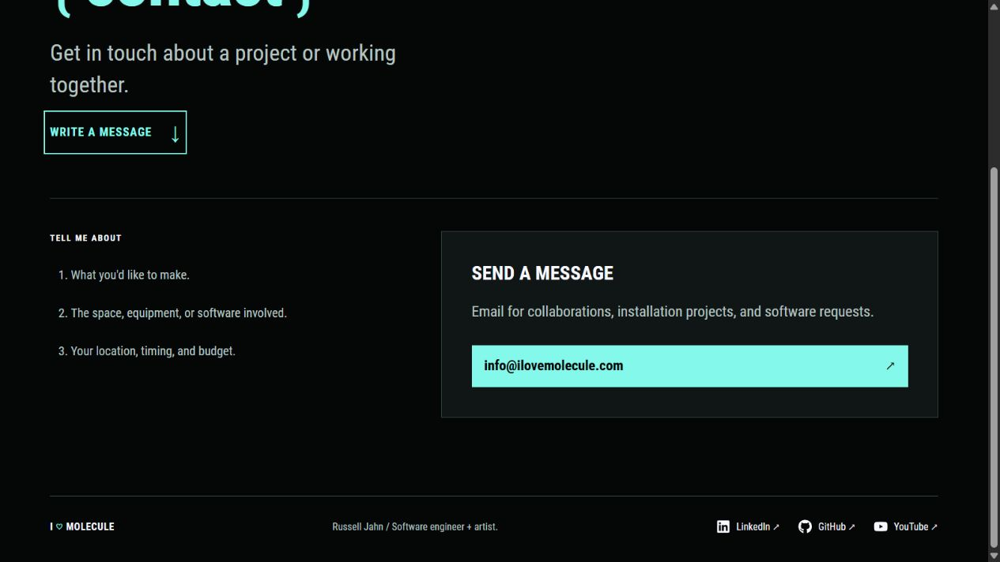

# Contact list and social icon options

Russell requires explicit approval before any further commits. This update remains uncommitted.

## Contact list

The three inquiry prompts now use a semantic ordered list:

1. What you'd like to make.
2. The space, equipment, or software involved.
3. Your location, timing, and budget.

The list has no dividers under Tell me about or between its items. Russell initially retained the line below the label, then requested its removal. These rules live in the Contact stylesheet, so other pages' styles are unchanged.

## Contact arrow explanation

The header's Contact link includes a decorative up-right arrow. It currently navigates to the site's internal Contact page. The arrow does not open a new tab or add another behavior.

Up-right or launch icons commonly indicate an external destination, while a right arrow can indicate internal navigation. [Carbon's link guidelines](https://www.carbondesignsystem.com/building-blocks/core/components/link/guidelines) describe that convention and emphasize consistency.

Russell asked for an explanation rather than a change. The arrow is retained. The downward arrow on Write a message is different: it points to a section further down the current page. The email button opens the configured mail destination.

## Social icon suggestions

Use one small SVG before each visible service name. Keep LinkedIn, GitHub, and YouTube as text so the links stay clear. Icons can inherit the link color with `currentColor`, start at about 18px, and use an 8px gap. With text already identifying each link, treat the icon itself as decorative for accessibility.

### A. Existing filled brand SVGs

The repository already includes these files under `themes/blowfish/assets/icons/`:

| File | Bytes |
| --- | ---: |
| linkedin.svg | 526 |
| github.svg | 1406 |
| youtube.svg | 572 |
| Total | 2504 |

These are recognizable filled marks and already use `currentColor`. They could be embedded through one shared icon partial, without adding a library, font file, or external icon service. This is the recommended starting point.

### B. Tabler outline brand SVGs

[Tabler Icons](https://tabler.io/icons) offers an outline style with adjustable stroke and a consistent 24px grid. Its LinkedIn, GitHub, and YouTube marks provide a lighter alternative that fits the site's line drawing style. Include just the chosen SVG files rather than the whole set.

Relevant previews: [LinkedIn](https://tabler.io/icons?icon=brand-linkedin), [GitHub](https://tabler.io/icons?icon=brand-github), and [YouTube](https://tabler.io/icons?icon=brand-youtube).

An icon font is possible, but inline SVG is a simpler fit for these three icons and their color styling. Russell selected the existing SVGs for this iteration.

## Applied Contact and icon revision

The email description now reads: “Email for collaborations, installation projects, and software requests.”

The Project inquiries heading and its accompanying paragraph are removed from Contact. Tell me about and the numbered prompts remain, without a divider below the label.

The three existing filled SVGs now precede LinkedIn, GitHub, and YouTube in the shared footer. The homepage's additional LinkedIn link uses the same icon. The shared `portfolio/social-icon.html` partial embeds the assets directly, without another download, icon font, or script.

Icons use an 18px box. Russell subsequently selected optimized colored versions, documented in [Optimized colored social icons](46-optimized-color-social-icons.md). They are hidden from assistive technology and cannot receive separate keyboard focus. Visible service names still identify each link. Footer links can wrap on narrow screens.

## Verification

The pinned Hugo build and all eighteen existing tests pass. About's content and markup hashes are unchanged. Its stylesheet fingerprint was updated to match the shared icon CSS.

Browser checks at desktop and phone widths show the requested Contact copy, decimal list markers, no borders above the list or on its items, decorative SVGs beside the social names, and no horizontal overflow. The earlier icon revision was checked at 1280px, 390px, and 320px. The homepage LinkedIn icon was checked at 390px. The social color concepts were regenerated with the divider removed. The preview script was restarted and left running at `http://127.0.0.1:1313/`. No commits or PR updates were made.

