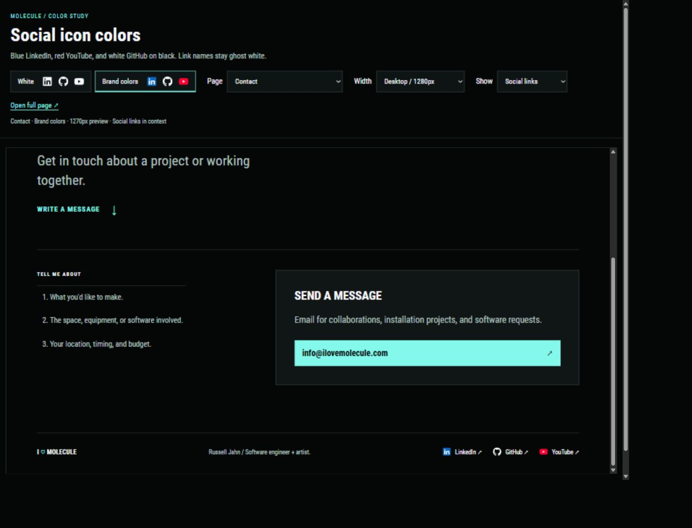
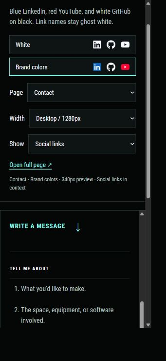

# Social icon color concepts

Russell requested colored versions of the existing social SVGs on each page, then selected the colored treatment. The main preview now uses optimized colored SVGs. See [Optimized colored social icons](46-optimized-color-social-icons.md) for the implementation and size measurements. The comparison remains available, and all pending work remains uncommitted.

Open [Social icon colors](http://127.0.0.1:1314/social-icon-colors.html). Use Page to choose a page, White or Brand colors to compare treatments, and Width to compare desktop and phone layouts. Social links jumps to the footer in context. Page from top shows the complete page. Open full page opens the selected treatment separately.

## Selected treatment

Only the icons receive the service color. Link names remain ghost white, with the existing mint hover and focus treatment.

| Service | Icon color | Interior |
| --- | --- | --- |
| LinkedIn | Blue, `#0a66c2` | White lettering |
| GitHub | White, `#ffffff` | Existing silhouette |
| YouTube | Red, `#ff0033` | White play triangle |

The original concept used the existing SVG paths with white shapes behind LinkedIn's lettering and YouTube's play triangle. The applied version optimizes those shapes while keeping the 18px icon boxes. White comparison pages hide the white interiors and restore monochrome paths. Visible names remain available to assistive technology, and the decorative SVGs do not receive keyboard focus.

GitHub stays white on the dark background. Its [logo guidance](https://brand.github.com/foundations/logo) supports white as a standard treatment and recommends high contrast. Other references are [LinkedIn's icon guidance](https://brand.linkedin.com/in-logo) and [YouTube's brand resources](https://brand.youtube/). LinkedIn's own inline brand SVGs use `#0a66c2`. The red value above is the proposed color for this study.

## Coverage

There are 24 generated snapshots, one white and one colored treatment for each of these 12 pages:

1. Home, including its additional LinkedIn link.
2. Work.
3. About.
4. Contact.
5. Film + television.
6. X-Men: Apocalypse.
7. The Glass Castle.
8. mother!.
9. Arrival.
10. Motion capture / Enflux.
11. Graphics + Content Pipeline + Performance.
12. Motion Capture + Lightsabers.

Internal navigation between these pages stays inside the selected concept treatment. The page selector follows that navigation. Metadata-only project records do not gain public pages.

## Files and regeneration

The review controls are in `concepts/social-icon-colors.html`, `concepts/social-icon-colors.css`, and `concepts/social-icon-colors.js`. The generator is `concepts/build-social-icon-colors.py`. Generated snapshots and shared dependencies live in `concepts/social-icon-colors/`, outside Hugo's content and static mounts.

From the repository root:

```powershell
.\.tools\hugo\0.115.4\hugo.exe --destination .preview/project-catalogue-check --cleanDestinationDir
python docs/portfolio/concepts/build-social-icon-colors.py
```

The existing concept server on port 1314 serves `docs/portfolio/concepts/`. Snapshots share local CSS, fonts, and scripts. Images continue to use the Hugo preview on port 1313, so both servers should stay running.

## Verification

The Hugo build and all eighteen existing tests pass. All 24 snapshots have the three decorative footer icons, the two intended white interiors, and resolved CSS and script dependencies. Browser checks covered both treatment buttons, all 12 page choices, the full-page switch, and the 390px and 320px width controls. Home's additional LinkedIn icon and Contact's colored footer were checked visually. The narrow comparison controls fit without horizontal overflow.

The preview script was restarted and left running. No production template or stylesheet was changed for this concept batch. No commits, pushes, or PR updates were made.




