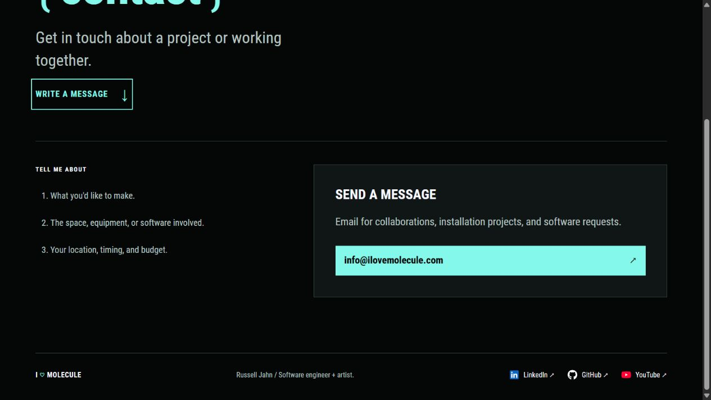
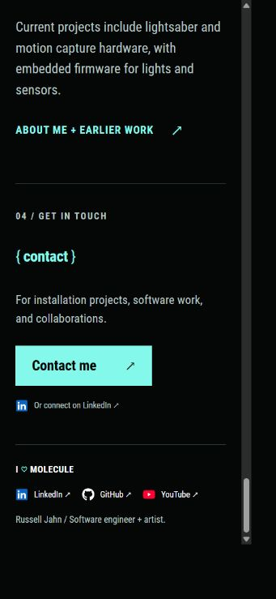

# Optimized colored social icons

Russell selected the colored SVG treatment because the services are easier to recognize. It now appears in the shared footer on every page and on Home's additional LinkedIn link. The visible service names remain ghost white. Pending changes remain uncommitted until Russell explicitly approves a commit.

LinkedIn uses blue with white lettering. YouTube uses red with a white play triangle. GitHub stays white against black. These colors stay attached to the icons while the surrounding link text retains its existing hover and focus behavior.

## File sizes

| Icon | Original white SVG | Optimized colored SVG |
| --- | ---: | ---: |
| LinkedIn | 526 bytes | 471 bytes |
| GitHub | 1406 bytes | 1153 bytes |
| YouTube | 572 bytes | 329 bytes |
| Total | 2504 bytes | 1953 bytes |

The colored set is 551 bytes smaller than the original white files, a 22% reduction, even with the added white interiors. Concatenating the three optimized files and compressing them with gzip at level 9 produces 916 bytes. Actual delivery is part of the surrounding HTML and its hosting compression.

The shared partial embeds the SVGs directly. There are no icon image requests, icon fonts, external services, or added browser scripts. It also omits the redundant XML namespace from the inline copies while retaining it in the valid standalone source files. Icon boxes stay at 18px. The SVGs are decorative and cannot receive keyboard focus separately from their links.

## Optimization and sources

The original files are retained unchanged in `themes/blowfish/assets/icons/`. The optimized, colored copies live in `assets/icons/social/`. `portfolio/social-icon.html` reads those copies for all link occurrences.

`scripts/optimize-social-icons.mjs` prepares the selected colors, normalizes the shapes into a 24 by 24 coordinate system, and uses [SVGO](https://svgo.dev/docs/introduction/) to shorten the markup and path data. Its [path optimizer](https://svgo.dev/docs/plugins/convertPathData/) can trim redundant commands and coordinate precision. No raster images are embedded.

The script tries zero through three decimal places, then chooses the smallest candidate that stays within a mean RGB channel difference of 0.5 on a 0–255 scale. It renders the original colored shapes and each candidate at 18px, 36px, and 54px to cover the displayed size at 1×, 2×, and 3× pixel density. LinkedIn and GitHub use two decimal places. YouTube uses one. More aggressive candidates failed that tolerance and were rejected.

The full candidate measurements are in [social-icon-optimization.json](assets/social-icon-optimization.json). This comparison checks vector rasterization on the site's dark background. Browser checks separately confirm the actual link layout, colors, and accessibility markup.

## Regeneration

The pinned tools live under the ignored `.tools/social-icons/` directory. They are used only during preparation and are not site dependencies. From the repository root, using the existing local npm bootstrap:

```powershell
node .tools/npm-bootstrap/package/bin/npm-cli.js install --prefix .tools/social-icons --cache .tools/npm-cache --ignore-scripts --no-audit --no-fund svgo@4.0.0 @resvg/resvg-js@2.6.2
node scripts/optimize-social-icons.mjs
```

The optimizer writes the three assets and the measurement report. The social color comparison generator now handles the optimized colored shapes, so White still shows the earlier monochrome treatment. Both comparisons were regenerated for reference.

## Verification

The pinned Hugo build and all eighteen existing tests pass. An additional build check confirms the colored, decorative SVGs on all twelve public portfolio pages, excluding redirect aliases. About's main content, copy, and stylesheet fingerprint remain unchanged by this update.

The live Contact page was checked at desktop width. Home was checked in a narrow phone viewport, including its extra LinkedIn icon. All icons retain their 18px boxes, their expected fills, and their visible link names. No horizontal overflow appeared. The Contact prompts still have no dividers.

The preview script was restarted and left running at `http://127.0.0.1:1313/`. No commits, pushes, or PR updates were made.




