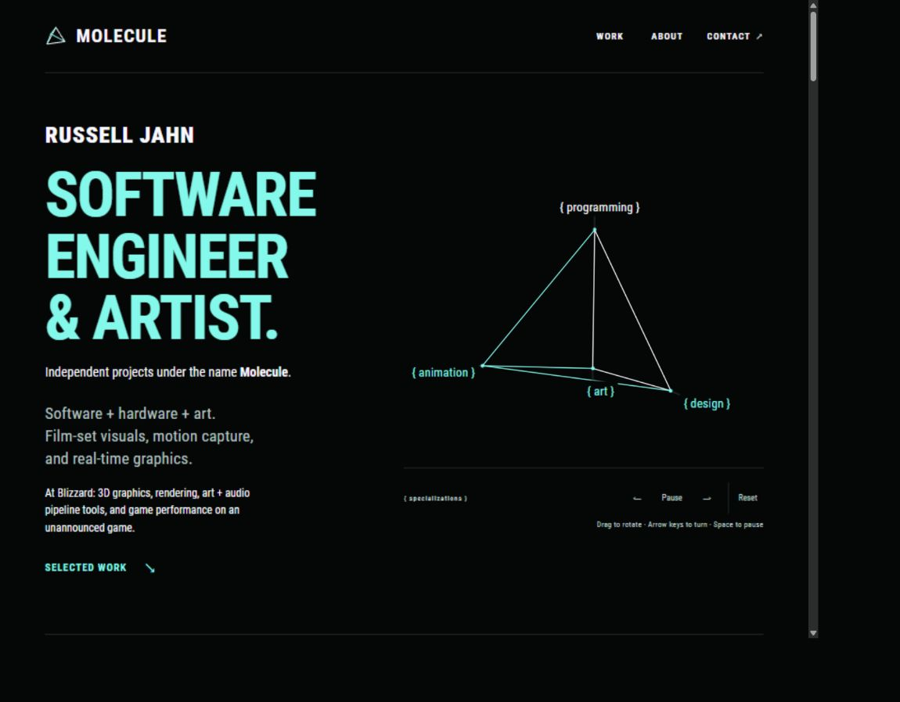
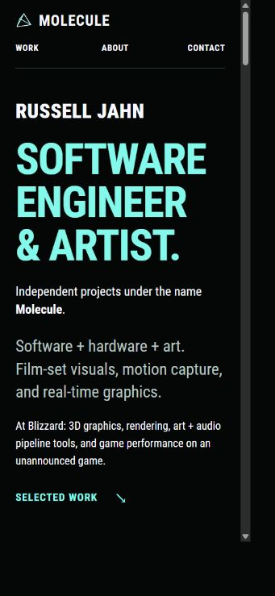
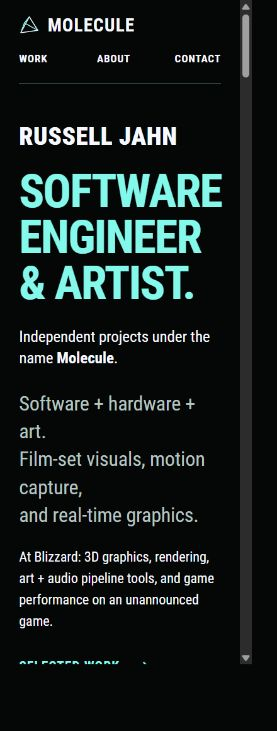

# Home navigation and identity pitches

Russell asked whether Home should appear in navigation and requested clearer ways to distinguish Russell Jahn, the person, from Molecule, the brand. He selected Pitch A and the line “Independent projects under the name Molecule.” That identity revision is applied. The Home navigation proposal remains open, and pending work remains uncommitted.

## Navigation recommendation

Keep the Molecule logo as a link to `/` and add Home as the first main navigation item:

```text
MOLECULE                         HOME   WORK   ABOUT   CONTACT
```

Home points to the existing homepage. It does not require another page or another content section.

The logo remains at the upper left and keeps its accessible name, Molecule — home. Home receives the active mint treatment only on the homepage. Work remains active on its collection and project pages. Keep every navigation link visible on phones with 44px touch targets, allowing the existing two-row header where needed.

This recommendation fits a portfolio intended for engineering recruiters, producers, artists, and installation clients. The audience may include people who use either route home. That audience assessment is a design judgment, not a measured demographic result for this site.

## Research and limits

Sources were reviewed on 2026-10-26. They establish useful behavior patterns, without providing a current population-wide preference percentage.

| Source | Evidence | Use here |
| --- | --- | --- |
| [Nielsen Norman Group, Homepage Design: 5 Fundamental Principles, March 2024](https://www.nngroup.com/articles/homepage-design-principles/) | Recommends both a logo link and an explicit Home link. Also recommends a prominent identity and a concise explanation of what the site offers. This is published guidance, rather than a percentage estimate. | Keep both paths home and explain the person/brand relationship directly. |
| [Epix Media, home-button research, data from Q1 2021](https://www.epixmedia.co.uk/articles/website-home-button/) | Three sites recorded 1444 home-navigation actions: 838 logo clicks and 606 menu/breadcrumb clicks, or 58% and 42%. Mobile split 53% and 47%. | Both routes received substantial use. These are event shares, not percentages of people who know the convention. The three sites had different layouts and were not a randomized portfolio experiment. |
| [Nielsen Norman Group, Centered Logos Hurt Website Navigation, July 2016](https://www.nngroup.com/articles/centered-logos/) | Fifty participants used fourteen fashion retail sites. Failure to reach Home in one click was six times as likely with centered logos as with left-aligned logos. | Preserve the familiar logo placement. This study compares placement, not the benefit of adding a Home text link. |

The Epix article's introductory claim about 95% awareness comes from one layout's click share. It does not establish that 95% of all users know the logo convention. Do not repeat that headline as a general knowledge statistic.

An additional [four-site sequential field experiment from The Admin Bar, February 2023](https://theadminbar.com/should-you-include-a-home-link-in-your-website-navigation/) also reports use of both routes. Its week-before/week-after setup and audience differences prevent treating its averages as a causal estimate or universal preference.

The expected patterns for this portfolio are hypotheses: a visitor may arrive directly at a case study and use Home to get an overview, use Work to browse all projects, or use the logo to start over. The header should support those choices without requiring visitors to know an implicit convention.

## Current identity problem

Before this revision, the homepage rendered a 5px mint dot and Russell Jahn / Molecule in a 13px uppercase eyebrow. The much larger professional headline dominated it.

The dot can read as an availability or online indicator. The slash gives both names equal status without explaining their relationship. Small type makes the personal name easy to miss. These are observations about the current design, not measured test findings.

For every proposed version:

- Remove the dot and slash.
- Give Russell Jahn a distinct, readable line.
- State how Molecule relates to Russell in ordinary language.
- Keep Roboto Condensed and the existing black, mint, and ghost-white palette.
- Keep the Blizzard role visible and retain the selected project work.
- Keep the WebGL pyramid and its rendered text labels.
- Avoid invented studio scale, new job titles, availability claims, and abstract promotional language.

## Pitch A: Keep the professional headline

Russell selected this direction for the first revision, then chose the first Molecule line alternative. The approved professional headline remains, with his personal name as a strong introduction above it.

```text
RUSSELL JAHN

SOFTWARE
ENGINEER
& ARTIST.

Independent projects under the name Molecule.
```

Russell Jahn uses ghost white, Roboto Condensed Black 900, at 28–36px according to screen width. The existing professional headline stays large and mint. The brand sentence uses readable body type, with Molecule emphasized through weight.

The existing description of software, hardware, film-set visuals, motion capture, and real-time graphics follows. Avoid repeating the same description in the new brand sentence. Check the added height on phones so the pyramid and work remain easy to reach.

This approach makes the name legible while keeping the work and profession prominent. It makes the smallest change to the current visual hierarchy.

Alternative wording for the relationship, if a full sentence is preferred:

> Molecule is the name for Russell Jahn's independent projects.

### Molecule line alternatives

Russell requested alternatives to Independent work as Molecule after selecting Pitch A. The phrase as Molecule can sound like an alias. These options state the brand relationship more directly:

| Wording | Emphasis |
| --- | --- |
| Independent projects under the name **Molecule**. | Selected and applied for this iteration, with the personal name already visible above. |
| **Molecule** is the independent work of Russell Jahn. | A complete explanation of the person and brand relationship. |
| **Molecule** — software, hardware, and art by Russell Jahn. | Describes the work as well as its author. Avoid repeating those disciplines immediately afterward if this version is selected. |

Russell selected the first wording. The other two remain alternatives for reference.

## Pitch B: Lead with the name

```text
RUSSELL
JAHN

Software engineer + artist.
Independent work as Molecule.
```

The name becomes the large mint identity headline. The professional role follows in a smaller, bold ghost-white line. Molecule remains the header wordmark and is explained below the role.

This puts personal recognition first, which may suit hiring and speaking opportunities. It changes the current role-led hierarchy and gives the introduction a more personal emphasis.

## Pitch C: Lead with Molecule

```text
MOLECULE

Software, hardware, and art
by Russell Jahn.
```

Molecule becomes the large mint headline. Russell Jahn appears in bold ghost white within the explanatory sentence. The current Blizzard line stays below to connect the branded work to Russell's engineering career.

This gives the independent brand the strongest presence and states who makes the work. It may suit installation commissions, though it places the personal name below the brand. Do not call Molecule a studio or imply a team unless Russell chooses that positioning.

## Decision status

Russell selected Pitch A, keeping the professional headline and making his name more prominent. The applied sentence is “Independent projects under the name Molecule.” with Molecule bold. The status dot and slash-separated identity are removed. The explicit Home link remains a recommendation, with no navigation change selected.

## Applied revision checks

Russell's subsequent [homepage refinement](48-home-intro-and-selected-experience.md) makes MOLECULE uppercase and mint, separates the introduction lines, and moves Blizzard's role text into the Selected Experience strip.

The shared heading variables now include the name size. The name retains its larger type on phones, replacing an old mobile override that reduced it to 11px. A very narrow browser check also exposed the existing professional headline's 62px minimum overflowing its column. Below 340px, the display size now scales from 52px to 62px through the shared variable.

Browser checks at measured CSS viewport widths of 1164px, 355px, and 291px confirm the selected text and bold Molecule name, a ghost-white personal name at weight 900, the mint professional headline, and no horizontal overflow. The WebGL pyramid continues to render. The desktop screenshot and wider phone screenshot precede the narrow-only correction, which does not change their layouts.

The pinned Hugo build and all eighteen existing tests pass. About's main presentation and copy hashes are unchanged. Its stylesheet fingerprint was updated to match the shared CSS edit. The preview script was restarted after each website batch and left running at `http://127.0.0.1:1313/`. No commits, pushes, or PR updates were made.






