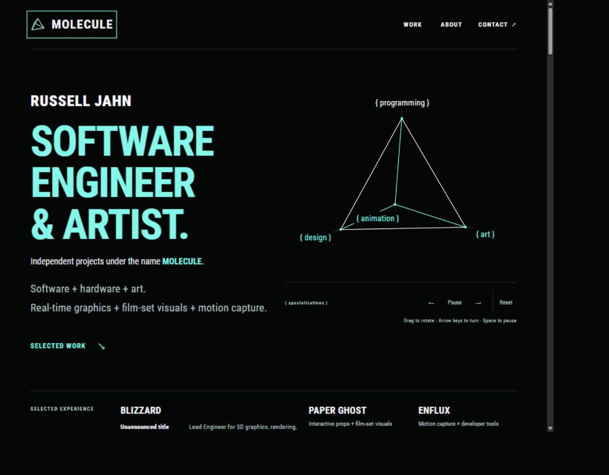
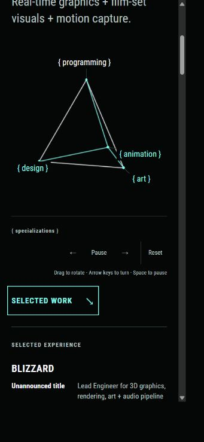
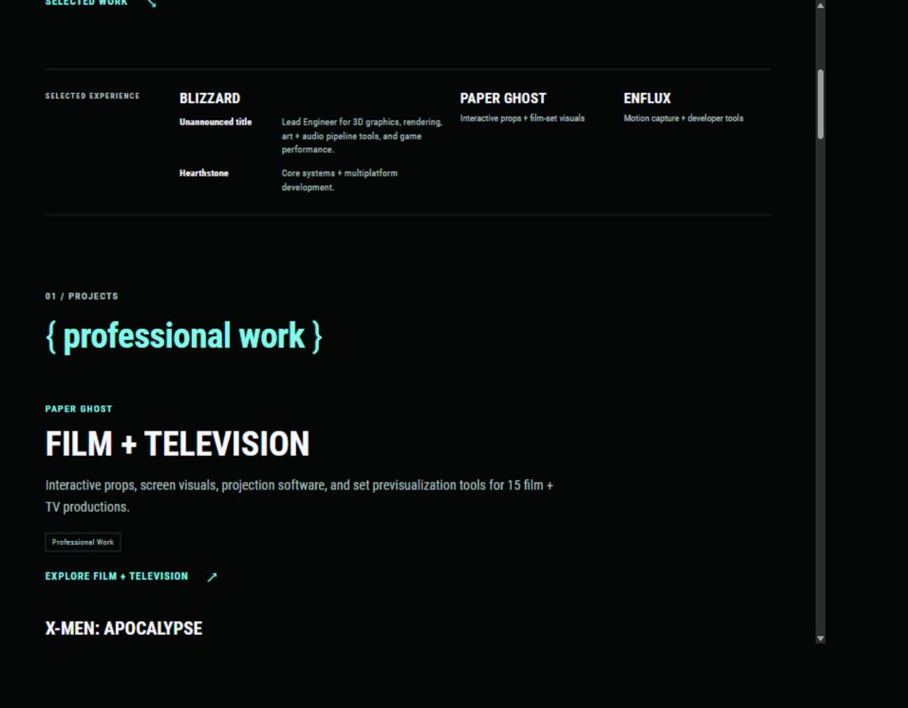
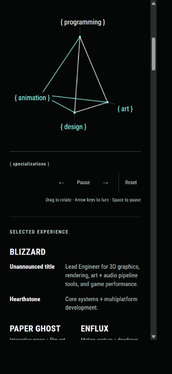

# Home introduction and selected experience

Russell requested an uppercase, mint MOLECULE accent, separate lines for the types of work, and the Blizzard introduction moved into Selected Experience. These changes are applied and remain uncommitted.

## Hero

The name and professional headline keep the hierarchy selected in [Home navigation and identity pitches](47-home-navigation-and-identity-pitches.md).

The brand line now reads:

> Independent projects under the name **MOLECULE**.

MOLECULE is bold and mint. The surrounding sentence remains ghost white. This follows the requested emphasis on the brand name.

Russell subsequently requested the three specialties joined with plus signs, matching the first line. The introduction now reads:

```text
Software + hardware + art.
Real-time graphics + film-set visuals + motion capture.
```

Each phrase is one paragraph, with no forced breaks between the specialties. The text column is slightly wider so the joined specialties fit on one line at desktop width in the same type style as the line above. The text wraps naturally on narrow screens.

The separate At Blizzard paragraph is removed from the hero.

## Selected work link order

Russell identified the Selected work link appearing above the pyramid on mobile, then clarified that its position was wrong on all platforms. The link now follows the complete introduction and visualization, before Selected Experience.

The link is a single element after the pyramid in the document. It spans both desktop grid columns and keeps the same position in the single-column phone layout. Visual, reading, and keyboard order therefore follow the introduction, pyramid controls, then Selected work, with no duplicate links or JavaScript rearrangement.

## Selected Experience

The Blizzard entry contains two rows in this order:

| Project | Summary |
| --- | --- |
| Unannounced title | Lead Engineer for 3D graphics, rendering, art + audio pipeline tools, and game performance. |
| Hearthstone | Core systems + multiplatform development. |

The summaries live beside their corresponding sections in the Blizzard project record, under `projectSections.unannounced.experienceSummary` and `projectSections.hearthstone.experienceSummary`. The homepage reads that metadata rather than keeping another copy of the responsibility text in its layout.

Home and Work project-card summaries retain their existing Hearthstone-first order. The detailed case study retains Unannounced title followed by Hearthstone. Art/audio tools, graphics, rendering, and the current performance initiative remain associated with the current game.

Paper Ghost and Enflux remain in the strip. The Blizzard column has more room on desktop. On phones, it spans the full strip width, with Paper Ghost and Enflux below. Each Blizzard row keeps its label alongside its description. The labels stay on one line, and narrow company headings use a smaller size to fit.

## Proposed consistency rule for Selected Experience

Russell identified a mismatch between Blizzard and the other employers. The current Blizzard descriptions are 14px, while Paper Ghost and Enflux use 13px, dropping to 12px at the intermediate breakpoint. Blizzard uses a separate label-and-description grid and full stops, while the other employers use stacked capability fragments joined with plus signs.

Initial recommendation, subsequently applied with mint job titles as recorded in [Selected Experience role concept](49-selected-experience-role-concept.md):

- Give every employer the same stacked structure and left alignment. Blizzard has two named project groups within its entry, in the existing Unannounced title then Hearthstone order.
- Company names are uppercase, bold Roboto Condensed, and ghost white, with one shared responsive type rule.
- Optional project names are smaller, bold, ghost white, and sentence case. They sit above their respective descriptions.
- All capability summaries use the same normal weight, muted color, size, line height, and spacing.
- Join parallel capabilities with spaced plus signs. Use no final period on these short fragments. Keep normal sentence punctuation in longer prose elsewhere.
- Separate employers and project groups with space. Keep the strip's outer rules, without adding bullets, colons, slashes, or dividers between every item. Mint remains reserved for the established primary headings and accents.

Suggested compact copy:

```text
BLIZZARD
Unannounced title
Lead Engineer for graphics + content pipeline tools + performance

Hearthstone
Core systems + multiplatform development

PAPER GHOST
Interactive props + film-set visuals

ENFLUX
Motion capture + developer tools
```

The shorter current-game summary follows the previously requested public role wording. Specific 3D graphics, rendering, art and audio tools, and performance work remain described in the case study. The initial recommendation was demonstrated separately before Russell selected its application to the live homepage.

## Role titles in Selected Experience

Russell subsequently proposed Senior Engineer for core systems for Hearthstone and similar role information for the other employers. He directly confirmed that his formal title at Enflux was **VP, Product**.

The revised recommendation keeps the role title on its own line, followed by a separate capability line. This accommodates the confirmed Enflux title while preserving the short plus-separated descriptions. A formal title and a description of the work remain distinct data fields. Russell subsequently selected this structure and requested mint job titles with the same size as descriptions.

| Employer / project | Role | Capabilities |
| --- | --- | --- |
| Blizzard / Unannounced title | Lead Engineer | Graphics + content pipeline tools + performance |
| Blizzard / Hearthstone | Senior Engineer, proposed by Russell | Core systems + multiplatform development |
| Paper Ghost | Software engineer + artist, descriptive wording pending the formal title | Interactive props + film-set visuals |
| Enflux | VP, Product, confirmed by Russell | Motion capture + developer tools + live demos |

The comma in VP, Product is part of the job title. Plus signs join capabilities, not every kind of phrase. Preserve the separate Blizzard project groups and do not rename Enflux's role to an engineering title for visual symmetry. The current project records establish Paper Ghost's software, art, animation, and team supervision work but do not record a formal job title.

Russell requested a visual example. The [Selected Experience role concept](49-selected-experience-role-concept.md) records the comparison, then the applied live section with mint job titles and shared 14px text. No commit was made.

## Verification

The Hugo build and all eighteen existing tests pass. A build check confirms the exact hero text, removal of its Blizzard paragraph, uppercase MOLECULE, and the requested Blizzard row order. About's main content and copy hashes remain unchanged. Its stylesheet fingerprint was updated for the shared CSS edits.

Desktop and phone browser checks confirm the mint brand name, readable role rows, and no horizontal overflow. The narrowest role-row check uses a measured 291px CSS viewport. The subsequent plus-sign copy revision was checked at 1164px and 355px. At desktop width, each intro paragraph fits on a single line with identical type size and line height. On the phone, the joined phrase wraps naturally, with no forced breaks or horizontal overflow. The preview script was restarted after each website batch and left running at `http://127.0.0.1:1313/`. No commits, pushes, or PR updates were made.

The Selected work order correction was checked at 1164px, 355px, and 291px. Its top edge follows the bottom of the complete pyramid section, including controls and instructions, at all three widths. Selected Experience follows the link. Only one link is rendered. Tabbing from the pyramid's Reset button moves focus to Selected work on desktop and mobile. The Hugo build and all eighteen existing tests pass after the correction.








