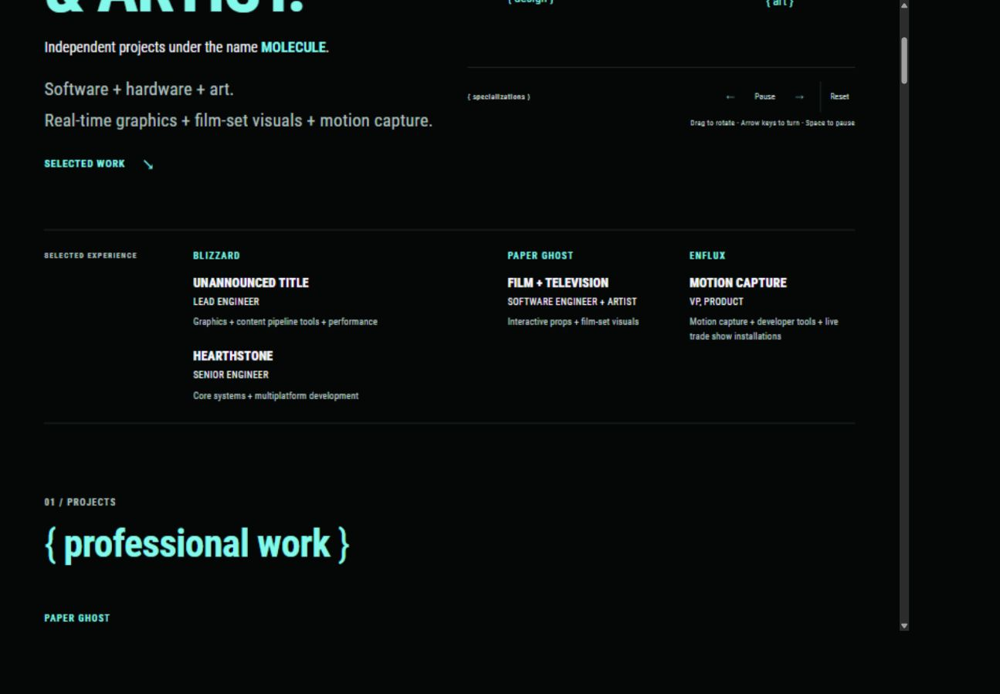
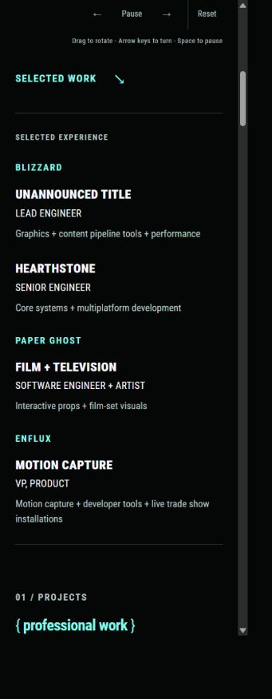
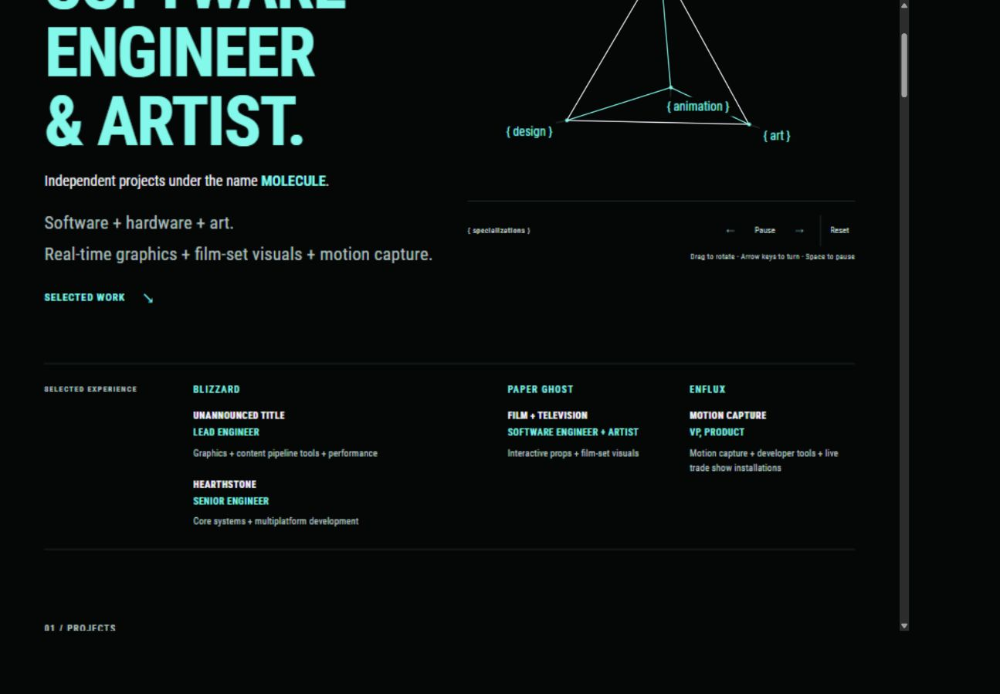
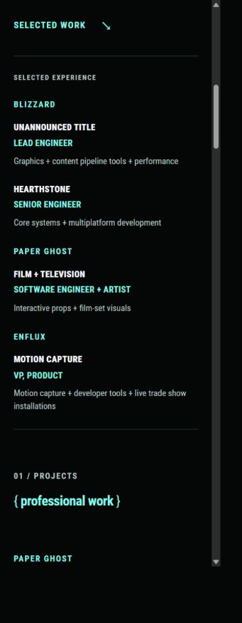
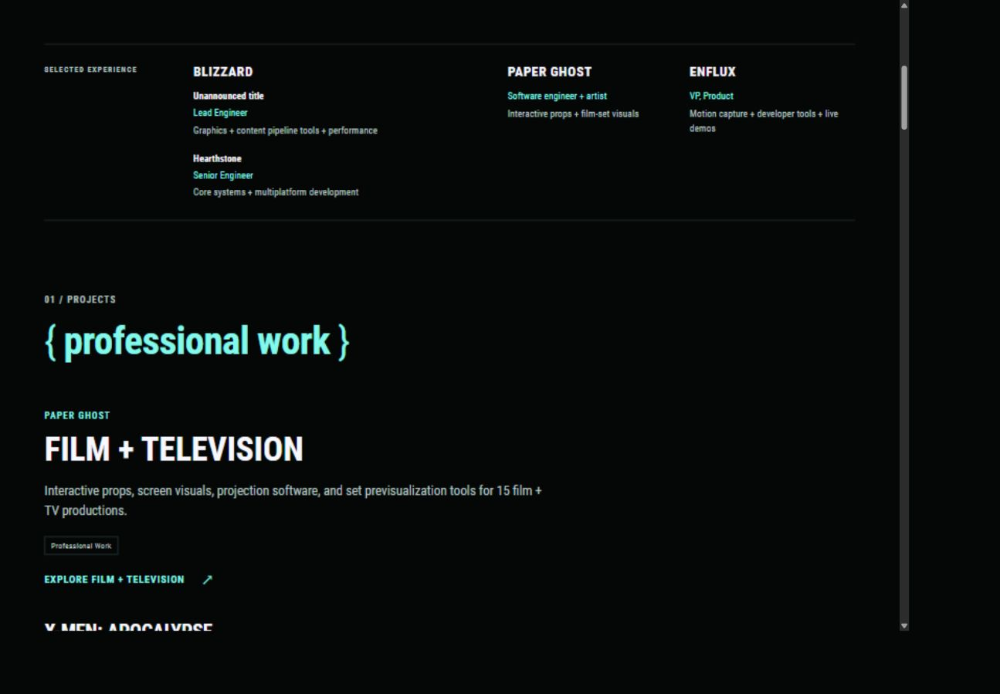
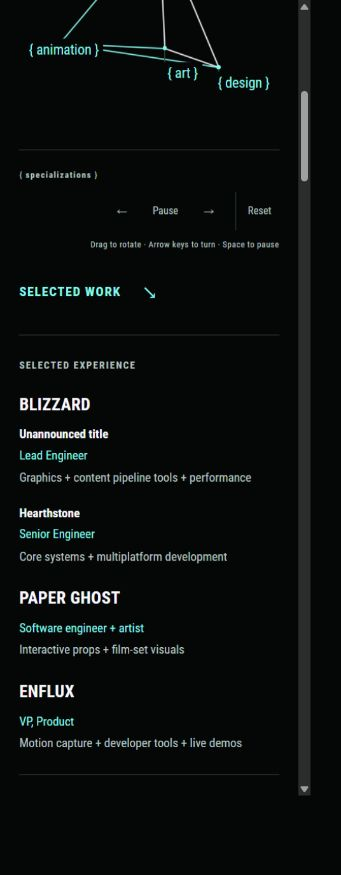
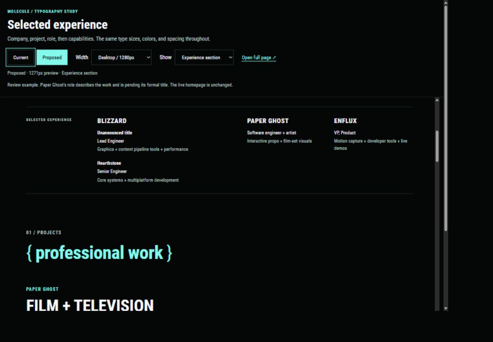
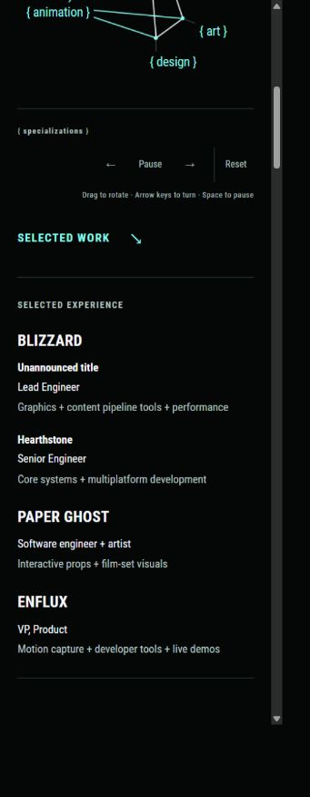

# Selected Experience role concept

Russell requested a visual example of the role and capability hierarchy discussed in [Home introduction and selected experience](48-home-intro-and-selected-experience.md). He selected mint job titles and consistent text sizes, then requested clearer weight, consistent capitalization, and the mint-company, white-title pattern used by the project cards. The current treatment below is applied to the live homepage and remains uncommitted. The earlier comparison stays available separately.

Open [the comparison](http://127.0.0.1:1314/selected-experience.html). It offers Current and Proposed, desktop and phone widths, and either the experience section or the homepage from the top. Both treatments use snapshots of the same current homepage, with its existing fonts, colors, outer rules, and surrounding projects.

## Current hierarchy, revised October 27, 2026

Russell found that mint positions competed with company names and that the topic, position, and description still had too little hierarchy. This revision replaces the earlier mint-position rule.

| Level | Color | Typography | Casing |
| --- | --- | --- | --- |
| Company | Mint | Shared 13px Bold 700 eyebrow with spaced lettering | Uppercase |
| Project topic | Ghost white | 18px Black 900, 1.25 line height | Uppercase |
| Position | Ghost white | 14px Regular 400, 1.5 line height | Uppercase |
| Description | Muted | 14px Regular 400, 1.5 line height | Sentence case |

Within Selected Experience, mint identifies only the employer. Size and weight establish the topic as the main heading. Positions stay readable in white but use the regular face, while the description uses the shared muted color. The same convention applies to all four entries. Casing remains controlled by shared CSS. It does not depend on each record's incidental capitalization.

The topic size uses the shared `--heading-experience-topic-size` variable. Supporting text retains one 14px size on every screen. Topics have 6px below them, descriptions keep 8px above them, and Blizzard's two project groups have 28px between them. Employer groups retain the existing desktop columns and phone stacking. Content, project order, punctuation, and the metadata renderer are unchanged.

The Hugo build and all nineteen Python checks pass. About's main markup and copy hashes are unchanged. Only its shared stylesheet fingerprint was updated. Browser checks at measured CSS widths of 1309px and 355px confirm the four levels' colors, sizes, weights, and casing, with no horizontal overflow. The preview script was restarted and responds at `http://127.0.0.1:1313/`. Nothing was staged, committed, or pushed.





## Earlier mint positions, October 27, 2026

The project cards supply the color and capitalization rule. Company labels are mint, project titles are ghost white, and capability descriptions are muted. Job titles retain Russell's selected mint color.

| Text | Color | Weight | Casing | Size |
| --- | --- | --- | --- | --- |
| Company | Mint | Bold 700, spaced lettering | Uppercase | Shared 13px eyebrow |
| Project | Ghost white | Black 900 | Uppercase | 14px |
| Job title | Mint | Bold 700 | Uppercase | 14px |
| Capabilities | Muted | Normal 400 | Sentence case | 14px |

Every project, role, and capability line uses 1.5 line height at all breakpoints. Company labels use the existing shared `eyebrow heading-accent` classes. Shared CSS applies the uppercase treatment consistently, without changing the source metadata's natural casing. Brace section labels keep their separate lowercase convention.

Each employer now follows company, project, role, then capabilities. Paper Ghost uses its existing Film + television project title. Enflux uses Motion capture. Blizzard retains separate Unannounced title and Hearthstone entries, in that order. The shared entry partial reads all titles, roles, and summaries from project metadata. The Home and Work card order remains separate.

Project groups have 24px between them. Descriptions have 8px above them, separating the quiet supporting text from the title and role. Capability fragments retain plus signs and no final periods. The Enflux summary uses live trade show installations. No bullets were added.

The Hugo build and all eighteen existing Python tests pass. About's main presentation and copy hashes are unchanged. Only its stylesheet fingerprint changed. Browser checks at measured CSS widths of 1309px and 355px confirm the intended colors, weights, casing, one 14px entry text size, and no horizontal page overflow. Employer groups form columns on desktop and stack on phones.

The preview script was restarted and returned HTTP 200 at `http://127.0.0.1:1313/`. It remains running. Nothing was staged, committed, or pushed.





## Original proposed hierarchy

- Company names are uppercase and bold, at 20px on desktop and 19px below 1050px.
- Blizzard's project names are bold, sentence case, and 14px. Unannounced title remains above Hearthstone.
- Roles were initially shown in ghost white. Russell selected mint for the applied version, at the same 14px size.
- Capabilities are normal-weight muted text, at 14px with the same 1.5 line height as roles. Parallel capabilities use spaced plus signs, without final periods.
- Project groups are separated by 20px of space. The outer rules remain, without additional rules between entries.

The proposed desktop strip keeps the employer columns. At intermediate widths its section label spans the grid, above the three employer columns. On phones every employer occupies the full width so role and capability text can retain the same size.

| Employer / project | Role | Capabilities |
| --- | --- | --- |
| Blizzard / Unannounced title | Lead Engineer | Graphics + content pipeline tools + performance |
| Blizzard / Hearthstone | Senior Engineer | Core systems + multiplatform development |
| Paper Ghost | Software engineer + artist | Interactive props + film-set visuals |
| Enflux | VP, Product | Motion capture + developer tools + live demos |

Enflux's title is confirmed by Russell. Hearthstone uses his selected refinement. Paper Ghost's role is descriptive and awaits its formal title. This qualification appears in the review controls, outside the sample website.

## Regenerate

With the local preview built, run from the repository root:

```powershell
& 'C:\Users\russe\.cache\codex-runtimes\codex-primary-runtime\dependencies\python\python.exe' docs/portfolio/concepts/build-selected-experience.py
```

The generator reads `.preview/site/index.html` by default. An optional first argument selects another build directory. It copies styles, scripts, fonts, and font licenses into the concept folder. Project media continues to use the running local preview. Only the proposed snapshot's Selected Experience section changes. Production templates, styles, and project metadata are untouched by this concept.

Serve `docs/portfolio/concepts` on the existing concept server at port 1314. These review files remain outside Hugo's published mounts.

## Prototype verification

Current and Proposed select their respective snapshots, with the correct pressed state. The phone width control renders a 390px iframe. Browser checks at measured CSS widths of 355px and 291px show no horizontal overflow, consistent 14px role and capability text, and all four role lines. The desktop example uses a 1271px iframe. Fonts and the working pyramid load from copied dependencies, while project images retain the current preview's delivery.

The preview script was restarted and left running. The initial example did not change the live website.

## First applied version, October 26, 2026

All four role lines are now mint: Lead Engineer, Senior Engineer, Software engineer + artist, and VP, Product. Every role, capability description, and Blizzard project label inherits one shared 14px text size and 1.5 line height. Company headings retain the larger ghost-white treatment. No breakpoint reduces the supporting text to a different size.

Each project record owns its role and capability summary. The shared `portfolio/experience-entry.html` partial renders both Blizzard groups, Paper Ghost, and Enflux. The homepage keeps Unannounced title above Hearthstone. The separate Home and Work cards and detailed case studies retain their existing copy and order.

The original Current snapshot remains available in the concept comparison. Proposed now shows the selected mint role color and the review controls link to the live homepage.

The Hugo build and all eighteen existing tests pass. A build check confirms the four role values, Blizzard project order, unique employer IDs, and capability fragments without final periods. About's main presentation and copy hashes are unchanged. Only its stylesheet fingerprint was updated for the shared CSS revision.

Browser checks at measured CSS widths of 1309px, 909px, 355px, and 291px confirm one 14px size across the entry text and no horizontal page overflow. All four roles resolve to mint. The preview script was restarted and left running at `http://127.0.0.1:1313/`. Nothing was committed, staged, or pushed.





## Enflux wording, October 27, 2026

Russell requested live trade show installations in place of live demos. The Selected Experience summary now reads Motion capture + developer tools + live trade show installations. The shared Enflux project description and its Workshops section heading use the same wording, so it also appears on Home, Work, and the case study. The curated About copy remains unchanged.

These wording changes remain uncommitted.

## Original concept screenshots




