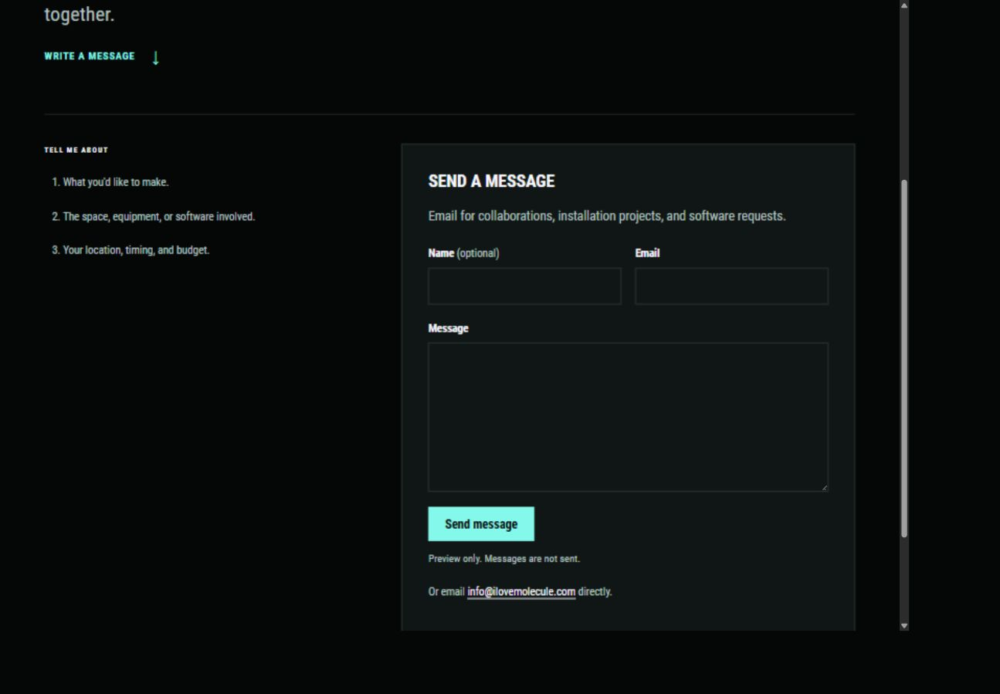
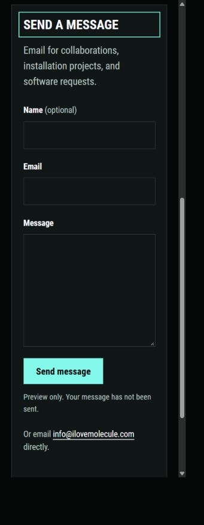

# Ad-free Contact form options

Update: Russell selected Web3Forms, supplied the public form key, and confirmed receipt of the approved test email. [Web3Forms Contact integration](51-web3forms-contact-integration.md) records the connected form and verified delivery. The comparison and original non-sending preview below remain as history.

Russell reports that the email button does not work for him and is unclear compared with a form. He asked about another service and whether HubSpot's advertisement could be hidden.

## Current behavior

The Contact page's primary action is a `mailto:info@ilovemolecule.com` link. It asks the browser or operating system to open an email app. It does not submit an inquiry through the website. The source confirms this behavior, but it does not establish which email handler, if any, is configured on Russell's device.

The earlier HubSpot investigation found both injected advertising and a submission endpoint rejecting requests. See [Contact without advertising](38-contact-without-advertising.md). That historical rejection has not been retested in this pass.

## Recommended implementation

Use ordinary HTML inputs styled by the portfolio, with a small local script sending the submission to a form-delivery service. Show confirmation and errors inside this page. Keep a visible, copyable email address as an alternative.

The visitor-facing form would contain optional Name, required Email and Message, and a clear Send message button. Keep the existing numbered project prompts and their spacing. A form-delivery service can support this without changing Hugo or the site's static hosting.

The form markup, labels, and response UI remain controlled by this repository. Do not load a provider's hosted form embed or a provider-controlled success page. Preserve the visitor's message on errors, disable sending while a request is pending, and distinguish accepted submission from confirmed mailbox delivery. No successful-delivery claim should be shown before the delivery service accepts the request.

## Services checked

Official sources reviewed on October 26, 2026:

| Option | Relevant current terms | Fit |
| --- | --- | --- |
| [Web3Forms](https://web3forms.com/pricing) | Free tier includes 250 monthly submissions and custom redirects | Recommended starting point for this portfolio's contact form |
| [Formspree](https://formspree.io/plans/) | Free tier includes 50 monthly submissions, a 30-day archive, and AJAX forms. Personal is $15 monthly or $120 yearly for 200 monthly submissions | Another suitable delivery backend for the same form design |
| [HubSpot Marketing Hub Starter](https://blog.hubspot.com/marketing/hubspot-marketing-hub-pricing) | Paid Starter removes HubSpot branding from forms | Branding removal would still leave the prior submission failure to resolve |

Web3Forms documents [submitting custom HTML with JavaScript](https://github.com/surjithctly/web3forms-docs/blob/main/how-to-guides/html-and-javascript.md), allowing visitors to remain on the portfolio. Its form key connects the form to a recipient. Its [setup instructions](https://github.com/surjithctly/web3forms-docs/blob/main/getting-started/installation.md) describe obtaining the key. Its pricing page separately describes paid removal of branding from notification emails. That is distinct from the website form and confirmation UI we control.

Formspree documents [JavaScript submissions and custom response handling](https://help.formspree.io/articles/building-your-form/submit-forms-with-javascript-ajax). Its [system limits](https://help.formspree.io/articles/form-and-project-settings/system-limits) require sensible pending-request handling and a visible error when rate-limited. The final implementation can use a small local fetch handler instead of adding a provider UI library.

Covering HubSpot's advertisement would not resolve the recorded submission problem. Prefer the native form and a verified delivery service. No provider plan was purchased and no account was created.

## Local form preview

Open [the form preview](http://127.0.0.1:1314/contact-form.html).

The prototype retains the current Contact page's header, copy, numbered prompts, footer, typeface, and colors. Name and Email share a desktop row and stack on phones. The message field and Send message button are followed by a direct email link.

The page explicitly says it is a preview. Its local submit handler prevents sending and reports that the message has not been sent. There is no configured delivery endpoint or external request handler. The submit button starts disabled in the source and is enabled only after the preview handler is installed.

Regenerate after a Hugo check build:

```powershell
& 'C:\Users\russe\.cache\codex-runtimes\codex-primary-runtime\dependencies\python\python.exe' docs/portfolio/concepts/build-contact-form.py
```

The script reads `.preview/project-catalogue-check/contact/index.html`, copies styles, fonts, and font licenses, and writes files outside Hugo's published mounts. Live Contact markup and behavior are unchanged in this pass.

## Delivery setup still needed

Russell was asked to choose Web3Forms or Formspree. After that selection, configure a recipient/form under his account, connect its public form identifier, and verify delivery before replacing the live contact action. No activation email, inquiry, or outbound test message was sent during this research and preview work.

## Verification

Desktop and phone checks confirm the form labels, three inputs, visible email fallback, and no horizontal overflow at measured CSS widths of 1309px, 355px, and 291px. Input text remains 18px on phones.

Submitting the empty preview focuses the required Email field. A local check with example-only values exercises the preview handler, retains the message, and displays the explicit not-sent notice. These checks establish the preview's behavior, not email delivery. Example values were cleared afterward.

The repository preview script was restarted and left running. No live website implementation was changed and nothing was committed.




