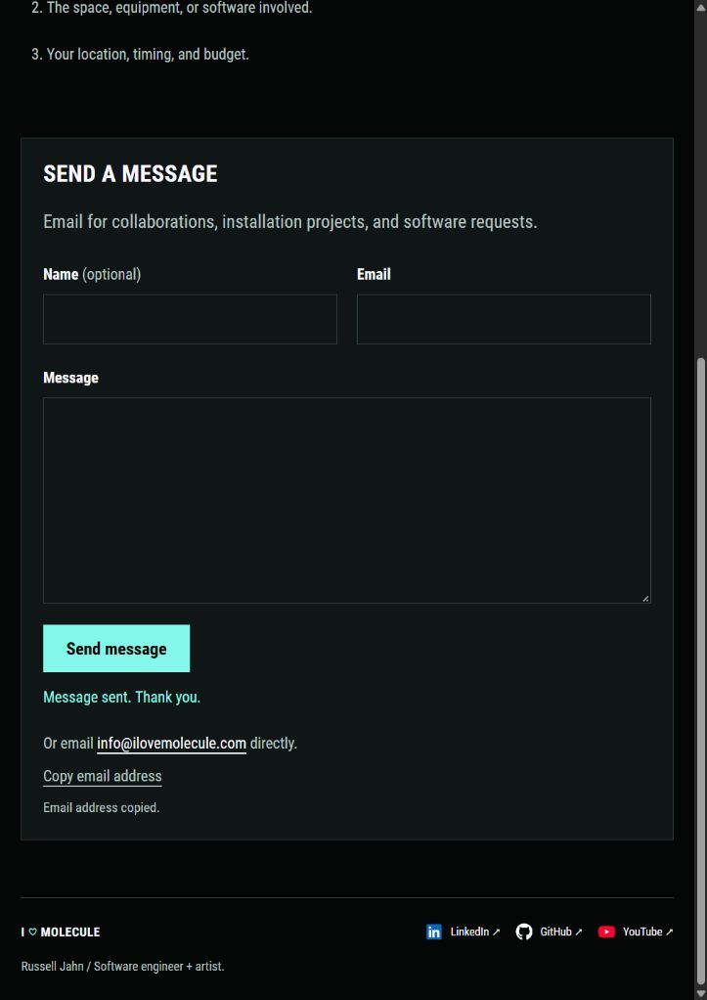
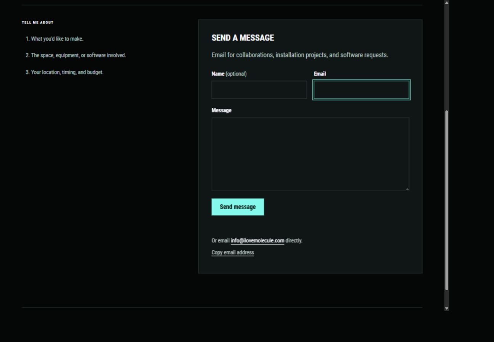
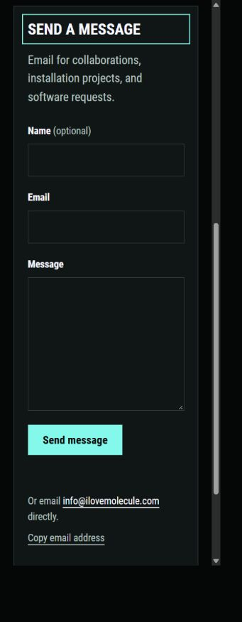

# Web3Forms Contact integration

Russell selected Web3Forms and supplied a public Access Key for the form delivering to `info@ilovemolecule.com`. The native form is now connected in the local site at [Contact](http://127.0.0.1:1313/contact/). All changes remain uncommitted.

## Implementation

The form retains the reviewed design: optional Name, required Email and Message, a mint Send message button, and the existing numbered prompts. Name and Email share a desktop row and stack on phones. Inputs use 18px text and mint focus styling. The email address remains visible below the form, with a Copy email address button for visitors without an email app.

The public form key lives in `content/contact/_index.md` as `web3formsAccessKey`. Web3Forms [explicitly describes this key as public](https://web3forms.com/). It identifies the receiving form and is intended for client-side HTML. It is distinct from an account password or private API credential. The template fails the build if the key is missing or malformed.

The Contact template owns every field and all displayed copy. Its small local script posts JSON to `https://api.web3forms.com/submit`, using the visitor's Email field as the reply address. The configured subject is Portfolio inquiry / ilovemolecule.com, and the sender label is Molecule portfolio. A hidden honeypot uses the service's documented `botcheck` field.

The integration follows the official [submission API reference](https://docs.web3forms.com/getting-started/api-reference). It requires both a successful HTTP response and `success: true` before displaying Message sent. Thank you. It does not display provider-supplied HTML or redirect visitors to a provider page.

While sending, the fields and button are disabled to prevent editing or duplicate submissions. A 20-second timeout restores the form if the service does not respond. Rejection, rate limiting, invalid responses, and network failures preserve the visitor's message and show a readable error. Only confirmed acceptance resets the form. Network and timeout errors describe sending as unconfirmed, since the service could have accepted a message before the connection failed.

The submit button starts disabled in HTML and is enabled after the local handler is installed. Without JavaScript, a visible notice directs visitors to the email alternative. The script and stylesheet load only on Contact. There is no provider embed, hosted form script, or provider-controlled confirmation page.

## Verification

- The pinned Hugo build and all eighteen Python checks pass. The updated Contact check verifies its own form, field labels, required fields, valid public-key shape, local deferred script, email alternative, honeypot, and accessible status region. It continues to exclude advertising embeds.
- Ten Node checks pass. They simulate accepted submissions, several rejection and invalid-response cases, rate limiting, network failure, timeout, duplicate attempts, invalid fields, and a filled honeypot. The checks verify that only accepted submissions clear the message and that pending states restore correctly. They use a mocked fetch function and send no email.
- Browser checks at measured CSS widths of 1309px, 355px, and 291px show no horizontal overflow. Fields stack on phones and retain 18px text. The browser focuses the required Email field when an empty form is submitted, without issuing a submission.
- The Copy email address action reports Email address copied. Mint input borders and outlines replace the theme's default blue focus ring.
- The preview script was restarted after the website changes and left running at port 1313. No commits, staging, pushes, or purchases were performed.

Run the checks from the repository root:

```powershell
& .\.tools\hugo\0.115.4\hugo.exe --destination .preview/project-catalogue-check --cleanDestinationDir
& 'C:\Users\russe\.cache\codex-runtimes\codex-primary-runtime\dependencies\python\python.exe' -m unittest discover -s tests
node --test tests/contact-form.test.mjs
```

## Real delivery check

Russell explicitly approved sending one test email. One submission was made through the local Contact page on October 26, 2026, with the following values:

- Name: Portfolio delivery test
- Email and Reply-To: `info@ilovemolecule.com`
- Message: Contact form delivery test from the local portfolio preview. No reply is needed.
- Subject configured by the form: Portfolio inquiry / ilovemolecule.com

Web3Forms accepted the submission. The live page moved from Sending your message… to Message sent. Thank you. The success state was verified, all three fields cleared, and the submit button became available again. The handler shows this state only after HTTP success and `success: true`. No second submission was sent.

Russell subsequently confirmed that the test email was received at `info@ilovemolecule.com` on October 26, 2026. This completes the full delivery check from the website through Web3Forms to the recipient mailbox. Receipt does not establish whether the message initially landed in the inbox or spam, since Russell did not specify that detail.

The preview remains running, with the accepted-result page left open for review. No further messages were sent. No website source changes or commits were made while recording this confirmation.






