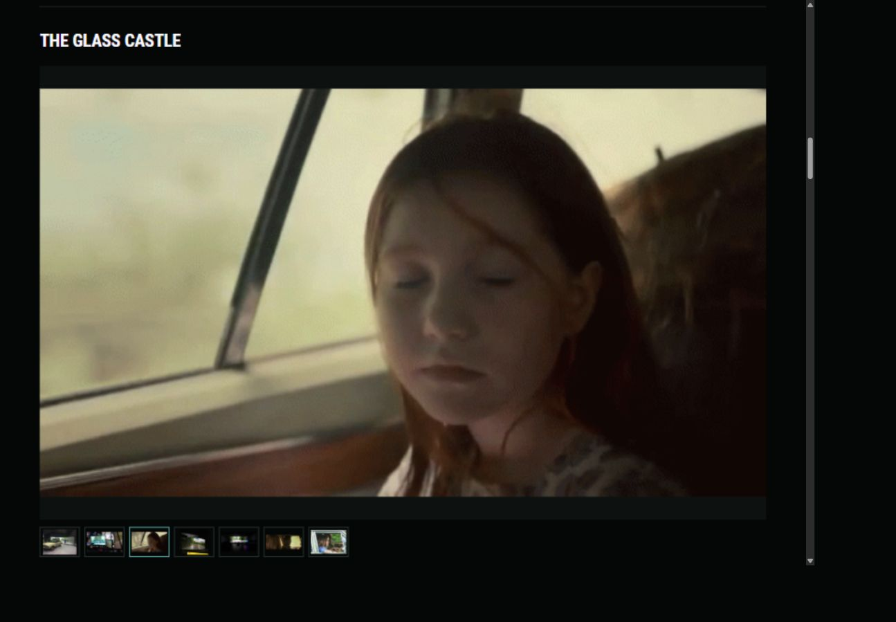
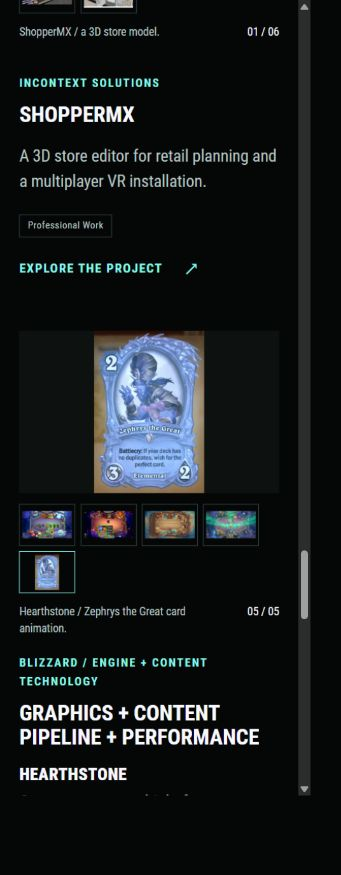
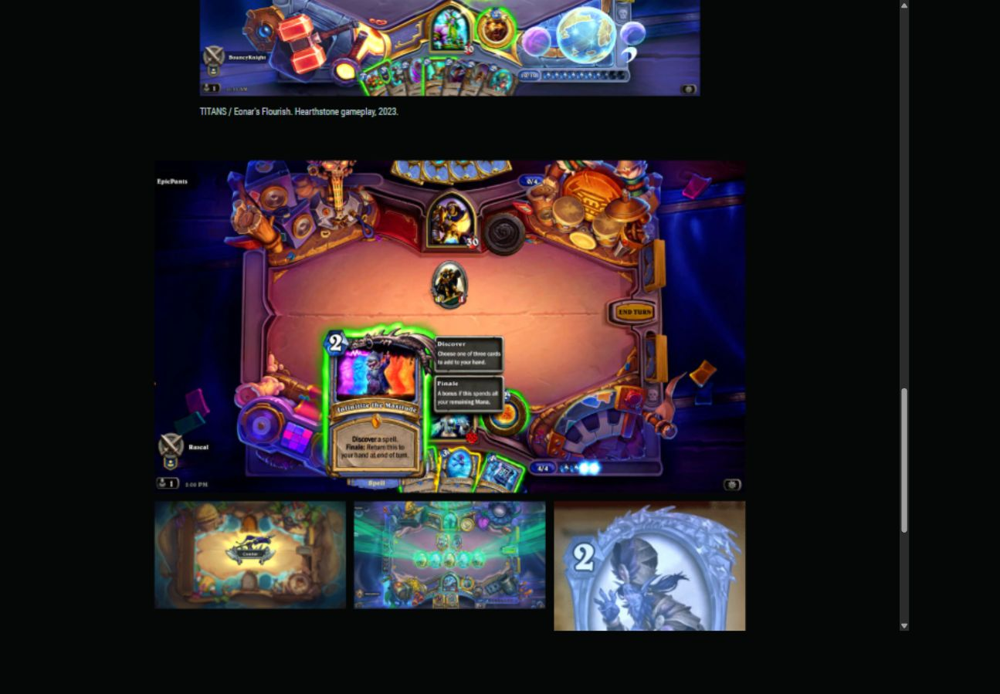
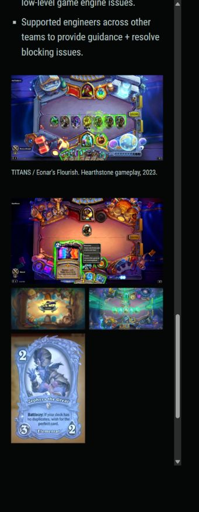
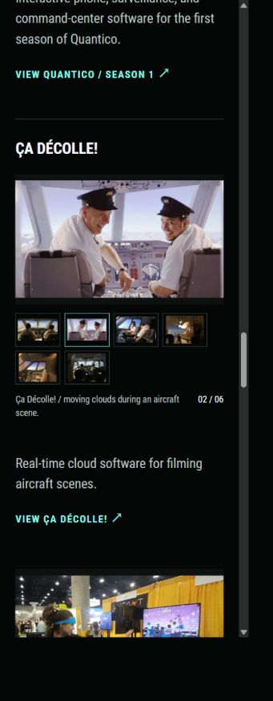
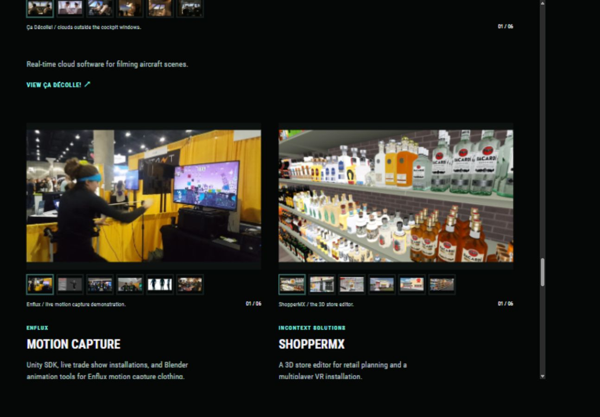
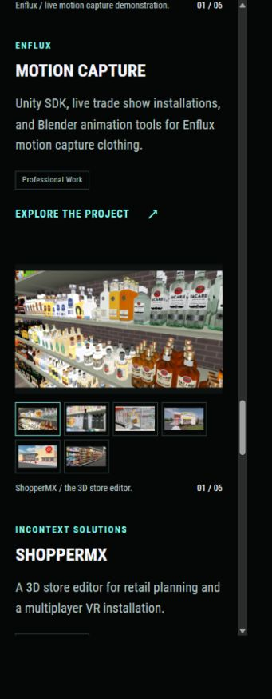

# Complete project galleries and public pages

Later revision: [Glass Castle quality and loop delivery](53-glass-castle-quality-and-loop-delivery.md) records its selected seven-image order and optimized lossless delivery across Home, the case study, and About.

Russell requested all pictures and missing details from About Me on the corresponding project pages, thumbnails for those pictures in the home carousels, and pages for Quantico, Ça Décolle!, and the other major work listed on About.

Every project currently featured in About's professional experience now has a public case study. ShopperMX was the other project whose record supplied About without publishing a page. No experience was inferred from unused asset folders.

## Pages and ordering

Quantico / Season 1, Ça Décolle!, and ShopperMX publish at `/work/quantico/`, `/work/ca-decolle/`, and `/work/shoppermx/`. Work lists ten projects, nine professional and one experimental, without a duplicate Film + television collection card.

Film + television keeps X-Men: Apocalypse, The Glass Castle, mother!, and Arrival first. Quantico and Ça Décolle! follow them on Home and the collection page. The collection no longer has separate bespoke sections for those two productions. About keeps its historical order and presentation.

ShopperMX follows Enflux and precedes Blizzard on Home and Work. Blizzard retains its existing URL and separate Unannounced title and Hearthstone sections.

Arrival carousel revision, October 27: Russell selected `arrival_spytent3.jpg`, `arrival_cryptotent1.jpg`, then `arrival_spytent1.jpg` as its first three images. The remaining four follow in their prior relative order. The case-study headliner and About gallery order are unchanged.

Quantico carousel revision, October 27: Russell selected `quantico_cut1.gif`, `quantico_cut2.gif`, `quantico_bomb1.gif`, `quantico_van1.jpg`, then `quantico_training4.jpg`. The three clips remain looping images. The case-study headliner and About gallery order are unchanged.

mother! carousel revision, October 27: Russell listed `mother_preproduction5.jpeg` twice, followed by `mother_preproduction4.png`, `mother_preproduction3.png`, and `mother_software_1.jpeg`. Include the duplicated photo once, then those three images in order. Keep `mother_preproduction6.gif` last. The case-study headliner and About gallery order are unchanged.

## Shared image coverage

| Project | About gallery pictures | Home selections |
| --- | ---: | ---: |
| X-Men: Apocalypse | 4 | 4 |
| The Glass Castle | 7 | 7 |
| mother! | 5 | 5 |
| Arrival | 7 | 7 |
| Quantico / Season 1 | 5 | 5 |
| Ça Décolle! | 6 | 6 |
| Enflux / Motion capture | 6 | 6 |
| ShopperMX | 6 | 6 |
| Blizzard / Hearthstone | 5 | 5 |
| Motion Capture + Lightsabers | 0 | 3 existing selections |
| Total | 51 | 54 |

All 51 About gallery pictures appear on their case studies. A separately displayed hero or credits card counts once. Glass Castle now uses its full seven-picture selection. Hearthstone includes its gameplay still, credits card, two original loops, and visual-effects image, alongside the selected Eonar headliner.

Home keeps Russell's earlier exception for the Hearthstone credits card. Eonar remains first, with the other four gallery pictures available through thumbnails. Enflux's selected animated WebP represents the same convention footage as its original GIF, so that footage appears once in its carousel. The original GIF remains on About and the case study. Company logos and Russell's portrait are not carousel photographs.

Arrival's original selection includes `PaperGhost/quantico_tablet1.jpeg`. Its placement is preserved from About. The neutral caption does not assert a film credit based on the filename. Confirm its production before moving it or changing its attribution.

## Data and delivery

`galleries` remains the shared source for About and case studies. Each selection also owns a short thumbnail `label` and `caption`. About's original alt text, source order, classes, and copy remain unchanged. Optional `resume.galleryTitle` preserves its historical image labels when Quantico and ShopperMX use shorter public titles.

`carouselGalleries` names the shared selections to append. `portfolio/project-slides.html` starts with the curated `carousel` entries, appends those gallery selections, and removes duplicate sources. The chosen headliners and initial order stay in place. `carouselExclude` records the two exceptions above. Future additions to these galleries reach Home automatically.

Each carousel has one live image. Additional full images stay in inert templates until selected. The 54 still WebP thumbnails are at most 160 × 100 pixels. Together they occupy 216,616 bytes, about 212 KiB, with individual files between 1,480 and 7,666 bytes. They remain lazy-loaded.

GIF thumbnails are flattened previews. Selecting one loads its unchanged looping source. Animated WebP selections retain their explicit still thumbnails. Thirteen Home selections loop. Native-width limits and full image composition remain intact. In the keyboard check, the 324px Zephrys animation displayed at 324px rather than being enlarged. No original media was changed.

## Carousel sizing revision, October 27, 2026

Russell requested that images expand to the largest size that fits the carousel preview while retaining their aspect ratio. The earlier native-width cap is now removed inside carousel stages. `object-fit: contain` keeps the whole picture visible, and an absolutely positioned image fills the fixed preview box. Smaller sources can enlarge. Wider or taller pictures retain space on the unused axis instead of being cropped or stretched.

This change is confined to Home's carousel stylesheet. Other project images retain their existing sizing rules. Original source files, thumbnail sizes, animation delivery, selection controls, and lazy loading are unchanged.

At a measured desktop width of 1309px, the 498px-wide Glass Castle loop now fills a 1167px-wide preview, retaining its proportions. At a phone width of 355px, every carousel image box matches its 297 × 186px stage. The portrait Hearthstone animation fills the available height with space at the sides. The fresh phone load has no horizontal overflow. The Hugo build and all nineteen checks pass. The preview was restarted and left running. No commit was made.

A separate responsive follow-up was observed during the desktop-to-phone viewport switch: offscreen pyramid labels briefly retained positions outside the new width. A fresh load at phone width resolved it. Check that behavior during a real resize before deciding whether to change the pyramid's resize handling.

## Contribution details

`project-details` renders the original `resume.details` on Quantico, Ça Décolle!, ShopperMX, and Hearthstone. Hearthstone keeps its compact overview, then its credits card, detailed contribution list, and media. Expansion dates and engineering responsibilities remain separate from the current game's work.

Quantico includes the 259 Android apps, 21 episodes, actor-operated props, surveillance stations, video walls, surveillance van, command stations, and bomb timers. Ça Décolle! includes adjustable real-time cloud software. ShopperMX includes the enterprise store editor and engineering and product design for the multiplayer VR installation.

Paper Ghost's introduction now includes programming, art, animation, team supervision, deadlines, and direct production collaboration. Enflux's existing YouTube demo renders through `project-video`, reading the same ID as About. Arrival's set-design article link is present on its case study.

A nested Hugo rendering issue initially treated the Hearthstone gallery wrapper as an indented code block. The gallery shortcode now removes formatting indentation before the surrounding project section renders it. A regression check rejects escaped gallery markup as well as missing pictures.

## Verification

- Hugo Extended 0.115.4 builds 50 pages and 12 aliases successfully.
- All nineteen Python checks pass. They cover every About picture on its case study, eligible pictures on Home, no duplicate slides, small still thumbnails, original loops, collection ordering, public pages, shared contributions, and unchanged About presentation and copy hashes.
- Fourteen built routes reference 510 unique local pages and assets, with none missing. See [the full inventory](assets/2026-10-27-project-gallery-coverage.json).
- Browser checks at measured CSS widths of 1309px and 355px show no horizontal overflow on the three new pages and Blizzard. Home's thumbnails wrap on the phone. Clicking an appended Glass Castle image updates the image, caption, selected border, and count. End and Home select the last and first Hearthstone slides and move keyboard focus correctly.
- Work's professional filter displays nine projects, including the three new pages. All projects displays ten.
- The preview script was restarted after website updates and left running at `http://127.0.0.1:1313/`.

These checks do not measure public-host latency or physical Safari and Android behavior. Nothing was staged, committed, pushed, or published.

## ShopperMX carousel selection

Russell selected this exact Home carousel order:

1. `InContext/incontext_aisle1.png`
2. `InContext/incontext_bottle1.gif`
3. `InContext/incontext_aisle3.jpg`
4. `InContext/incontext_store2.png`
5. `InContext/incontext_store1.png`
6. `InContext/incontext_aisle2.png`

The project record's `carousel` now declares all six selections. The shared resolver deduplicates the appended archive selections, keeping exactly six thumbnails. The linked 640px previews map to the original PNG and JPEG sources, so responsive delivery still chooses the appropriate image size. The bottle animation remains its unchanged original GIF, loaded when selected. About's curated gallery and the case-study headliner remain unchanged.

The Hugo build and all twenty Python checks pass. A separate built-page check confirms the exact order and byte-identical published GIF. Browser checks at CSS widths of 1309px and 355px confirm the six choices, `01 / 06` initial count, working `02 / 06` animated selection, contain sizing, and no horizontal overflow. The preview script was restarted and Home returned HTTP 200. The preview remains running. Nothing was committed.

