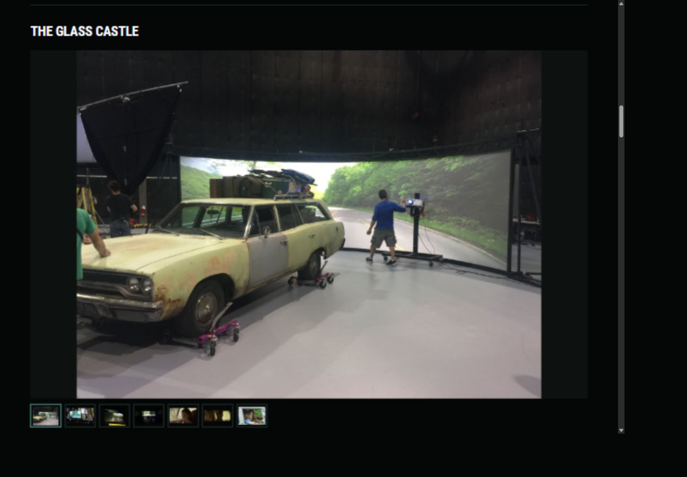
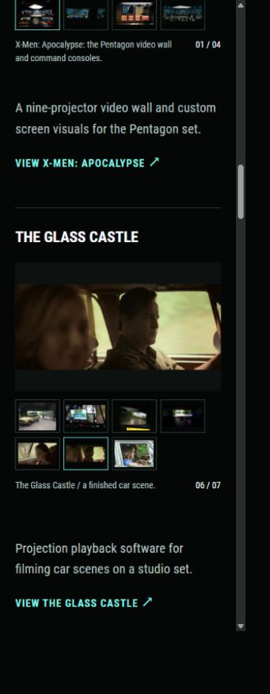

# Glass Castle image quality and loop delivery

Russell selected this Home carousel order:

1. `glasscastle_test1.jpg`
2. `glasscastle_test3.jpg`
3. `glasscastle_test4.jpg`
4. `glasscastle_software1.jpg`
5. `glasscastle_final3.gif`
6. `glasscastle_final2.gif`
7. `glasscastle_final1.jpg`

The carousel metadata now uses that order. About's curated gallery order and the case-study headliner remain in place. The two GIF source identities stay in metadata, while their prepared delivery copies use lossless animated WebP.

## Why the finished scenes look soft

| Selected source | Actual dimensions | Finding |
| --- | --- | --- |
| Projection setup | 3264 × 2448 | High-resolution original already in use |
| Production monitors | 5312 × 2988 | High-resolution original already in use |
| Projection test | 2448 × 2176 | High-resolution original already in use |
| Playback software | 5312 × 2988 | High-resolution original already in use |
| Finished scene loop 3 | 498 × 280 | 30 frames over 3 seconds |
| Finished scene loop 2 | 498 × 206 | 47 frames over 2.35 seconds |
| Finished still | 275 × 183 | Small original, matching the archive's `images.jpg` |

At a measured 1309px browser width and device pixel ratio 1.1, the lead photograph used a 1600px WebP in the 1167px preview box. It was not displaying a 160px thumbnail. The still-image pipeline remains responsive WebP at quality 90 with Lanczos resizing.

The scene clips contain fewer than 500 pixels across and already have the GIF's limited color palette and compression artifacts. The requested contain layout enlarges them to fit the available box, making those limits more visible. Re-encoding cannot recover missing focus, fine detail, or colors from the original video. The 275px finished still has an even lower resolution limit.

## Archive review and scope

The focused review inspected the Glass Castle folder under `\\VADER\data\MotherBrain\Molecule\Portfolio Website\Portfolio Pics\Paper Ghost`, plus the top-level Paper Ghost production directories under the supplied Personal Work archive. No higher-resolution matching car-scene clips or finished still were found in that review. This is not an exhaustive search of every archive folder.

The original scene filenames are `look-at-you-rex.gif` and `the-glass-castle-the-glass-castle-gi-fs.gif`. Their archive copies match the website GIFs byte for byte. The other archived Glass Castle GIFs are different clips, so they were not substituted for Russell's selections.

Russell answered “Use the existing archive for now” when asked about higher-resolution source material. A sharper version of the selected scenes remains a future sourcing task. Replace them from higher-resolution video or stills when available, retaining their chosen scene content and order.

## Lossless delivery

[WebP supports animation and lossless compression](https://developers.google.com/speed/webp/faq). The prepared copies retain every decoded RGBA pixel, frame duration, canvas size, and infinite loop setting. They remain automatically looping images without a video player.

| Loop | Original GIF | Lossless WebP | Reduction |
| --- | ---: | ---: | ---: |
| `glasscastle_final2` | 2,583,994 bytes | 2,107,050 bytes | 18.46% |
| `glasscastle_final3` | 2,208,797 bytes | 1,683,868 bytes | 23.77% |
| Combined | 4,792,791 bytes | 3,790,918 bytes | 20.90% |

This reduces downloads without adding further loss. It does not make the source scenes sharper. It measures these two files, rather than whole-page load time. Home still loads an unselected full loop only when it is chosen.

Quality-95 and quality-98 lossy WebP candidates were also compared. Their combined sizes were 2,252,394 and 2,988,570 bytes. They introduced pixel differences, so the lossless copies were chosen for this iteration. The machine-readable manifest records those comparisons and the chosen encoding settings. Pillow's [WebP saving options](https://pillow.readthedocs.io/en/stable/handbook/image-file-formats.html#webp) describe the encoding controls.

## Sources and shared metadata

The prepared loops and lossless first-frame posters live in `assets/portfolio/glass-castle/`. Unchanged original GIF copies, with their archive filenames, live in `source-media/paper-ghost/glass-castle/`. That source directory remains outside Hugo's mounts. The copies in `content/about/PaperGhost/` are also unchanged.

Each gallery record has its stable original `source`, plus an optional `deliverySource` and `animated: true`. Home's slide resolver, the case-study gallery, and About's metadata renderer read the same delivery choice. Original source identities still control deduplication and gallery coverage. Original GIF URLs remain published and accessible, but are not fetched by the optimized views.

About's structure, text, source identities, classes, and image dimensions are unchanged. Only the two poster URLs, loop URLs, and associated noscript links changed. A normalized before/after content-tree comparison checked that these were the only markup changes before updating its presentation fingerprint. Its original copy hash and curated source list were retained.

See [the delivery manifest](assets/glass-castle-loop-delivery.json) for archive paths, source copies, byte counts, hashes, settings, and every frame's pixel hash and duration. The pixel comparison can be repeated with Pillow installed:

```powershell
python scripts/verify-glass-castle-media.py
```

## Verification

- All 77 original and prepared frames have identical decoded RGBA pixels and timing. Both animations keep `loop: 0`.
- The Hugo build and all twenty Python tests pass. The tests verify delivery hashes, preserved source hashes, published original URLs, animated WebP frame timings, Home and case-study references, gallery coverage, and the reviewed About markup and copy.
- Browser checks at measured CSS widths of 1309px and 355px confirm the selected order, correct WebP delivery, contain sizing, and no horizontal overflow on a fresh phone load. The native browser renders both loops as images.
- Home returns HTTP 200. Both WebP URLs return HTTP 200 with `image/webp` and their expected byte counts. Both original GIF URLs return HTTP 200 with `image/gif` and their unchanged byte counts.
- The preview script was restarted and left running at `http://127.0.0.1:1313/`. Nothing was staged, committed, pushed, or published.




