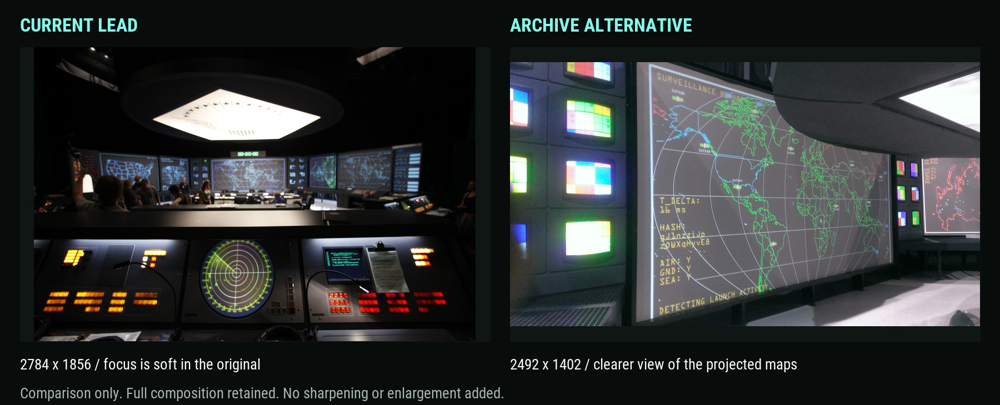

# X-Men image quality review

The selected Pentagon lead is out of focus in its current 2784 × 1856 original. A larger download or higher compression setting will not restore the missing focus. The Home carousel is loading the full image selection through the responsive pipeline, rather than accidentally displaying its thumbnail.

## Source and delivery checks

| Selection | Original dimensions | Desktop delivery | Finding |
| --- | --- | --- | --- |
| Pentagon wall, current lead | 2784 × 1856 | 1600px WebP | Soft focus is visible in the original |
| Wide view | 1400 × 350 | 1400px WebP | Very wide crop with only 350px of vertical detail |
| Submarine | 2492 × 1402 | 1600px WebP | Higher-resolution console photograph, with some camera grain |
| Pentagon consoles | 800 × 337 | 800px WebP | Small source enlarged by the full gallery box |

The desktop check measured a 1309px CSS viewport, a 1167 × 730px carousel box, and a device pixel ratio of 1.1. The selected lead's 1600px WebP is 120,888 bytes. Its source JPEG is 583,321 bytes. The delivery uses quality 90 and Lanczos resizing. The source is already soft before either operation.

On a fresh 355px CSS viewport, the lead loaded a 480px WebP in a 297 × 186px gallery box. There was no horizontal page overflow. All selections use `object-fit: contain`, preserving the complete image and its aspect ratio. The 800px source's enlargement follows Russell's requested gallery behavior, so changing that global layout to hide this source limitation would affect every project.

## Archive findings

The focused review covered 57 photographs in the curated X-Men archive, nearby Paper Ghost production folders, the archived Zed Axiz website images, and a contact sheet sampled from its archived 1280 × 720 showreel. No sharper matching copy of the current lead was found in that review. This does not establish that no other copy exists anywhere in the archive.

The current lead was already recovered from the larger Wix source during the earlier image-quality work. Its 2784px dimensions do not mean the camera captured sharp detail. The available production screenshots document the original screen software, but they are different material from the chosen set photograph.

Two different photographs provide clearer alternatives:

1. **Projected maps**, `IMG_20161012_033625_01.jpg`, 2492 × 1402. The close-up makes the map lines and screen lettering easier to see. This is the recommended replacement lead because it directly illustrates Russell's screen work. It also shows test patterns during setup.
2. **Projection setup**, `IMG_20161012_033641_01.jpg`, 2492 × 1402. The wider photograph shows the room, projectors, and calibration patterns. It provides installation context, with less emphasis on the finished screen graphics.

Both originals were copied byte for byte, with their original filenames, to `source-media/paper-ghost/x-men-apocalypse/`. They remain outside Hugo's mounts. The [review manifest](assets/xmen-image-quality-review.json) records archive paths, dimensions, byte counts, SHA-256 hashes, and browser measurements.

## Recommended next choice

Use the projected-map close-up as the Home, Work, and case-study lead. Retain the existing whole-room photograph in the gallery for context. Keep the setup photograph as an optional additional gallery image. Preserve the existing project credits and About selection.

This is a proposed change of photograph, rather than a higher-resolution version of the same frame. The website's selected lead and gallery order have therefore been left in place for Russell to compare. No sharpening, generated detail, source replacement, website change, staging, or commit was performed in this pass. The existing local preview remains running.

The comparison downsizes both original photographs into equal gallery boxes, preserves their full compositions, and adds no sharpening or enlargement. Open the preserved source files to inspect the available detail at native resolution.
